# Apidoc (apidoc-rust)

基于 Rust 过程宏（proc-macro）的 API 文档生成与接口开发工具，兼容 axum、actix-web 等主流框架

[](https://crates.io/crates/apidoc-rust)
[](https://github.com/erikwang2013/apidoc-rust)
[](https://github.com/erikwang2013/apidoc-rust)

**[中文](README.md)** ·
[English](https://github.com/erikwang2013/apidoc-rust/blob/HEAD/docs/i18n/README-en.md) ·
[한국어](https://github.com/erikwang2013/apidoc-rust/blob/HEAD/docs/i18n/README-ko.md) ·
[Русский](https://github.com/erikwang2013/apidoc-rust/blob/HEAD/docs/i18n/README-ru.md) ·
[Deutsch](https://github.com/erikwang2013/apidoc-rust/blob/HEAD/docs/i18n/README-de.md) ·
[Français](https://github.com/erikwang2013/apidoc-rust/blob/HEAD/docs/i18n/README-fr.md) ·
[Español](https://github.com/erikwang2013/apidoc-rust/blob/HEAD/docs/i18n/README-es.md) ·
[Português](https://github.com/erikwang2013/apidoc-rust/blob/HEAD/docs/i18n/README-pt.md) ·
[हिन्दी](https://github.com/erikwang2013/apidoc-rust/blob/HEAD/docs/i18n/README-hi.md) ·
[العربية](https://github.com/erikwang2013/apidoc-rust/blob/HEAD/docs/i18n/README-ar.md) ·
[বাংলা](https://github.com/erikwang2013/apidoc-rust/blob/HEAD/docs/i18n/README-bn.md) ·
[Bahasa Indonesia](https://github.com/erikwang2013/apidoc-rust/blob/HEAD/docs/i18n/README-id.md) ·
[日本語](https://github.com/erikwang2013/apidoc-rust/blob/HEAD/docs/i18n/README-ja.md)

## 📖项目介绍

Apidoc 是一款通过解析 **Rust 过程宏（proc-macro）** 自动生成 API 接口文档的 Rust 插件库，兼容 axum、actix-web 等主流框架。除文档自动生成外，还集成了在线接口调试、Mock 调试数据、Json/TypeScript 代码生成、接口生成器、代码生成器等能力，覆盖接口开发、调试、交付的全流程，致力于提升 API 开发效率。2.2.0 起提供 **UIC-1 后端契约**，apidoc-ui 的 Vue 构建可直接消费；内嵌原生 UI 保留，两者可按配置切换。

apidoc-rust 的实现取向：

- **编译期生成**：文档由过程宏在编译期生成，文档与代码永不失同步；
- **零成本收集**：linkme 静态注册，运行期一次聚合即得全部接口文档；
- **通用插件**：核心与 HTTP 框架无关，通过薄适配器（axum / actix-web）接入任意框架。

### ✨项目说明

- **开箱即用**：无需繁杂配置，安装后按文档编写注解即可自动生成 API 文档。
- **轻松编写**：支持字段 `ref` / `table` 引用，以及 OpenAPI、AsyncAPI、GraphQL、Proto、WSDL、EDMX、JSON Schema、JSON-RPC、XML-RPC 九种外部协议定义文件（`#[apidoc::definition]`），几句注解即可完成完整字段定义。
- **在线调试**：文档页内直接调试接口，支持全局参数带入、Mock 数据、调试事件。
- **多协议调试**：45 种协议注解（RPC、消息队列、工业、媒体、IoT 等），浏览器直连与服务端中继双通道，注解即生成协议文档与调试面板。
- **UIC-1 契约**：`/apidoc/ui/v1/*` 提供 capabilities / config / menus / detail / docs / 调试 / 分享 / 缓存 / 生成器 / 导出接口，同一份 apidoc-ui Vue 构建可适配 PHP、Go、Rust；Vue 静态 UI 通过 `ui` / `ui_path` 启用，发布包默认 Vue，库默认保留内嵌原生 UI。
- **多应用/多版本**：单应用、多应用、多版本项目均可配置，接口按应用/版本分组展示与切换。
- **分组/Tag**：接口支持多级分组与 Tag 标记。
- **Markdown 文档**：`md` 注解可将 Markdown 挂载为文档页。
- **Json/TypeScript 生成**：每个接口自动生成 Json 请求/响应示例与 TypeScript 类型定义，直接用于前端。
- **代码生成器**：配置 + 模板即可生成业务代码与前端 Api 文件。
- **接口分享**：可生成指定应用/接口的分享链接、导出 `swagger.json`。
- **安全访问**：支持全局密码与应用/版本独立密码授权；服务端调试默认关闭并强制 SSRF 守卫、大小/帧数/超时封顶；定义文件与工业协议解析有硬上限；文档数据构建期物化，本地响应 p99 < 10ms。

## 特性

### 已实现（M1-M3）

- **注解式文档**：`title` / `desc` / `method` / `url` / `param` / `query` / `returned` 等属性宏（含 `tag` / `group` / `header` / `table` 与 45 个协议注解），逐条注解，参数支持 `required` / `default` / `desc` / `mock` / `children` / `field` 嵌套
- **编译期校验**：url 必须以 `/` 开头、method 白名单、param name 必填等，非法注解编译期报错（span 精确）
- **自动收集**：linkme `distributed_slice` 静态注册，无需手动接口清单；`DocRegistry::collect()` 按 id 合并、按 seq 恢复声明顺序，跨 crate 自动收集
- **api.json 输出**：serde 序列化统一文档数据模型（config + endpoints），字段名与导出器共用同一份定义
- **axum 适配器 + 内嵌文档 UI**：挂载路由即得文档页面，分组目录浏览（M2）
- **注解补齐**：`tag` / `group` / `author` / `header` / `route_param` / `response_status` / `success` / `error` / `not_debug` / `md` / `sort` / `ref` 12 个新注解（M3）

### 已实现（M4）

- **在线调试**：文档页内置「在线调试」面板——Base URL 预填 `location.origin` 跨域直连目标服务、参数表单 mock 预填、`{name}` / `:name` 路由占位符替换、GET/HEAD 参数并入 query、其余 method 组装 JSON body、请求头编辑 + 自定义 header、响应展示（状态 / 耗时 / pretty JSON）、CORS 失败黄色提示
- **Mock 引擎**（`crates/apidoc/src/mock.rs`，feature `mock`，依赖 fake crate，15 条规则：name / company / email / phone / url / ip / city / country / text / number / int / float / bool / uuid / date）。规则优先级：`mock="fake:xxx"` 走 fake 规则表（未知名回退默认值）→ 其余非空 mock 原样直出（如 `mock="1"`、`mock="erik"`）→ 无 mock 按 `ty` 自动生成（int→`"1"`、float→`"0.5"`、bool→`"true"`、object→`"{}"`、string→`"string"`）；children 递归嵌套对象，array 固定 2 项
- **mock 接口**：axum 适配器新增 `GET /apidoc/mock?url=&method=`，url + method 精确匹配，未命中返回 404；调试面板默认隐藏 `not_debug` 端点，勾选「显示 not_debug 接口」才显示
- **CORS 直连**：在线调试由浏览器直连目标接口，适配器 `cors_layer` 负责放行；服务端中继由 P2–P5 执行器提供

### 已实现（M5）

- **导出四格式**（`crates/apidoc/src/export/`）：markdown / typescript / swagger（OpenAPI 3.0.0）/ AsyncAPI 2.6（P6），核心 crate 提供 `export::markdown::render` / `export::typescript::render` / `export::swagger::render` / `export::asyncapi::render`
- **导出路由**：适配器新增 `GET /apidoc/export?format=md|ts|swagger|asyncapi`，未知 format 返回 400；Content-Type 分别为 `text/markdown` / `application/typescript` / `application/json`
- **markdown**：分组目录 + 参数表 + 响应块；**typescript**：按 group 命名空间生成 `{Name}Params` / `{Name}Result` 类型，未分组接口落入 `defaultGroup`（`default` 是 TS 保留字）；**swagger**：`info.version` 优先取 `ApidocConfig.version`，未配置时回落到 Cargo 包版本
- **actix-web 适配器**（`crates/apidoc/src/actix.rs`，feature `actix`）：与 axum 适配器功能 1:1——`apidoc_routes(ApidocConfig) -> Scope` 挂载 /apidoc、/apidoc/api.json、/apidoc/mock、/apidoc/export，`cors_layer(CorsConfig)` 放行跨域
- **UI 共享**：文档 UI（`src/ui.html`）上移至核心 crate，导出 `pub const UI_HTML`，两适配器引用同一份（发布打包安全）

### 已实现（M6）

- **密码鉴权（M6a）**：`AuthConfig { enable, password, secret_key, expire }` 开启后，客户端 `POST /apidoc/auth`（JSON body `{"password": "...", "appKey": "..."}`）换取 token；数据路由 `/apidoc/api.json`、`/apidoc/export`、`/apidoc/mock` 需附带 `?token=xxx`，token 缺失/过期/错误返回 401，文档 UI 弹出密码遮罩。密码走请求体而不是 URL（不进访问日志/浏览器历史），服务端恒定时间比对，前端不做任何摘要。令牌为 `base64url(payload).base64url(HMAC-SHA256(payload))` 的无状态签名令牌（载荷 `{"exp": …}`），签名密钥由 `secret_key` 与凭据派生——改密码即刻作废旧令牌；只用 URL 安全字符，可直接放进分享链接
- **鉴权安全红线**：`password` / `secret_key` 永不序列化，api.json 输出与未启用鉴权时字节级一致；auth 未启用时 `/apidoc/auth` 返回 404、数据路由直接放行；应用配置独立 password 时应用密码优先于全局密码，空密码一律失败关闭（签发与校验两侧同规则）；`secret_key` 缺省时取**进程内随机密钥**（重启即失效，不存在公开默认密钥），`expire` 缺省 86400 秒；连续登录失败按指数退避拒答（前 3 次不罚，之后 1s→2s→…封顶 60s）；带凭据/token 的响应统一 `Cache-Control: no-store`
- **多应用多版本（M6b）**：`ApidocConfig.apps: Vec<AppConfig>`（`key` / `title` / `items` 递归子版本 / `password`）配置应用树，`#[apidoc::app("key")]` 把接口挂到指定应用 key，未挂 key 的接口落默认应用；api.json 输出新增 `doc.apps` 树，UI 顶部出现应用/版本选择器，token 按 appKey 分开存 localStorage（不同应用可有独立密码）

### 已实现（v2）

- **数据表字段引用（`table`）**：`#[apidoc::table("user")]` 按 `ApidocConfig.tables` 配置的表 key 把字段**平铺**并入 `returned`（与 `ref` 同语义，区别是数据源为配置表而非其他端点）；字段支持 `required` / `default` / `desc` / `mock`；未配置的 key 只在 stderr 警告；未使用该注解时输出与 v1 字节级一致
- **构建期物化 / 本地延迟**：api.json、markdown/typescript/swagger/AsyncAPI、代码生成模板与 `/apidoc/mock` 响应全部在 `Core::build` 时生成，请求期只做查表 + `Bytes` 克隆；`tests/latency.rs` 用 in-process 请求验证所有 apidoc 路由 p99 < 10ms（不含服务端调试目标自身的网络耗时）。`ApidocConfig.cache` 保留兼容，但 mock 已不再需要请求期记忆化。
- **分享链接**：`GET /apidoc/share?app=&url=&method=&base=` → `{"url":"…"}` 深链（`?app=<key>&ep=<接口 url>&method=<方法>[&token=…]`）；文档页每个接口旁有「分享」按钮（写剪贴板，失败降级为可复制的输入框），打开深链即定位到该应用/接口；鉴权开启时链接附带服务端签发的 token（应用独立密码优先于全局密码），打开即免密
- **代码生成器**：`GET /apidoc/generate?template=<name>` → 渲染后的文本（未知模板 404）；内置 `api.ts`（前端 Api 文件）、`handler.rs`（Rust 接口骨架）、`schema.sql`（按 `tables` 生成建表语句）；`ApidocConfig.codegen` 里的同名模板覆盖内置。模板语法只有两种：`{{变量}}`（未定义则原样保留）与 `{{#each 列表}}…{{/each}}`（可嵌套，如 `tables` × `fields`）；变量值里的换行统一折叠成空格（三份产物都是行式结构）
- **调试事件**：在线调试面板新增可折叠的「前置脚本 / 后置脚本」（持久化到 localStorage）——前置以 `new Function('ctx', code)` 在请求前执行，可改 `ctx.url/method/headers/body` 或返回对象浅合并；后置在响应后执行，可读 `status/ms/text/url/method/ep`，返回字符串则替换展示的响应文本；脚本报错只在结果区提示，不中断请求

### 已实现（v2.2 · UIC-1）

- **UIC-1 后端契约（Contract 1.0）**：`/apidoc/ui/v1/*` 提供 capabilities / config / menus / detail / docMenus / docDetail / verifyAuth / 调试会话 / 分享记录 / 缓存 / 代码模板 / 全量导出；`capabilities` 按本次构建实际编译的 feature 上报能力，UI 据此隐藏不可用入口。Rust 侧能力为 `share.actions=false`、`cache.mode=build`、生成器 `forms=false` / `templates=true`、中继只有一元 `relay-unary`。
- **九种外部协议定义**：`#[apidoc::definition(file = "...", operation = "...")]` 解析 OpenAPI、AsyncAPI、GraphQL、Proto、WSDL、EDMX、JSON Schema、JSON-RPC、XML-RPC，统一输出 `{format, source, operation, meta, messages, validation}`；`/apidoc/ui/v1/detail` 的 `definitions` 返回解析结果与逐条诊断（path / line / column / severity / message）。定义文件不进 api.json，原生 UI 与旧输出保持不变。
- **Vue 静态 UI**：`ui: UiMode::Vue` + `ui_path` 提供 apidoc-ui 的 `dist/uic1-ui/` 构建；`ApidocConfig::release(title, ui_path)` 是发布包默认入口（库默认仍为内嵌原生 UI）。支持 SPA 兜底、`config.js` / `assets/*`、路径逃逸与符号链接防护，`ui_path` 缺失或没有 `index.html` 时启动即失败。
- **服务端中继能力全量上报**：`capabilities.debug.relay` 只列出本构建实际编译的协议执行器；`debug-all` 聚合全部 30 个协议 id，UI 不再出现「能选但一发就报未编译」的入口。
- **工业协议修复与资源上限**：DNP3 在 IIN 之后解析对象头，每条响应最多 10,000 点；IEC 60870-5-104 每条响应最多 10,000 行；BACnet/IP 发送合法 ReadProperty 请求；DNP3 点数 u16 溢出修复。

### 多协议注解

- **协议注解**：每个协议一个独立注解，如 `#[apidoc::websocket("wss://…")]`、`#[apidoc::grpc(target = "http://…", service = "x.Y", method = "Z")]`、`#[apidoc::mqtt("mqtt://broker:1883", topic = "sensors/#")]`；位置参数等价于 `target = "…"`。底层与通用形式 `#[apidoc::protocol("kind", ...)]` 完全等价，新协议仍可用通用形式
- **事件与字段**：`#[apidoc::event(direction = "in", name = "message")]` 声明流式消息，`#[apidoc::param(..., field = "1")]` 声明协议字段号

### 已实现（多协议调试 P1–P6）


| 阶段 | 协议 | 执行位置 | feature |
|---|---|---|---|
| P1 | SOAP / GraphQL（含订阅）/ JSON-RPC / XML-RPC / OData / MCP / A2A / Webhooks / WebSocket（文本/二进制帧）/ SSE / Socket.IO / STOMP（含二进制）/ WebRTC / DataChannel / HLS | 浏览器直连 | 无 |
| P2 | WebSocket 会话桥 / gRPC（一元 + 服务端流）/ Thrift / Dubbo + Hessian2 / ISO 8583 / TCP / UDP / Raw / Unix Domain Socket | 服务端 | `debug-session` / `debug-grpc` / `debug-thrift` / `debug-dubbo` / `debug-iso8583` / `debug-sockets` |
| P3 | MQTT / AMQP 0-9-1 / Kafka / XMPP / STOMP over TCP | 服务端 | `debug-mqtt` / `debug-amqp` / `debug-kafka` / `debug-xmpp` / `debug-sockets`（STOMP） |
| P4 | CoAP / LwM2M / Modbus TCP / DNP3 / IEC 60870-5-104 / BACnet/IP / OPC UA Binary | 服务端 | `debug-coap` / `debug-industrial` |
| P5 | HTTP/2 / HTTP/3 / RTP / RTCP / RTSP / SIP / RTMP | 服务端 | `debug-http` / `debug-http3` / `debug-media` |
| P6 | Webhook 入站捕获 / AsyncAPI 2.6 导出 / `.proto` + `.thrift` IDL 导入 / Dubbo Nacos 注册中心 / 事件 mock 示例 | 核心 + `apidoc-idl` CLI | 无（`apidoc-idl` 独立 crate） |

**UIC-1 中继能力**：`GET /apidoc/ui/v1/capabilities` 的 `features.debug.relay` 只列出本构建实际编译的执行器，UI 据此决定是否显示「经服务端发送」。Rust 目前只有一元中继（`modes` 含 `relay-unary`，没有 `relay-stream`）；`debug-all` 全量构建上报 30 个协议 id：

| feature | relay 协议 id |
|---|---|
| `debug-http` | `http` `http2` |
| `debug-session` | `websocket` |
| `debug-grpc` | `grpc` |
| `debug-thrift` | `thrift` |
| `debug-dubbo` | `dubbo` `hessian` |
| `debug-iso8583` | `iso8583` |
| `debug-mqtt` | `mqtt` |
| `debug-amqp` | `amqp` |
| `debug-kafka` | `kafka` |
| `debug-xmpp` | `xmpp` |
| `debug-sockets` | `stomp` `tcp` `udp` `raw` `unix` |
| `debug-coap` | `coap` `lwm2m` |
| `debug-industrial` | `modbus` `dnp3` `iec104` `bacnet` `opcua` |
| `debug-media` | `rtp` `rtcp` `rtsp` `sip` `rtmp` |
| `debug-http3` | `http3` |

`websocket` 之外的流式执行器尚未接入中继会话，Kafka / AMQP / XMPP 等按一元收集返回；`debug-all` 只做 feature 聚合。

**安全边界**：`DebugConfig { enable_server_side: true }` 默认关闭，开启必须配置全局鉴权；所有服务端目标先过 SSRF 守卫（allowlist、默认拒回环/私网/链路本地/CGNAT、云元数据永久拒绝、DNS 解析后逐 IP 校验并钉住连接、禁重定向/代理/CONNECT）；`max_bytes` / `max_frames` / `timeout` 全链路封顶；DNP3 每条响应最多 10,000 点、IEC 104 最多 10,000 行，超出直接报错，避免小帧放大解析结果；凭据永不进 api.json 或错误文本。`wss`、gRPC `https`、MQTT TLS、AMQP TLS 在未实现 pinned TLS 前 fail closed。

**性能**：api.json、四种导出、代码生成模板与 mock 响应全部构建期物化；webhook 事件捕获时预序列化并按 100 条 / 256 KiB 截断。`tests/latency.rs` 验证 apidoc 本地路由 p99 < 10ms（不含服务端调试目标自身的网络耗时）。

服务端执行器按协议族独立 feature，默认构建不引入任何重型依赖；`debug-all` 一键聚合全部执行器。

## 架构


## 功能


## 生命周期


## 项目结构

```
apidoc-rust/
├── Cargo.toml                 # workspace 配置（resolver 2）
├── VERSION                    # 项目版本（v2.2.0）
├── crates/
│   ├── apidoc/                # 单一发布包 apidoc-rust（lib 名 apidoc）
│   │   ├── src/lib.rs         # 数据模型 + DocRegistry 聚合 + api.json + UI_HTML + UiMode
│   │   ├── src/auth.rs        # M6a 密码鉴权（HMAC 令牌签发/校验 + 路由守卫 + 失败退避）
│   │   ├── src/mock.rs        # M4 Mock 引擎 + 事件示例（feature `mock`）
│   │   ├── src/protocol.rs    # 45 种协议的注册表、交互/执行方式与 HTTP 兼容判定
│   │   ├── src/uiapi.rs       # UIC-1 契约：capabilities / menus / detail / docs / 管理路由
│   │   ├── src/protocol_defs/ # 九种外部协议定义解析（OpenAPI/AsyncAPI/GraphQL/proto/…）
│   │   ├── src/webhook.rs     # Webhook 入站捕获（HMAC、限速、有界环形缓冲、预序列化）
│   │   ├── src/debug/         # 服务端调试执行器（guard / session / http / grpc / thrift /
│   │   │                      #   dubbo / sockets / mqtt / amqp / kafka / xmpp / stomp /
│   │   │                      #   coap / lwm2m / industrial / media / http3）
│   │   ├── src/axum.rs        # axum 适配器（文档/调试/流会话/Webhook/UIC-1/静态 UI + cors）
│   │   ├── src/actix.rs       # actix-web 适配器（feature `actix`，与 axum 功能 1:1）
│   │   ├── src/export/        # 导出：markdown / typescript / swagger / asyncapi + 代码生成
│   │   ├── src/ui.html        # 内嵌原生 UI；Vue 静态包经 ui/ui_path 另行提供
│   │   ├── src/ui.*.js        # 调试面板：编码器 / 协议表单 / 服务端调试 / 流适配 / 媒体
│   │   ├── tests/             # 集成测试（宏/聚合/序列化/调试执行器/UIC-1/定义解析/延迟）
│   │   ├── examples/demo.rs   # 示例：注解 + 输出 api.json
│   │   └── examples/axum_demo.rs  # 示例：axum 接入（feature `axum`）
│   ├── apidoc-macros/         # proc-macro：24 个基础注解 + 45 个协议别名（经 re-export）
│   │   └── src/               # 宏定义 / 参数解析 / 协议 kind 别名与编译期校验
│   ├── apidoc-idl/            # `.proto` / `.thrift` → apidoc 注解的独立 CLI
│   └── apidoc-test-fixtures/  # 跨 crate 注册测试夹具（仅 workspace，不发布）
├── contract/                  # UIC-1 Contract 1.0：schema + 跨端 fixtures
├── .github/
│   └── workflows/release.yml  # 发布工作流（读取 VERSION，增量创建 tag+release）
└── docs/
    ├── images/                # 架构/功能/生命周期/多协议/社交预览图
    └── i18n/                  # 多语言文档（12 种语言）
```

## 使用说明

### 1. 添加依赖

```toml
[dependencies]
apidoc-rust = "2.2"     # 或 path = "crates/apidoc"
serde_json = "1"      # 输出 api.json 用
linkme = "0.3"        # 宏生成的注册代码引用它（必须直接依赖）
```

> 需要 Rust 1.82+（`rust-version` 已声明）。
> 单个发布包 `apidoc-rust`（lib 名 `apidoc`；`apidoc-macros` 经 re-export 无需单独依赖，但生成的注册代码引用 `linkme`，所以它必须像上面那样直接列出）：
> 纯核心零 feature；按 Web 框架二选一开 `features = ["axum"]` 或 `features = ["actix"]`（两者功能 1:1）；Mock 引擎由适配器 feature 隐含启用（`mock` 也可单独开启）。默认构建不拉任何框架依赖。

### 2. 编写注解

在 handler 函数上逐条挂注解，文档即在编译期生成：

```rust
use apidoc::*;

#[apidoc::title("获取用户信息")]
#[apidoc::desc("根据用户 ID 查询用户详情")]
#[apidoc::url("/api/user/info")]
#[apidoc::method("GET")]
#[apidoc::param(name = "user_id", ty = "int", required, desc = "用户ID", mock = "1")]
#[apidoc::query(name = "lang", ty = "string", desc = "语言", default = "zh-CN")]
#[apidoc::returned(
    name = "data",
    ty = "object",
    desc = "用户数据",
    children = [
        { name = "id", ty = "int", required, desc = "用户ID" },
        { name = "name", ty = "string", required, desc = "用户名", mock = "erik" },
    ]
)]
fn get_user_info() -> String {
    unimplemented!()
}
```

M3 起支持分组、作者、标签、请求头、路由参数、状态码、成功/失败示例、排序与引用等注解（全部可选，未标注的字段不出现在输出中）：

```rust
use apidoc::*;

#[apidoc::title("获取用户信息")]
#[apidoc::url("/api/user/info")]
#[apidoc::method("GET")]
#[apidoc::group("用户管理")]                              // 分组（UI 优先使用）
#[apidoc::author("erik")]                                // 作者
#[apidoc::tag("user", "v1")]                             // 标签，可重复挂载，追加
#[apidoc::header(name = "X-Token", desc = "访问令牌")]    // 请求头
#[apidoc::route_param(name = "user_id", ty = "int", required, desc = "用户ID")]
#[apidoc::response_status("200", "404")]                 // 状态码，重复自动去重
#[apidoc::success(code = "200", example = "{\"code\":0,\"data\":{}}")]
#[apidoc::error(code = "500", example = "{\"code\":1,\"msg\":\"err\"}")]
#[apidoc::not_debug]                                     // 标志位，M4 调试面板按环境过滤
#[apidoc::md("### 备注\n调用前需登录")]                    // 补充说明（原样展示）
#[apidoc::sort(10)]                                      // 组内排序权重，大者在前，可负
fn get_user_info() -> String {
    unimplemented!()
}

#[apidoc::title("用户列表")]
#[apidoc::url("/api/user/list")]
#[apidoc::method("GET")]
#[apidoc::returned(
    name = "list",
    ty = "array",
    children = [
        { name = "id", ty = "int", required },
        { name = "name", ty = "string", required },
    ]
)]
fn get_user_list() -> String {
    unimplemented!()
}

#[apidoc::title("用户详情(复用)")]
#[apidoc::url("/api/user/detail")]
#[apidoc::method("GET")]
// ref 引用目标接口的返回结构（按函数名全局匹配），UI 展示"参考接口"。
// `ref` 是 Rust 关键字，属性路径须写 raw identifier：#[apidoc::r#ref(...)]
#[apidoc::r#ref("get_user_list")]
fn get_user_detail() -> String {
    unimplemented!()
}
```

### 3. 收集与输出

```rust
fn main() {
    let doc = DocRegistry::collect_doc(ApidocConfig {
        title: "我的 API".to_string(),
        description: None,
        auth: None,    // M6a 密码鉴权，见「8. 密码鉴权」
        apps: vec![],  // M6b 多应用多版本，见「9. 多应用与多版本」
    });
    println!("{}", serde_json::to_string_pretty(&doc).unwrap());
}
```

### 4. 运行示例

```bash
cargo run --example demo -p apidoc
```

输出（节选）：

```json
{
  "config": { "title": "demo api" },
  "endpoints": [
    {
      "title": "获取用户信息",
      "desc": "根据用户 ID 查询用户详情",
      "url": "/api/user/info",
      "method": "GET",
      "params": [
        { "name": "user_id", "type": "int", "required": true, "desc": "用户ID", "mock": "1" }
      ],
      "querys": [
        { "name": "lang", "type": "string", "required": false, "default": "zh-CN", "desc": "语言" }
      ],
      "returned": [
        {
          "name": "data",
          "type": "object",
          "required": false,
          "desc": "用户数据",
          "children": [
            { "name": "id", "type": "int", "required": true, "desc": "用户ID" },
            { "name": "name", "type": "string", "required": true, "desc": "用户名", "mock": "erik" }
          ]
        }
      ]
    }
  ]
}
```

### 5. 在线调试与 Mock（M4）

打开文档页面 → 选中接口 → 右侧「在线调试」面板按 mock 规则预填好参数 → 将 Base URL 指向目标服务地址（默认 `location.origin`，跨域直连）→ 点击发送，即得真实响应（状态码 / 耗时 / pretty JSON）。调试面板默认隐藏 `not_debug` 端点，勾选「显示 not_debug 接口」后才展示。

**CORS 要求**：在线调试由浏览器直连目标接口，目标服务需挂载适配器提供的 `cors_layer` 放行跨域请求；CORS 失败时面板给出黄色提示。

Mock 规则语法（三个优先级）：

```rust
#[apidoc::param(name = "email", ty = "string", desc = "邮箱", mock = "fake:email")]  // fake 规则生成
#[apidoc::param(name = "status", ty = "string", desc = "状态", mock = "1")]          // 非空 mock 原样直出
#[apidoc::param(name = "name", ty = "string", desc = "用户名")]                       // 无 mock：按 ty 自动生成
#[apidoc::returned(
    name = "data",
    ty = "object",
    children = [
        { name = "id", ty = "int", required },       // 无 mock → "1"
        { name = "email", ty = "string", mock = "fake:email" },  // children 递归嵌套
    ]
)]
fn create_user() -> String {
    unimplemented!()
}
```

内置 15 条 fake 规则：`name` / `company` / `email` / `phone` / `url` / `ip` / `city` / `country` / `text` / `number` / `int` / `float` / `bool` / `uuid` / `date`；未知名规则回退为默认值。无 mock 的自动生成规则：int→`"1"`、float→`"0.5"`、bool→`"true"`、object→`"{}"`、string→`"string"`；array 固定 2 项。

### 6. 在线导出（M5）

适配器内置四种导出接口，接入后即用（未知 `format` 返回 400）：

```bash
GET /apidoc/export?format=md        # 分组目录 + 参数表 + 响应块（text/markdown）
GET /apidoc/export?format=ts        # 按 group 命名空间生成 {Name}Params / {Name}Result 类型（application/typescript）
GET /apidoc/export?format=swagger   # OpenAPI 3.0.0 描述文件（application/json）
GET /apidoc/export?format=asyncapi  # AsyncAPI 2.6（事件/流式协议，application/json）
```

- **markdown**：适合贴进项目 Wiki / 发布说明，按分组输出目录，每个接口带参数表与响应块；
- **typescript**：前端可直接粘贴为类型定义；未分组接口落入 `defaultGroup` 命名空间（`default` 是 TS 保留字，不能作标识符）；
- **swagger**：`info.version` 取 `ApidocConfig.version`（被文档化的 API 版本），未配置时回落到 apidoc-rust 包版本（当前 2.2.0）；path 参数以 URL 模板为准，可直接导入 Swagger UI 或代码生成器；
- **asyncapi**：按协议生成 channel/operation/message，覆盖 WebSocket、SSE、MQTT、Kafka、STOMP 等事件端点。

### 7. actix-web 适配器

Web 框架用 actix-web 时开启 `features = ["actix"]`（与 axum 适配器功能 1:1）：

```toml
[dependencies]
apidoc-rust = { version = "2.2", features = ["actix"] }
```

```rust
use actix_web::{App, HttpServer};
use apidoc::actix::{apidoc_routes, cors_layer, CorsConfig};
use apidoc::ApidocConfig;

#[actix_web::main]
async fn main() -> std::io::Result<()> {
    HttpServer::new(|| {
        App::new()
            .service(apidoc_routes(ApidocConfig {
                title: "我的 API".to_string(),
                description: None,
                auth: None,    // M6a 密码鉴权，见「8. 密码鉴权」
                apps: vec![],  // M6b 多应用多版本，见「9. 多应用与多版本」
            }))
            .wrap(cors_layer(CorsConfig::default()))   // M4 在线调试跨域放行
    })
    .bind("127.0.0.1:8080")?
    .run()
    .await
}
```

挂载后即可访问 `/apidoc`（文档 UI）、`/apidoc/api.json`（数据）、`/apidoc/mock`（Mock）、`/apidoc/export`（导出）。CORS 空配置或 `["*"]` 放行字面 `*`（不携带凭据），配置 `allow_origins` 白名单则精确匹配反射 Origin，两种模式均不开凭据。

### 8. 密码鉴权（M6a）

开启 `auth` 后文档需要密码才能访问（HMAC-SHA256 签名令牌，服务端恒定时间比对，登录失败退避）：

> **2.0 破坏性变更**：登录端点由 `GET /apidoc/auth?password=…` 改为 `POST /apidoc/auth`（JSON body），令牌由旧版的加密封套改为 HMAC-SHA256 签名令牌——**旧令牌与旧调用方式全部失效**，客户端需改为 POST。另外未显式配置 `secret_key` 的部署，进程重启会作废已签发令牌（改用进程内随机密钥，不再有公开默认值）。

```rust
use apidoc::auth::AuthConfig;

let doc = DocRegistry::collect_doc(ApidocConfig {
    title: "我的 API".to_string(),
    description: None,
    auth: Some(AuthConfig {
        enable: true,
        password: "your-password".to_string(),
        secret_key: "your-secret-key".to_string(), // 缺省取进程内随机密钥：重启即失效（多实例部署务必显式配置）
        expire: 86400,                             // 秒；缺省 86400
    }),
    apps: vec![],
});
```

**流程**：

1. 客户端 `POST /apidoc/auth`（JSON body `{"password": "...", "appKey": "<key>"}`，`appKey` 用于应用独立密码）换取 token（成功返回 `{"token":"..."}`，密码错误返回 401，body 非法返回 400）；密码走请求体不进 URL/日志，前端不做任何摘要。auth 未启用时该路由返回 404，数据路由直接放行
2. 数据路由 `GET /apidoc/api.json`、`/apidoc/export`、`/apidoc/mock` 需附带 `?token=xxx`（选择了具体应用时同时带 `&appKey=`）；token 缺失/过期/错误返回 401，文档 UI 自动弹出密码遮罩，输入密码后直接 POST 换取 token
3. token 为 `base64url(payload).base64url(HMAC-SHA256(payload))`，载荷是 `{"exp": <unix 秒>}`；签名密钥 = HMAC-SHA256(`secret_key`, 凭据)，所以改密码即刻作废旧令牌。校验恒定时间比对 + 过期检查；令牌只用 URL 安全字符
4. `password` / `secret_key` 永不序列化，api.json 输出与未启用鉴权时字节级一致；应用配置了独立 `password` 时应用密码优先于全局密码，空密码（全局或应用）一律失败关闭
5. 连续登录失败按指数退避拒答（前 3 次不罚，之后 1s→2s→…封顶 60s，成功即清零）；带凭据/token 的响应统一 `Cache-Control: no-store`

### 9. 多应用与多版本（M6b）

一个项目可拆成多个应用/版本，各自独立展示与访问控制：

```rust
#[apidoc::title("获取用户信息")]
#[apidoc::app("demo")]   // 挂到 key="demo" 的应用；未挂 app 的接口落默认应用
fn get_user_info() -> String {
    unimplemented!()
}
```

```rust
let doc = DocRegistry::collect_doc(ApidocConfig {
    title: "我的 API".to_string(),
    description: None,
    auth: None,
    apps: vec![
        AppConfig {
            key: "demo".to_string(),
            title: "演示应用".to_string(),
            items: vec![AppConfig {
                key: "v1".to_string(),
                title: "v1".to_string(),
                items: vec![],
                password: None,
            }],
            password: None, // 应用独立访问密码，优先于全局密码，永不序列化
        },
    ],
});
```

- `AppConfig { key, title, items, password }`：`key` 为 `#[apidoc::app("key")]` 注解引用的唯一标识，`items` 递归嵌套子版本/子应用，`password` 为应用独立访问密码（有独立密码时只校验应用 token）
- api.json 输出新增 `doc.apps` 树（key / title / items / endpoints）；UI 顶部出现应用/版本选择器，切换后按该节点渲染接口并重拉数据，token 按 appKey 分开存 localStorage
- `app` 注解引用了未在 `apps` 中配置的 key 时 stderr 警告并落默认应用；无 `app` 注解或未配置 `apps` 时输出与 M5 字节级一致

### 10. 数据表字段引用 · 文档缓存（v2）

```rust
ApidocConfig {
    // 表结构由配置提供（Rust 侧不连数据库），注解按 key 引用
    tables: vec![TableDef {
        key: "user".into(),
        title: "用户表".into(),
        fields: vec![
            TableField { name: "id".into(), ty: "int".into(), required: true, desc: Some("用户ID".into()), ..Default::default() },
            TableField { name: "name".into(), ty: "string".into(), mock: Some("erik".into()), ..Default::default() },
        ],
    }],
    // 兼容配置；mock/导出已在构建期物化，无需请求期缓存
    cache: Some(CacheConfig { enable: true, ttl: 60 }),
    ..Default::default()   // title / description / auth / apps / codegen 照常配
}
```

handler 上与 `ref` 同样写法：`#[apidoc::table("user")]`。字段平铺进该接口的 `returned`；`tables` 里没有的 key 只警告不报错。

### 11. 分享链接 · 代码生成（v2）

- `GET /apidoc/share?app=api&url=/api/user/info&method=GET&base=https://example.com` → `{"url":"https://example.com/apidoc?app=api&ep=%2Fapi%2Fuser%2Finfo&method=GET"}`（鉴权开启时链接尾部附 `&token=…`，打开免密）
- `GET /apidoc/generate?template=api.ts`（或 `handler.rs` / `schema.sql`）→ `text/plain; charset=utf-8`；未知模板 404、缺参数 400
- 自定义模板（同名覆盖内置）：

```rust
ApidocConfig {
    codegen: vec![CodegenTemplate {
        name: "api.ts".into(),
        template: "// {{title}}\n{{#each endpoints}}// {{method}} {{url}}\n{{/each}}".into(),
    }],
    ..Default::default()
}
```

模板可用变量：顶层 `title` / `description`；`{{#each endpoints}}` 内 `title` / `url` / `method` / `group` / `desc` / `author`；`{{#each tables}}` 内 `key` / `title`，其 `{{#each fields}}` 内 `name` / `ty` / `required` / `default` / `desc` / `mock`，另有派生变量：`not_null` / `default_clause` / `comma` / `key_q` / `name_q`（便于直接生成合法 SQL；`*_q` 是带引号的标识符），以及 endpoints 块内的 `url_js` / `method_js`（JSON 字符串字面量，可直接落进 JS 代码位）与 `fn_name`（过标识符清洗的 `{method}_{group}`，供 Rust 骨架用）。

### 12. 调试前置/后置脚本（v2）

文档页「在线调试」面板展开「前置脚本」「后置脚本」（内容存 localStorage）：

```js
// 前置：请求发出前执行，可改 ctx.url / method / headers / body，或返回对象浅合并
ctx.headers['X-Token'] = localStorage.getItem('token') || '';
```

```js
// 后置：响应回来后执行，ctx = { status, ms, text, url, method, ep }（只读）
// 返回字符串则替换结果区展示的文本
return 'HTTP ' + ctx.status + ' · ' + ctx.ms + 'ms\n' + ctx.text;
```

脚本报错只在调试结果区提示，不中断请求（前置失败照常发请求，后置失败照常展示原始响应）。

### 13. 前端 UI：原生 / Vue 静态包（UIC-1 Phase 5）

默认 `/apidoc` 提供 crate 内嵌的原生 UI（`UiMode::Native`），已有部署无需任何改动。Vue 构建消费下面第 14 节的 UIC-1 契约，与 PHP、Go 共用同一份 apidoc-ui 产物（`npm run package:ui`）：

```rust
use apidoc::{ApidocConfig, UiMode};

let cfg = ApidocConfig {
    title: "我的 API".into(),
    ui: UiMode::Vue,
    ui_path: Some("/srv/apidoc".into()), // dist/uic1-ui/ 内容：index.html + config.js + assets/
    ..Default::default()
};
```

- 发布包默认走 Vue：`ApidocConfig::release("我的 API", "/srv/apidoc")` 等价于上面的显式配置；**库默认仍是 `native`**。
- Vue 模式下 `GET /apidoc` 返回 307 到 `/apidoc/`（构建产物用 `./assets/...` 相对路径，缺尾斜杠会解析到站点根），`/apidoc/`、`config.js`、`assets/*` 从 `ui_path` 读取，无扩展名的未知路径回退 `index.html`（SPA 兜底）。
- API 路由优先级不变：`/apidoc/api.json`、`/apidoc/export`、`/apidoc/ui/v1/*`、鉴权、调试、webhook 仍先于静态文件匹配；未知 API 子路径返回 404，不落到 SPA 壳。
- 安全：路径限定在 `ui_path` 内，`..`、编码绕过与符号链接逃逸一律 404；目录不列清单；`ui_path` 不存在或缺 `index.html` 时启动即报错（fail closed）。`ui` / `ui_path` 只用于服务端，不写入 api.json。
- 回滚：改回 `ui: UiMode::Native` 并重启，原生 UI 与全部旧路由保持原样。

### 14. UIC-1 契约 · 外部协议定义

`/apidoc/ui/v1/*` 是 apidoc-ui 消费的稳定契约（Contract 1.0），成功响应统一为 `{code:0,message:"ok",data}`：

| 路由 | 用途 |
|---|---|
| `GET /apidoc/ui/v1/capabilities` | 后端能力：contract / backend / version / features（含按构建编译的 relay 协议列表） |
| `GET /apidoc/ui/v1/config` | UI 初始化配置（标题、应用树、鉴权开关等） |
| `POST /apidoc/ui/v1/menus` · `detail` | 接口目录与接口详情（含 `definitions` 解析结果与 `validation`） |
| `GET/POST /apidoc/ui/v1/docMenus` · `POST docDetail` | Markdown 文档目录与正文 |
| `POST /apidoc/ui/v1/verifyAuth` | 校验全局 / 应用 / 分享令牌 |
| `POST /apidoc/ui/v1/debugSend` · `debugStart` · `debugPoll` · `debugStop` | 浏览器直连与服务端中继调试 |
| `POST /apidoc/ui/v1/addApiShare` · `getApiShareList` · `getApiShareDetail` · `deleteApiShare` · `handleApiShareAction` | 分享记录 CRUD（Rust `share.actions=false`，无声明式动作） |
| `POST /apidoc/ui/v1/cache/clear` · `cache/warm` | 缓存管理（Rust `cache.mode=build`） |
| `POST /apidoc/ui/v1/renderCodeTemplate` · `exportAllData` | 代码模板渲染与批量数据导出（供 UI 生成 md / pdf / openapi / postman / asyncapi / typescript） |

外部定义用 `#[apidoc::definition]` 挂在 handler 上：

```rust
#[apidoc::title("获取用户信息")]
#[apidoc::url("/api/user/info")]
#[apidoc::method("GET")]
#[apidoc::definition(file = "api/openapi.yaml", operation = "getUser")]
fn get_user_info() -> String { unimplemented!() }
```

- **九种格式**：OpenAPI、AsyncAPI、GraphQL、Proto、WSDL、EDMX、JSON Schema、JSON-RPC、XML-RPC；`format` 缺省时按扩展名/内容自动检测，也可显式指定。
- **可选参数**：`operation`（选择操作）、`message` / `direction`（选择消息）、`sample` / `sample_file` / `sample_encoding`（校验样例）与 `strict`（默认 `true`，不支持的语法按错误处理）。
- **输出**：统一 `{format, source, operation, meta, messages, validation}`，诊断含 `path / line / column / severity / message`；定义只进 UIC-1 detail，不进 api.json。
- **边界**：路径相对声明方 crate 的 `CARGO_MANIFEST_DIR`，软链 realpath 后必须仍在 crate 根内；单文件上限 2 MiB / 50,000 行，最多 64 个导入，导入深度 32 层。

## 开发计划

| 阶段 | 内容 | 状态 |
|------|------|------|
| M1 | workspace 骨架 + 数据模型 + 宏 MVP + linkme 注册 | ✅ 已完成 |
| M2 | axum 适配器 + 内嵌文档 UI + 分组目录 | ✅ 已完成 |
| M3 | 注解补齐（tag/group/author/header/route_param/response_status/success/error/not_debug/md/sort/ref） | ✅ 已完成 |
| M4 | 在线调试 + Mock 引擎 | ✅ 已完成 |
| M5 | 导出 markdown / typescript / swagger.json（OpenAPI3） | ✅ 已完成 |
| —  | actix-web 适配器（与 axum 功能 1:1） | ✅ 已完成 |
| M6a | 密码鉴权（HMAC-SHA256 签名令牌 + 密码遮罩，应用密码优先） | ✅ 已完成 |
| M6b | 多应用多版本（apps 配置树 + app 注解 + UI 选择器） | ✅ 已完成 |
| v2 | 数据表字段引用 + 文档缓存 + 分享链接 + 代码生成器 + 调试事件 | ✅ 已完成 |
| UIC-1 Phase 0–2 | Contract 1.0：capabilities / menus / detail / docs / 调试 / 分享 / 缓存 / 生成器 / 导出，三端语义对齐 | ✅ 已完成 |
| UIC-1 Phase 3–4 | 全量协议 relay 能力上报 + 九种外部协议定义解析与 UIC 详情接线 | ✅ 已完成 |
| UIC-1 Phase 5 | Vue 静态 UI（`ui` / `ui_path`，发布包默认 Vue，原生 UI 保留） | ✅ 已完成 |

## 多语言文档

- [English](https://github.com/erikwang2013/apidoc-rust/blob/HEAD/docs/i18n/README-en.md)
- [한국어](https://github.com/erikwang2013/apidoc-rust/blob/HEAD/docs/i18n/README-ko.md)
- [Русский](https://github.com/erikwang2013/apidoc-rust/blob/HEAD/docs/i18n/README-ru.md)
- [Deutsch](https://github.com/erikwang2013/apidoc-rust/blob/HEAD/docs/i18n/README-de.md)
- [Français](https://github.com/erikwang2013/apidoc-rust/blob/HEAD/docs/i18n/README-fr.md)
- [Español](https://github.com/erikwang2013/apidoc-rust/blob/HEAD/docs/i18n/README-es.md)
- [Português](https://github.com/erikwang2013/apidoc-rust/blob/HEAD/docs/i18n/README-pt.md)
- [हिन्दी](https://github.com/erikwang2013/apidoc-rust/blob/HEAD/docs/i18n/README-hi.md)
- [العربية](https://github.com/erikwang2013/apidoc-rust/blob/HEAD/docs/i18n/README-ar.md)
- [বাংলা](https://github.com/erikwang2013/apidoc-rust/blob/HEAD/docs/i18n/README-bn.md)
- [Bahasa Indonesia](https://github.com/erikwang2013/apidoc-rust/blob/HEAD/docs/i18n/README-id.md)
- [日本語](https://github.com/erikwang2013/apidoc-rust/blob/HEAD/docs/i18n/README-ja.md)

## 支持与打赏

如果本项目对您有所帮助，欢迎点个 ⭐ Star 支持我们，也欢迎打赏支持开源！

### 微信 / 支付宝

| 微信支付 | 支付宝 |
|---|---|
|  |  |

### 全球转账打赏

**【收款人信息】**

- 收款人姓名：WANG KEXUN
- 收款账户号码：881015918251

**【收款银行】**

- ZA Bank SWIFT Code：AABLHKHHXXX
- 银行名称：ZA Bank Limited
- 银行编号：387
- 银行地址：Core F, Cyberport 3, 100 Cyberport Road, Hong Kong

**【跨境汇款代理银行（如需）】**

> 请留意，此为跨境汇款代理银行（中转银行）信息，非收款银行信息。请向汇款银行查询是否需要提供跨境汇款代理银行信息。

- **汇入港元、人民币及美元的代理银行为 Citibank：**
  - 银行名称：Citibank N.A. Hong Kong
  - SWIFT Code：CITIHKHXXXX
  - 银行编号：006
  - 分行名称：Hong Kong Branch
  - 分行编号：391
  - 银行地址：Citibank Tower, Citibank Plaza, 3 Garden Road, Central, Hong Kong
- **汇入其他币种时的代理银行为 BNY Mellon：**
  - 银行名称：THE BANK OF NEW YORK MELLON
  - SWIFT Code：IRVTUS3NXXX
  - 银行地址：THE BANK OF NEW YORK MELLON, 240 GREENWICH STREET, NEW YORK, United States

## License

[MIT](LICENSE)

<!-- pet-expressions:start -->
## 项目宠物表情形态 · Apidoc

<table align="center">
<tr><td align="center"><br><b>笑</b><br><code>:emoji-smile:</code></td><td align="center"><br><b>欢乐</b><br><code>:emoji-joy:</code></td><td align="center"><br><b>哭</b><br><code>:emoji-cry:</code></td><td align="center"><br><b>沮丧</b><br><code>:emoji-depressed:</code></td><td align="center"><br><b>惊恐</b><br><code>:emoji-terrified:</code></td><td align="center"><br><b>愤怒</b><br><code>:emoji-angry:</code></td></tr>
<tr><td align="center"><br><b>撒娇</b><br><code>:emoji-coquettish:</code></td><td align="center"><br><b>卖萌</b><br><code>:emoji-cute:</code></td><td align="center"><br><b>讨好</b><br><code>:emoji-pleasing:</code></td><td align="center"><br><b>敲打</b><br><code>:emoji-knocking:</code></td><td align="center"><br><b>捂脸</b><br><code>:emoji-facepalm:</code></td><td align="center"><br><b>吐舌头</b><br><code>:emoji-tongue:</code></td></tr>
</table>

> 12 种彩色动态形态：笑 / 欢乐 / 哭 / 沮丧 / 惊恐 / 愤怒 / 撒娇 / 卖萌 / 讨好 / 敲打 / 捂脸 / 吐舌头。每个 SVG 自带表情、情绪特效与整体动效，并遵循 `prefers-reduced-motion`。
<!-- pet-expressions:end -->

<!-- assets-license:start -->
## 视觉资产授权 / Visual Assets License

本项目的项目宠物、图片、图标、表情（包括 `docs/pet-expressions/` 等目录下的
SVG / PNG）**不是开源资产**，版权归作者所有。未经书面许可不得复制、修改、再分发或
用于商业用途；商业使用需取得商业授权，联系 **erik@erik.xyz**。详见
[ASSETS-LICENSE.md](ASSETS-LICENSE.md)。

> 代码部分仍遵循仓库原有 `LICENSE`；第三方素材（如明确标注的 Go Gopher 等）仍遵循其原许可证。
<!-- assets-license:end -->

