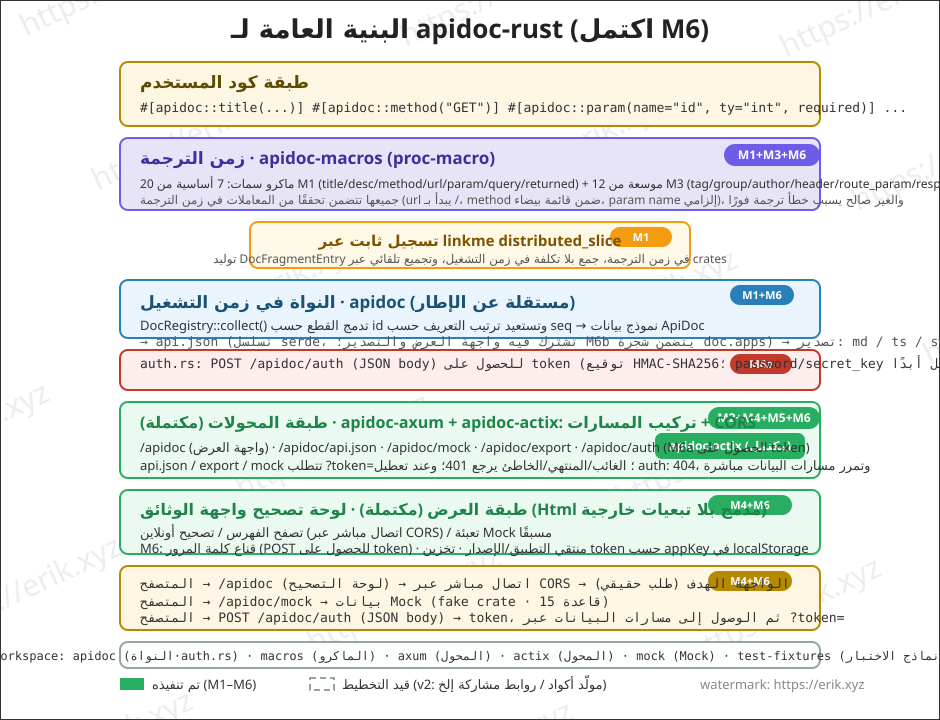
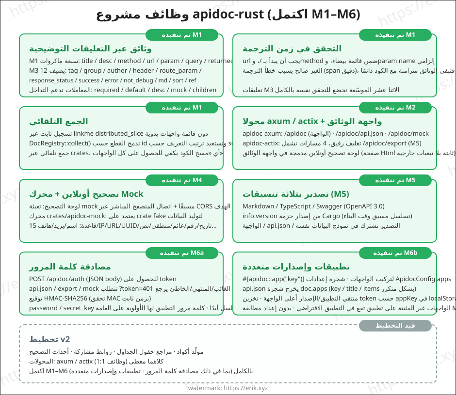
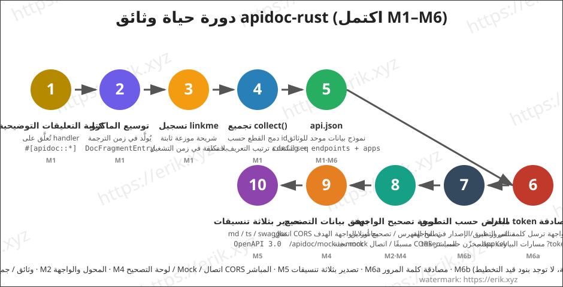

# Apidoc (apidoc-rust)

مجموعة أدوات لتوليد وثائق API وتطوير الواجهات مبنية على ماكروات Rust الإجرائية (proc-macro)، متوافقة مع axum وactix-web وغيرها من الأطر الشائعة

[](https://github.com/erikwang2013/apidoc-rust)
[](https://github.com/erikwang2013/apidoc-rust)

[中文](../../README.md) ·
[English](README-en.md) ·
[한국어](README-ko.md) ·
[Русский](README-ru.md) ·
[Deutsch](README-de.md) ·
[Français](README-fr.md) ·
[Español](README-es.md) ·
[Português](README-pt.md) ·
[हिन्दी](README-hi.md) ·
**[العربية](README-ar.md)** ·
[বাংলা](README-bn.md) ·
[Bahasa Indonesia](README-id.md) ·
[日本語](README-ja.md)

## 📖مقدمة المشروع

Apidoc مكتبة إضافات (plugin) بلغة Rust تولّد وثائق واجهات API تلقائيًا عبر تحليل **ماكروات Rust الإجرائية (proc-macro)**، وهي متوافقة مع axum وactix-web وغيرها من أطر العمل الشائعة. وإلى جانب التوليد التلقائي للوثائق، تتضمن أيضًا التصحيح أونلاين للواجهات وبيانات Mock للتصحيح وتوليد أكواد Json/TypeScript ومولّد الواجهات ومولّد الأكواد، بما يغطي دورة تطوير الواجهات وتصحيحها وتسليمها كاملة، سعيًا إلى رفع كفاءة تطوير API. وابتداءً من 2.2.0 توفّر أيضًا **عقد الخادم UIC-1** الذي تستهلكه نسخة Vue من apidoc-ui مباشرةً؛ وتبقى واجهة المستخدم الأصلية المضمّنة محفوظة، ويمكن الاختيار بينهما عبر الإعدادات.

توجّه apidoc-rust في التنفيذ:

- **التوليد في زمن الترجمة**: تُولَّد الوثائق بواسطة الماكرو الإجرائي في زمن الترجمة، فلا تنفصل الوثائق عن الكود أبدًا؛
- **جمع بلا تكلفة**: تسجيل ثابت عبر linkme، وتجميع واحد في زمن التشغيل يكفي للحصول على جميع وثائق الواجهات؛
- **إضافات عامة**: النواة مستقلة عن إطار عمل HTTP، وتتصل بأي إطار عبر محولات رقيقة (axum / actix-web).

### ✨وصف المشروع

- **جاهز للاستخدام فورًا**: بلا إعدادات معقّدة؛ بعد التثبيت اكتب التعليقات التوضيحية وفق الوثائق ليُولَّد توثيق API تلقائيًا.
- **كتابة سهلة**: مراجع الحقول `ref` / `table` وتسعة صيغ تعريفات خارجية (OpenAPI، AsyncAPI، GraphQL، Proto، WSDL، EDMX، JSON Schema، JSON-RPC، XML-RPC) مدعومة عبر `#[apidoc::definition]`، وبضعة تعليقات توضيحية تكفي لتعريف الحقول كاملًا.
- **تصحيح أونلاين**: صحّح الواجهات مباشرةً من صفحة الوثائق، مع دعم تمرير المعاملات العامة وبيانات Mock وأحداث التصحيح.
- **تصحيح متعدد البروتوكولات**: 45 تعليقًا توضيحيًا للبروتوكولات (RPC والمراسلة والصناعة والوسائط وإنترنت الأشياء وغيرها) عبر قناتي الاتصال المباشر من المتصفح والترحيل من جهة الخادم؛ وتُنشئ التعليقات توثيق البروتوكول ولوحة التصحيح معًا.
- **عقد UIC-1**: يوفّر `/apidoc/ui/v1/*` نقاط capabilities / config / menus / detail / docs / debug / share / cache / generator / export، بحيث تخدم نسخة Vue واحدة من apidoc-ui منصات PHP وGo وRust. تُفعَّل واجهة Vue الثابتة عبر `ui` / `ui_path` (حزم الإصدار تستخدم Vue افتراضيًا، ويحتفظ إعداد المكتبة الافتراضي بواجهة المستخدم الأصلية المضمّنة).
- **تطبيقات/إصدارات متعددة**: يمكن تهيئة المشروع بتطبيق واحد أو تطبيقات وإصدارات متعددة؛ وتُعرض الواجهات مجمّعة حسب التطبيق/الإصدار مع إمكانية التبديل بينها.
- **المجموعات/Tag**: تدعم الواجهات تجميعًا متعدد المستويات ووسم Tag.
- **وثائق Markdown**: يمكن لتعليقة `md` تركيب ملف Markdown كصفحة وثائق.
- **توليد Json/TypeScript**: يُولَّد لكل واجهة مثال طلب/استجابة Json وتعريفات أنواع TypeScript جاهزة للاستخدام مباشرة في الواجهة الأمامية.
- **مولّد الأكواد**: بإعداد + قالب يُولَّد كود الأعمال وملفات Api للواجهة الأمامية.
- **مشاركة الواجهات**: يمكن توليد رابط مشاركة لتطبيق/واجهة محددة، وتصدير `swagger.json`.
- **وصول آمن**: كلمة مرور عامة وكلمات مرور مستقلة لكل تطبيق/إصدار؛ تصحيح الخادم معطّل افتراضيًا ويفرض حارس SSRF وحدود الحجم/الإطارات/المهلة؛ وملفات التعريفات والبروتوكولات الصناعية لها حدود صارمة؛ وتُبنى الوثائق وقت البناء، وتبقى الاستجابات المحلية دون 10ms p99.

## المميزات

### تم تنفيذه (M1–M3)

- **وثائق عبر التعليقات التوضيحية**: سبعة ماكروات سمات أساسية `title` / `desc` / `method` / `url` / `param` / `query` / `returned` إضافةً إلى `tag` / `group` / `header` / `table` و45 تعليقًا توضيحيًا للبروتوكولات؛ وتدعم المعاملات التداخل `required` / `default` / `desc` / `mock` / `children` / `field`
- **التحقق في زمن الترجمة**: يجب أن يبدأ url بـ `/`، وmethod ضمن قائمة بيضاء، وparam name إلزامي... أي تعليق توضيحي غير صالح يُبلَغ عنه في زمن الترجمة (مع span دقيق)
- **الجمع التلقائي**: تسجيل ثابت عبر `distributed_slice` من linkme دون الحاجة إلى قائمة واجهات يدوية؛ `DocRegistry::collect()` يدمج القطع حسب id ويستعيد ترتيب التعريف حسب seq، مع جمع تلقائي عبر crates متعددة
- **إخراج api.json**: تسلسل serde لنموذج بيانات موحد (config + endpoints)، بحقول يتشاركها النموذج والمصدِّرات
- **محول axum + واجهة وثائق مدمجة**: تركيب المسار يعطيك صفحة الوثائق فورًا، مع تصفح الفهرس المجمّع (M2)
- **استكمال التعليقات التوضيحية**: 12 تعليقًا جديدًا `tag` / `group` / `author` / `header` / `route_param` / `response_status` / `success` / `error` / `not_debug` / `md` / `sort` / `ref` (M3)

### تم تنفيذه (M4)

- **تصحيح أونلاين**: لوحة «تصحيح أونلاين» مدمجة في صفحة الوثائق — Base URL يُعبَّأ مسبقًا بـ `location.origin` للاتصال المباشر بالخدمة عبر النطاقات، نموذج المعاملات يُعبَّأ مسبقًا ببيانات mock، استبدال مواضع المسار `{name}` / `:name`، دمج معاملات GET/HEAD في query، وتجميع بقية الـ methods في JSON body، تحرير رؤوس الطلب + header مخصص، عرض الاستجابة (الحالة / الزمن / pretty JSON)، مع تنبيه أصفر عند فشل CORS
- **محرك Mock** (`crates/apidoc/src/mock.rs`، يعتمد على crate fake، 15 قاعدة: name / company / email / phone / url / ip / city / country / text / number / int / float / bool / uuid / date). أولوية القواعد: `mock="fake:xxx"` تمر عبر جدول قواعد fake (الأسماء غير المعروفة تعود إلى قيمة افتراضية) ← بقية قيم mock غير الفارغة تُخرج كما هي (مثل `mock="1"`، `mock="erik"`) ← بدون mock يُولَّد تلقائيًا حسب `ty` (int←`"1"`، float←`"0.5"`، bool←`"true"`، object←`"{}"`، string←`"string"`)؛ children يتداخل بشكل متكرر، وarray ثابت على عنصرين
- **واجهة mock**: محول axum يضيف `GET /apidoc/mock?url=&method=`، بمطابقة دقيقة لـ url + method، ويعيد 404 عند عدم التطابق؛ لوحة التصحيح تخفي افتراضيًا نقاط النهاية `not_debug`، ولا تظهرها إلا بعد تحديد «إظهار واجهات not_debug»
- **اتصال CORS مباشر**: التصحيح أونلاين يربط المتصفح مباشرةً بالواجهة الهدف، ويسمح به `cors_layer` من المحول؛ ويوفّر الترحيل من جهة الخادم منفّذات P2–P5

### تم تنفيذه (M5)

- **التصدير بأربع صيغ** (`crates/apidoc/src/export/`): markdown / typescript / swagger (OpenAPI 3.0.0) / AsyncAPI 2.6 (P6)؛ وتوفّر النواة `export::markdown::render` / `export::typescript::render` / `export::swagger::render` / `export::asyncapi::render`
- **مسار التصدير**: يضيف المحول `GET /apidoc/export?format=md|ts|swagger|asyncapi`، والصيغة غير المعروفة تعيد 400؛ وContent-Type على التوالي `text/markdown` / `application/typescript` / `application/json`
- **markdown**: فهرس مجمّع + جداول معاملات + كتل استجابة؛ **typescript**: توليد أنواع `{Name}Params` / `{Name}Result` ضمن نطاق group، والواجهات غير المجمّعة تقع في `defaultGroup` (`default` كلمة محجوزة في TS)؛ **swagger**: يفضّل `info.version` قيمة `ApidocConfig.version` ويرجع إلى إصدار حزمة Cargo (حاليًا 2.2.0)
- **محول actix-web** (`crates/apidoc/src/actix.rs`): وظائف متطابقة 1:1 مع محول axum — `apidoc_routes(ApidocConfig) -> Scope` يركّب /apidoc و/apidoc/api.json و/apidoc/mock و/apidoc/export، و`cors_layer(CorsConfig)` يسمح بالطلبات عبر النطاقات
- **مشاركة الواجهة**: واجهة الوثائق (`src/ui.html`) نُقلت للأعلى إلى النواة، وتُصدَّر باسم `pub const UI_HTML`، والمحولان يشيران إلى النسخة نفسها (آمن عند نشر الحزمة)

### تم تنفيذه (M6)

- **مصادقة كلمة المرور (M6a)**: عند تفعيل `AuthConfig { enable, password, secret_key, expire }`، يستدعي العميل `POST /apidoc/auth` (بجسم JSON `{"password": "...", "appKey": "..."}`) لاستبداله بـ token؛ وتتطلب مسارات البيانات `/apidoc/api.json` و`/apidoc/export` و`/apidoc/mock` وجود `?token=xxx`، وإذا كان token مفقودًا أو منتهيًا أو خاطئًا يُعاد 401 مع ظهور قناع كلمة المرور في واجهة الوثائق. تمرّ كلمة المرور في جسم الطلب (لا في URL ولا في السجلات ولا في سجل المتصفح)، وتُقارَن على الخادم في زمن ثابت، ولا يُطبَّق عليها أي تجزئة في الطرف الأمامي. والـ token موقّع وبلا حالة `base64url(payload).base64url(HMAC-SHA256(payload))` بحمولة `{"exp": …}`؛ ومفتاح التوقيع مشتق من `secret_key` والبيانات السرية، لذا تغيير كلمة المرور يُبطل كل token صدر سابقًا. ولا يستخدم الـ token إلا أحرفًا آمنة لـ URL، فيدخل مباشرة في روابط المشاركة
- **الخطوط الحمراء لأمان المصادقة**: `password` / `secret_key` لا يُسلسلان أبدًا — إخراج api.json مطابق بايتًا ببايت لحالة عدم تفعيل المصادقة؛ وعند عدم تفعيل المصادقة يعيد `/apidoc/auth` 404 وتُمرَّر مسارات البيانات مباشرة؛ وإذا كان لإعداد تطبيق كلمة مرور مستقلة فلها الأولوية على كلمة المرور العامة، وكلمة المرور الفارغة (العامة أو لكل تطبيق) تفشل دائمًا بشكل مغلق على جانبي الإصدار والتحقق؛ وإذا لم يُعيَّن `secret_key` يُستخدم **مفتاح عشوائي لكل عملية** (تنتهي الـ tokens عند إعادة التشغيل — لا يوجد مفتاح افتراضي عام)، والقيمة الافتراضية لـ `expire` هي 86400 ثانية؛ وتُقابَل محاولات تسجيل الدخول الفاشلة المتكررة بتراجع أُسّي (بلا عقوبة في أول 3 محاولات، ثم 1s → 2s → … بحد أقصى 60s، ويُصفَّر عند النجاح)؛ وكل استجابة تحمل بيانات سرية أو token تُرفق بـ `Cache-Control: no-store`
- **تطبيقات وإصدارات متعددة (M6b)**: `ApidocConfig.apps: Vec<AppConfig>` (`key` / `title` / `items` إصدارات فرعية متكررة / `password`) يهيئ شجرة التطبيقات، و`#[apidoc::app("key")]` يعلّق الواجهات على مفتاح تطبيق معين، والواجهات بدون مفتاح تقع في التطبيق الافتراضي؛ إخراج api.json يضيف شجرة `doc.apps`، ويظهر منتقي تطبيق/إصدار أعلى الواجهة، وتُخزَّن الـ tokens منفصلة في localStorage حسب appKey (يمكن لتطبيقات مختلفة امتلاك كلمات مرور مستقلة)

### تم تنفيذه (v2)

- **مراجع حقول جداول البيانات (`table`)**: تُدرج `#[apidoc::table("user")]` الحقول **مسطَّحة** في `returned` وفق مفتاح الجدول المهيأ في `ApidocConfig.tables` (بالدلالة نفسها التي لـ `ref`، والفرق أن مصدر البيانات جدول إعداد وليس واجهة أخرى)؛ وتدعم الحقول `required` / `default` / `desc` / `mock`؛ والمفتاح غير المهيأ يُصدر تحذير stderr فقط؛ وعند عدم استخدام هذا التعليق يبقى الإخراج مطابقًا بايتًا ببايت لـ v1
- **التجسيد وقت البناء**: يُبنى api.json والتصديرات وقالبات codegen وأجسام `/apidoc/mock` مرة واحدة عند تركيب المسارات؛ وتكتفي الطلبات بالبحث في جدول. يبقى `ApidocConfig.cache` للتوافق، لكن استجابات mock لم تعد تحتاج تخزينًا مؤقتًا وقت الطلب
- **روابط المشاركة**: `GET /apidoc/share?app=&url=&method=&base=` → `{"url":"…"}` رابط عميق (`?app=<key>&ep=<接口 url>&method=<方法>[&token=…]`)؛ مع زر «مشاركة» بجوار كل واجهة في صفحة الوثائق (ينسخ إلى الحافظة، وعند الفشل يتحول إلى حقل قابل للنسخ)، وفتح الرابط العميق ينقل مباشرة إلى التطبيق/الواجهة المطلوبة؛ وعند تفعيل المصادقة يُرفق بالرابط token يُصدره الخادم (كلمة مرور التطبيق المستقلة لها الأولوية على العامة)، فيُفتح دون كلمة مرور
- **مولّد الأكواد**: `GET /apidoc/generate?template=<name>` → نص بعد المعالجة (قالب غير معروف 404)؛ قوالب مدمجة: `api.ts` (ملف Api للواجهة الأمامية)، `handler.rs` (هيكل واجهة Rust)، `schema.sql` (يولّد عبارات CREATE TABLE وفق `tables`)؛ وقالب بالاسم نفسه في `ApidocConfig.codegen` يطغى على المدمج. صيغة القوالب اثنتان فقط: `{{变量}}` (يبقى كما هو إن لم يُعرَّف) و`{{#each 列表}}…{{/each}}` (قابل للتداخل، مثل `tables` × `fields`)
- **أحداث التصحيح**: أُضيف إلى لوحة التصحيح أونلاين قسم قابل للطي «نصوص ما قبل الطلب / ما بعد الطلب» (يُحفظ في localStorage)——النص القبلي يُنفَّذ قبل الطلب عبر `new Function('ctx', code)` ويمكنه تعديل `ctx.url/method/headers/body` أو إرجاع كائن يُدمج دمجًا سطحيًا؛ والنص البعدي يُنفَّذ بعد الاستجابة ويقرأ `status/ms/text/url/method/ep`، وإذا أرجع نصًا استُبدل به النص المعروض للاستجابة؛ وخطأ السكريبت يظهر في منطقة النتائج فقط دون قطع الطلب

### تم تنفيذه (v2.2 · UIC-1)

- **عقد الخادم UIC-1 (Contract 1.0)**: يوفّر `/apidoc/ui/v1/*` capabilities / config / menus / detail / docMenus / docDetail / verifyAuth / جلسات التصحيح / سجلات المشاركة / التخزين المؤقت / قوالب الأكواد / التصدير الكامل. ويُبلّغ `capabilities` عمّا جُمِّع فعليًا في هذا البناء فقط، لتتمكن الواجهة من إخفاء المداخل غير المتاحة. ويعلن Rust `share.actions=false` و`cache.mode=build` والمولّد `forms=false` / `templates=true`، والترحيل الأحادي فقط (`relay-unary`).
- **تسع صيغ تعريفات خارجية**: يحلّل `#[apidoc::definition(file = "...", operation = "...")]` صيغ OpenAPI وAsyncAPI وGraphQL وProto وWSDL وEDMX وJSON Schema وJSON-RPC وXML-RPC إلى حمولة موحّدة `{format, source, operation, meta, messages, validation}`؛ ويعيد `/apidoc/ui/v1/detail` حقل `definitions` مع تشخيص لكل عنصر (`path` / `line` / `column` / `severity` / `message`). لا تدخل التعريفات في api.json أبدًا، فتبقى الواجهة الأصلية والمخرجات القديمة دون تغيير.
- **واجهة Vue الثابتة**: يخدم `ui: UiMode::Vue` + `ui_path` نسخة apidoc-ui من `dist/uic1-ui/`؛ و`ApidocConfig::release(title, ui_path)` هو مدخل حزم الإصدار (ويبقى الإعداد الافتراضي للمكتبة هو الواجهة الأصلية المضمّنة). يشمل SPA fallback و`config.js` / `assets/*` والحماية من الهروب خارج المسار والروابط الرمزية، وفشل الإقلاع fail-closed عند غياب `ui_path` أو `index.html`.
- **الإبلاغ الكامل بقدرات الترحيل**: يسرد `capabilities.debug.relay` المنفّذات المجمّعة في هذا البناء فقط؛ ويجمع `debug-all` جميع معرّفات البروتوكولات الثلاثين، بحيث لا تعرض الواجهة منفّذًا يفشل بـ «not compiled».
- **إصلاحات البروتوكولات الصناعية وحدود الموارد**: يحلّل DNP3 رؤوس الكائنات بعد IIN ويحدّ كل استجابة عند 10,000 نقطة؛ ويحدّ IEC 60870-5-104 كل استجابة عند 10,000 سطر؛ ويرسل BACnet/IP طلب ReadProperty صالحًا؛ وقد أُصلح تجاوز u16 في عدد نقاط DNP3.

## توثيق وتصحيح متعدد البروتوكولات (P1–P6)


- **45 تعليقًا للبروتوكولات** إضافة إلى الصيغة العامة `#[apidoc::protocol("kind", ...)]`؛ يعلن `event` رسائل التدفق ويعلن `param(..., field = "1")` أرقام حقول البروتوكول.
- **تصحيح مباشر من المتصفح** (دون اعتماد على Rust): SOAP، GraphQL (مع subscriptions)، JSON-RPC، XML-RPC، OData، MCP، A2A، Webhooks، WebSocket (نص/ثنائي)، SSE، Socket.IO، STOMP (مع الثنائي)، WebRTC/DataChannel، HLS.
- **منفذات على الخادم** (feature-gated): HTTP/2، HTTP/3، gRPC، Thrift، Dubbo/Hessian2، ISO 8583، TCP/UDP/Raw/Unix، MQTT، AMQP، Kafka، XMPP، STOMP/TCP، CoAP، LwM2M، Modbus، DNP3، IEC 104، BACnet/IP، OPC UA، RTP/RTCP/RTSP/SIP/RTMP. ويُفعّلها `debug-all` جميعًا.
- **P6**: التقاط Webhooks، تصدير AsyncAPI 2.6، استيراد `.proto`/`.thrift` عبر CLI `apidoc-idl`، سجل Dubbo Nacos، أمثلة mock من الأحداث.
- **قدرات الترحيل في UIC-1**: يعرض `GET /apidoc/ui/v1/capabilities` ضمن `features.debug.relay` المنفّذات المجمّعة في هذا البناء فقط. ويدعم Rust الترحيل الأحادي فقط (`modes` يحتوي `relay-unary` وليس `relay-stream`)؛ ويبلّغ بناء `debug-all` بجميع معرّفات البروتوكولات الثلاثين:

| feature | معرّفات بروتوكولات الترحيل |
|---|---|
| `debug-http` | `http` `http2` |
| `debug-session` | `websocket` |
| `debug-grpc` | `grpc` |
| `debug-thrift` | `thrift` |
| `debug-dubbo` | `dubbo` `hessian` |
| `debug-iso8583` | `iso8583` |
| `debug-mqtt` | `mqtt` |
| `debug-amqp` | `amqp` |
| `debug-kafka` | `kafka` |
| `debug-xmpp` | `xmpp` |
| `debug-sockets` | `stomp` `tcp` `udp` `raw` `unix` |
| `debug-coap` | `coap` `lwm2m` |
| `debug-industrial` | `modbus` `dnp3` `iec104` `bacnet` `opcua` |
| `debug-media` | `rtp` `rtcp` `rtsp` `sip` `rtmp` |
| `debug-http3` | `http3` |

باستثناء `websocket`، لم تُربط منفّذات البث بجلسات الترحيل بعد؛ وتجمع Kafka / AMQP / XMPP وما شابه استجابة أحادية. ولا يجمع `debug-all` سوى الميزات أعلاه.
- **الأمان**: تصحيح الخادم معطّل افتراضيًا ويتطلب مصادقة عامة؛ يتحقق حارس SSRF من كل IP ويثبّت الاتصال؛ ويُرفض كل من إعادة التوجيه/الوكيل وبيانات السحابة الوصفية؛ وتُحدّ أحجام الاستجابة والإطارات والمهلة؛ وتُحدّ استجابات DNP3 عند 10,000 نقطة وIEC 104 عند 10,000 سطر (خطأ صارم عند التجاوز)، حتى لا تضخّم الإطارات الصغيرة المخرجات المحلَّلة؛ والبروتوكولات بلا TLS مثبّت تفشل مغلقة.
- **الأداء**: تُبنى الوثائق والتصديرات وcodegen وأجسام mock وقت البناء؛ وتبقى مسارات apidoc المحلية دون 10ms p99 (`tests/latency.rs`).

## البنية



## الوظائف



## دورة الحياة



## بنية المشروع

```
apidoc-rust/
├── Cargo.toml                 # إعداد workspace (resolver 2)
├── VERSION                    # إصدار المشروع (v2.2.0)
├── crates/
│   ├── apidoc/                # نواة التشغيل (مستقلة عن إطار العمل)
│   │   ├── src/lib.rs         # نموذج البيانات + تجميع DocRegistry + api.json + UI_HTML + UiMode
│   │   ├── src/auth.rs        # مصادقة كلمة المرور M6a (إصدار/التحقق من رمز HMAC + الحارس + backoff)
│   │   ├── src/uiapi.rs       # عقد UIC-1: capabilities / menus / detail / docs / مسارات الإدارة
│   │   ├── src/protocol_defs/ # تسع صيغ تعريفات خارجية (OpenAPI/AsyncAPI/GraphQL/proto/…)
│   │   ├── src/export/        # التصدير: markdown / typescript / swagger / asyncapi + codegen
│   │   ├── src/debug/         # منفّذات خادم خاضعة لـ feature (http / grpc / sockets / mqtt / industrial / media / …)
│   │   ├── src/axum.rs        # محول axum (docs/debug/stream/webhook/UIC-1/واجهة ثابتة + CORS)
│   │   ├── src/actix.rs       # محول actix-web (feature `actix`، 1:1 مع axum)
│   │   ├── src/ui.html        # الواجهة الأصلية المضمّنة؛ نسخة Vue الثابتة تُخدم عبر ui/ui_path
│   │   ├── tests/             # اختبارات تكامل (الماكروات/التجميع/التسلسل/UIC-1/التعريفات/الكمون)
│   │   └── examples/demo.rs   # مثال: التعليقات التوضيحية + إخراج api.json
│   ├── apidoc-macros/         # proc-macro: 24 تعليقًا توضيحيًا أساسيًا + 45 اسمًا مستعارًا للبروتوكولات
│   │   └── src/lib.rs         # تعريفات الماكرو + تحليل المعاملات + التحقق في زمن الترجمة
│   ├── apidoc-idl/            # CLI مستقل `.proto` / `.thrift` → تعليق apidoc
│   └── apidoc-test-fixtures/  # تجهيزات اختبار التسجيل بين crates
├── contract/                  # UIC-1 Contract 1.0: المخطط + تجهيزات مشتركة بين الخوادم
├── .github/
│   └── workflows/release.yml  # سير عمل الإصدار (يقرأ VERSION وينشئ tag+release تدريجيًا)
└── docs/
    ├── images/                # أصول البنية/المميزات/دورة الحياة/تعدد البروتوكولات/المعاينة الاجتماعية
    └── i18n/                  # وثائق متعددة اللغات (12 لغة)
```

## دليل الاستخدام

### 1. إضافة التبعيات

```toml
[dependencies]
apidoc-rust = "2.2"        # أو path = "crates/apidoc"

serde_json = "1"      # لاستخدام إخراج api.json
linkme = "0.3"        # مطلوب: كود التسجيل الناتج عن الماكرو يشير إليه
```

> المحولات تُختار واحدًا حسب إطار العمل: axum يستخدم `features = ["axum"]`، وactix-web يستخدم `features = ["actix"]` (وظائف الاثنين 1:1). `mock` (محرك Mock) تبعية داخلية للإطار، تُضاف تلقائيًا عبر المحول، ولا يحتاج المستهلك عمومًا إلى استخدامه مباشرة.

### 2. كتابة التعليقات التوضيحية

علّق على دوال handler واحدًا تلو الآخر، وتُولَّد الوثائق في زمن الترجمة:

```rust
use apidoc::*;

#[apidoc::title("جلب معلومات المستخدم")]
#[apidoc::desc("الاستعلام عن تفاصيل المستخدم حسب معرّف المستخدم")]
#[apidoc::url("/api/user/info")]
#[apidoc::method("GET")]
#[apidoc::param(name = "user_id", ty = "int", required, desc = "معرّف المستخدم", mock = "1")]
#[apidoc::query(name = "lang", ty = "string", desc = "اللغة", default = "zh-CN")]
#[apidoc::returned(
    name = "data",
    ty = "object",
    desc = "بيانات المستخدم",
    children = [
        { name = "id", ty = "int", required, desc = "معرّف المستخدم" },
        { name = "name", ty = "string", required, desc = "اسم المستخدم", mock = "erik" },
    ]
)]
fn get_user_info() -> String {
    unimplemented!()
}
```

### 3. الجمع والإخراج

```rust
fn main() {
    let doc = DocRegistry::collect_doc(ApidocConfig {
        title: "API الخاص بي".to_string(),
        description: None,
        auth: None,    // M6a مصادقة كلمة المرور، انظر «8. مصادقة كلمة المرور»
        apps: vec![],  // M6b تطبيقات وإصدارات متعددة، انظر «9. تطبيقات وإصدارات متعددة»
    });
    println!("{}", serde_json::to_string_pretty(&doc).unwrap());
}
```

### 4. تشغيل المثال

```bash
cargo run --example demo -p apidoc
```

الإخراج (مقتطف):

```json
{
  "config": { "title": "demo api" },
  "endpoints": [
    {
      "title": "جلب معلومات المستخدم",
      "desc": "الاستعلام عن تفاصيل المستخدم حسب معرّف المستخدم",
      "url": "/api/user/info",
      "method": "GET",
      "params": [
        { "name": "user_id", "type": "int", "required": true, "desc": "معرّف المستخدم", "mock": "1" }
      ],
      "querys": [
        { "name": "lang", "type": "string", "required": false, "default": "zh-CN", "desc": "اللغة" }
      ],
      "returned": [
        {
          "name": "data",
          "type": "object",
          "required": false,
          "desc": "بيانات المستخدم",
          "children": [
            { "name": "id", "type": "int", "required": true, "desc": "معرّف المستخدم" },
            { "name": "name", "type": "string", "required": true, "desc": "اسم المستخدم", "mock": "erik" }
          ]
        }
      ]
    }
  ]
}
```

### 5. التصحيح أونلاين و Mock (M4)

افتح صفحة الوثائق ← اختر واجهة ← لوحة «التصحيح أونلاين» على اليمين تعبّئ المعاملات مسبقًا وفق قواعد mock ← وجّه Base URL إلى عنوان الخدمة الهدف (الافتراضي `location.origin`، اتصال مباشر عبر النطاقات) ← اضغط إرسال لتحصل على الاستجابة الحقيقية (رمز الحالة / الزمن / pretty JSON). لوحة التصحيح تخفي افتراضيًا نقاط النهاية `not_debug`، ولا تظهرها إلا بعد تحديد «إظهار واجهات not_debug».

**متطلب CORS**: التصحيح أونلاين يربط المتصفح مباشرة بالواجهة الهدف، لذا يجب على الخدمة الهدف تركيب `cors_layer` الذي يوفره المحول للسماح بطلبات عبر النطاقات؛ وعند فشل CORS تعرض اللوحة تنبيهًا أصفر.

صيغة قواعد Mock (ثلاث أولويات):

```rust
#[apidoc::param(name = "email", ty = "string", desc = "البريد", mock = "fake:email")]  // توليد عبر قاعدة fake
#[apidoc::param(name = "status", ty = "string", desc = "الحالة", mock = "1")]          // mock غير فارغ يُخرج كما هو
#[apidoc::param(name = "name", ty = "string", desc = "اسم المستخدم")]                   // بدون mock: توليد تلقائي حسب ty
#[apidoc::returned(
    name = "data",
    ty = "object",
    children = [
        { name = "id", ty = "int", required },       // بدون mock → "1"
        { name = "email", ty = "string", mock = "fake:email" },  // children يتداخل بشكل متكرر
    ]
)]
fn create_user() -> String {
    unimplemented!()
}
```

15 قاعدة fake مدمجة: `name` / `company` / `email` / `phone` / `url` / `ip` / `city` / `country` / `text` / `number` / `int` / `float` / `bool` / `uuid` / `date`؛ الأسماء غير المعروفة تعود إلى قيمة افتراضية. قواعد التوليد التلقائي بدون mock: int←`"1"`، float←`"0.5"`، bool←`"true"`، object←`"{}"`، string←`"string"`؛ وarray ثابت على عنصرين.

### 6. التصدير أونلاين (M5)

المحول يوفر واجهات تصدير بالصيغ الأربع مدمجة، جاهزة فور التركيب (الصيغة غير المعروفة `format` تعيد 400):

```bash
GET /apidoc/export?format=md        # فهرس مجمّع + جدول معاملات + كتلة استجابة (text/markdown)
GET /apidoc/export?format=ts        # توليد أنواع {Name}Params / {Name}Result ضمن نطاق group (application/typescript)
GET /apidoc/export?format=swagger   # ملف وصف OpenAPI 3.0.0 (application/json)
GET /apidoc/export?format=asyncapi  # AsyncAPI 2.6 event/streaming spec (application/json)
```

- **markdown**: مناسب للصقه في Wiki المشروع / ملاحظات الإصدار، يخرج فهرسًا مجمّعًا حسب المجموعة، وكل واجهة مع جدول معاملات وكتلة استجابة؛
- **typescript**: الواجهة الأمامية يمكنها لصقه مباشرة كتعريفات أنواع؛ الواجهات غير المجمّعة تقع في نطاق `defaultGroup` (`default` كلمة محجوزة في TS، لا يمكن استخدامها كمعرّف)؛
- **swagger**: `info.version` مأخوذ من `ApidocConfig.version` (إصدار الـ API الموثَّق)، وإذا لم يُعيَّن يرجع إلى إصدار حزمة apidoc-rust (حاليًا 2.2.0)؛ ومعاملات المسار مأخوذة من قالب URL، فيُستورد الملف مباشرة إلى Swagger UI أو مولّدات الكود.
- **asyncapi**: قنوات/عمليات/رسائل لنقاط نهاية الأحداث مثل WebSocket وSSE وMQTT وKafka وSTOMP (AsyncAPI 2.6).

### 7. محول actix-web

عند استخدام actix-web كإطار عمل للويب، اربط `features = ["actix"]` (وظائف متطابقة 1:1 مع محول axum):

```toml
[dependencies]
apidoc-rust = { version = "2.2", features = ["actix"] }
```

```rust
use actix_web::{App, HttpServer};
use apidoc::actix::{apidoc_routes, cors_layer, CorsConfig};
use apidoc::ApidocConfig;

#[actix_web::main]
async fn main() -> std::io::Result<()> {
    HttpServer::new(|| {
        App::new()
            .service(apidoc_routes(ApidocConfig {
                title: "API الخاص بي".to_string(),
                description: None,
                auth: None,    // M6a مصادقة كلمة المرور، انظر «8. مصادقة كلمة المرور»
                apps: vec![],  // M6b تطبيقات وإصدارات متعددة، انظر «9. تطبيقات وإصدارات متعددة»
            }))
            .wrap(cors_layer(CorsConfig::default()))   // M4 التصحيح أونلاين عبر النطاقات
    })
    .bind("127.0.0.1:8080")?
    .run()
    .await
}
```

بعد التركيب يمكن الوصول إلى `/apidoc` (واجهة الوثائق) و`/apidoc/api.json` (البيانات) و`/apidoc/mock` (Mock) و`/apidoc/export` (التصدير). إعداد CORS الفارغ **أو `["*"]`** يسمح حرفيًا `*` (دون حمل اعتمادات)، وعند إعداد القائمة البيضاء `allow_origins` فيطابق تلقائيًا Origin المُعاد توجيهه بدقة، وكلا الوضعين لا يفتحان الاعتمادات.

### 8. مصادقة كلمة المرور (M6a)

عند تفعيل `auth` تصبح الوثائق بحاجة إلى كلمة مرور للوصول (tokens موقّعة بـ HMAC-SHA256، ومقارنة على الخادم في زمن ثابت، وتراجع أُسّي عند تسجيل الدخول):

> **تغيير كاسر في 2.0**: انتقل مسار تسجيل الدخول من `GET /apidoc/auth?password=…` إلى `POST /apidoc/auth` (بجسم JSON)، وتغيّرت الـ tokens من المغلّف السابق إلى tokens موقّعة بـ HMAC-SHA256 — **الـ tokens القديمة وأساليب الاستدعاء القديمة لم تعد تعمل**، وعلى العملاء استخدام POST. كذلك تفقد عمليات النشر التي لم تعيّن `secret_key` صراحةً الـ tokens الصادرة عند إعادة التشغيل (يُستخدم مفتاح عشوائي لكل عملية؛ ولا يوجد مفتاح افتراضي عام).

```rust
use apidoc::auth::AuthConfig;

let doc = DocRegistry::collect_doc(ApidocConfig {
    title: "API الخاص بي".to_string(),
    description: None,
    auth: Some(AuthConfig {
        enable: true,
        password: "your-password".to_string(),
        secret_key: "your-secret-key".to_string(), // الافتراضي مفتاح عشوائي لكل عملية: يُبطل عند إعادة التشغيل (عيّنه صراحةً في النشر متعدد النسخ)
        expire: 86400,                             // بالثواني؛ الافتراضي 86400
    }),
    apps: vec![],
});
```

**الخطوات**:

1. يستدعي العميل `POST /apidoc/auth` (بجسم JSON `{"password": "...", "appKey": "<key>"}`؛ و`appKey` يحدد تطبيقًا له كلمة مرور مستقلة) ليحصل على token (عند النجاح يُعاد `{"token":"..."}`، وعند خطأ كلمة المرور 401، وعند جسم طلب غير صالح 400)؛ تمرّ كلمة المرور في الجسم ولا تظهر أبدًا في URL أو السجلات، ولا يُطبَّق عليها أي تجزئة في الطرف الأمامي. وعند عدم تفعيل المصادقة يعيد هذا المسار 404 وتُمرَّر مسارات البيانات مباشرة
2. مسارات البيانات `GET /apidoc/api.json` و`/apidoc/export` و`/apidoc/mock` تتطلب `?token=xxx` (مع `&appKey=` أيضًا عند اختيار تطبيق معين)؛ وإذا كان token مفقودًا/منتهيًا/خاطئًا يُعاد 401، وتفتح واجهة الوثائق تلقائيًا قناع كلمة المرور، وبعد إدخال كلمة المرور يرسلها الطرف الأمامي مباشرة (POST) ليستبدلها بـ token
3. الـ token هو `base64url(payload).base64url(HMAC-SHA256(payload))` بحمولة `{"exp": <الثواني اليونكسية>}`؛ ومفتاح التوقيع = HMAC-SHA256(`secret_key`, البيانات السرية)، لذا تغيير كلمة المرور يُبطل الـ tokens القديمة فورًا. يتحقق الخادم بمقارنة MAC في زمن ثابت ثم يفحص الانتهاء؛ ولا يستخدم الـ token إلا أحرفًا آمنة لـ URL
4. `password` / `secret_key` لا يُسلسلان أبدًا — إخراج api.json مطابق بايتًا ببايت لحالة عدم تفعيل المصادقة؛ وإذا كان لإعداد تطبيق `password` مستقلة فلها الأولوية على كلمة المرور العامة، وكلمة المرور الفارغة (العامة أو الخاصة بالتطبيق) تفشل دائمًا بشكل مغلق
5. محاولات تسجيل الدخول الفاشلة المتكررة تُقابَل بتراجع أُسّي (بلا عقوبة في أول 3 محاولات، ثم 1s → 2s → … بحد أقصى 60s، ويُصفَّر عند النجاح)؛ والاستجابات التي تحمل بيانات سرية أو token تُرفق بـ `Cache-Control: no-store`

### 9. تطبيقات وإصدارات متعددة (M6b)

يمكن تقسيم المشروع إلى تطبيقات/إصدارات متعددة، لكل منها عرض وتحكم بالوصول مستقل:

```rust
#[apidoc::title("获取用户信息")]
#[apidoc::app("demo")]   // تُعلق على التطبيق ذي key="demo"؛ الواجهات بدون app تقع في التطبيق الافتراضي
fn get_user_info() -> String {
    unimplemented!()
}
```

```rust
let doc = DocRegistry::collect_doc(ApidocConfig {
    title: "API الخاص بي".to_string(),
    description: None,
    auth: None,
    apps: vec![
        AppConfig {
            key: "demo".to_string(),
            title: "演示应用".to_string(),
            items: vec![AppConfig {
                key: "v1".to_string(),
                title: "v1".to_string(),
                items: vec![],
                password: None,
            }],
            password: None, // كلمة مرور وصول مستقلة للتطبيق، لها الأولوية على العامة، لا تُسلسل أبدًا
        },
    ],
});
```

- `AppConfig { key, title, items, password }`: `key` هو المعرّف الفريد الذي تشير إليه تعليقة `#[apidoc::app("key")]`، و`items` يتداخل بشكل متكرر لإصدارات/تطبيقات فرعية، و`password` هي كلمة مرور الوصول المستقلة للتطبيق (عند وجود كلمة مرور مستقلة يُتحقق من token التطبيق فقط)
- إخراج api.json يضيف شجرة `doc.apps` (key / title / items / endpoints)؛ يظهر منتقي تطبيق/إصدار أعلى الواجهة — عند التبديل تُعرض واجهات ذلك العقدة وتُعاد جلب البيانات، وتُخزَّن الـ tokens منفصلة في localStorage حسب appKey
- عندما تشير تعليقة `app` إلى مفتاح غير مهيأ في `apps` يُصدر تحذير stderr وتقع الواجهة في التطبيق الافتراضي؛ بدون تعليقات `app` أو بدون تهيئة `apps` يكون الإخراج مطابقًا بايتًا ببايت لـ M5

### 10. مراجع حقول جداول البيانات · تخزين الوثائق مؤقتًا (v2)

```rust
ApidocConfig {
    // بنية الجدول تأتي من الإعداد (جانب Rust لا يتصل بقاعدة البيانات)، ويشير التعليق عبر key
    tables: vec![TableDef {
        key: "user".into(),
        title: "用户表".into(),
        fields: vec![
            TableField { name: "id".into(), ty: "int".into(), required: true, desc: Some("用户ID".into()), ..Default::default() },
            TableField { name: "name".into(), ty: "string".into(), mock: Some("erik".into()), ..Default::default() },
        ],
    }],
    // تخزين الوثائق مؤقتًا: إخراج /apidoc/mock يُحفَظ وفق (url, method) ويُعاد بناؤه بعد ttl ثانية (0 = دائم)
    cache: Some(CacheConfig { enable: true, ttl: 60 }),
    ..Default::default()   // title / description / auth / apps / codegen تُهيأ كالمعتاد
}
```

على الـ handler بالكتابة نفسها التي لـ `ref`: `#[apidoc::table("user")]`. تُدرج الحقول مسطَّحة في `returned` لتلك الواجهة؛ والمفتاح غير الموجود في `tables` يُصدر تحذيرًا فقط دون خطأ.

### 11. روابط المشاركة · توليد الأكواد (v2)

- `GET /apidoc/share?app=api&url=/api/user/info&method=GET&base=https://example.com` → `{"url":"https://example.com/apidoc?app=api&ep=%2Fapi%2Fuser%2Finfo&method=GET"}` (عند تفعيل المصادقة يُضاف `&token=…` في نهاية الرابط، فيُفتح دون كلمة مرور)
- `GET /apidoc/generate?template=api.ts` (أو `handler.rs` / `schema.sql`) → `text/plain; charset=utf-8`؛ قالب غير معروف 404، ومعامل مفقود 400
- قوالب مخصصة (تطغى على المدمج بالاسم نفسه):

```rust
ApidocConfig {
    codegen: vec![CodegenTemplate {
        name: "api.ts".into(),
        template: "// {{title}}\n{{#each endpoints}}// {{method}} {{url}}\n{{/each}}".into(),
    }],
    ..Default::default()
}
```

المتغيرات المتاحة في القوالب: في المستوى الأعلى `title` / `description`؛ وداخل `{{#each endpoints}}`: `title` / `url` / `method` / `group` / `desc` / `author`؛ وداخل `{{#each tables}}`: `key` / `title`، وداخل `{{#each fields}}` التابعة لها: `name` / `ty` / `required` / `default` / `desc` / `mock`، إضافة إلى المتغيرات المشتقة `not_null` / `default_clause` / `comma` / `key_q` / `name_q` (مفيدة لتوليد SQL صالح مباشرة؛ والمتغيرات المنتهية بـ `_q` معرّفات مقتبسة)، وكذلك `url_js` / `method_js` داخل `{{#each endpoints}}` (قيم JS النصية الحرفية الجاهزة للصق في مواضع كود JS) و`fn_name` (اسم `{method}_{group}` بعد تطهيره ليكون معرّفًا صالحًا، لهيكل Rust).

### 12. نصوص ما قبل/ما بعد الطلب (v2)

في صفحة الوثائق، افتح «نصوص ما قبل الطلب» و«نصوص ما بعد الطلب» ضمن لوحة «تصحيح أونلاين» (يُحفظ المحتوى في localStorage):

```js
// ما قبل الطلب: يُنفَّذ قبل إرسال الطلب، ويمكنه تعديل ctx.url / method / headers / body أو إرجاع كائن يُدمج دمجًا سطحيًا
ctx.headers['X-Token'] = localStorage.getItem('token') || '';
```

```js
// ما بعد الطلب: يُنفَّذ بعد عودة الاستجابة، ctx = { status, ms, text, url, method, ep } (للقراءة فقط)
// وإرجاع نص يستبدل النص المعروض في منطقة النتائج
return 'HTTP ' + ctx.status + ' · ' + ctx.ms + 'ms\n' + ctx.text;
```

خطأ السكريبت يظهر في منطقة نتائج التصحيح فقط ولا يقطع الطلب (فشل النص القبلي يعني إرسال الطلب كالمعتاد، وفشل النص البعدي يعني عرض الاستجابة الأصلية كالمعتاد).

### 13. واجهة المستخدم: الأصلية / نسخة Vue الثابتة (UIC-1 Phase 5)

افتراضيًا يقدّم `/apidoc` الواجهة الأصلية المضمّنة (`UiMode::Native`)، لذا لا تحتاج عمليات النشر الحالية إلى أي تغيير. تستهلك نسخة Vue عقد UIC-1 في القسم 14 وتُشارك مع PHP وGo (apidoc-ui `npm run package:ui`):

```rust
use apidoc::{ApidocConfig, UiMode};

let cfg = ApidocConfig {
    title: "واجهة API الخاصة بي".into(),
    ui: UiMode::Vue,
    ui_path: Some("/srv/apidoc".into()), // محتويات dist/uic1-ui/: index.html + config.js + assets/
    ..Default::default()
};
```

- حزم الإصدار تستخدم Vue افتراضيًا: `ApidocConfig::release("واجهة API الخاصة بي", "/srv/apidoc")` مكافئة للإعداد الصريح أعلاه؛ **ويبقى الإعداد الافتراضي للمكتبة `native`**.
- في وضع Vue يعيد `GET /apidoc` تحويل 307 إلى `/apidoc/` (يستخدم البناء عناوين نسبية `./assets/...`)، وتُقرأ `/apidoc/` و`config.js` و`assets/*` من `ui_path`، وتُرجع المسارات غير المعروفة بلا امتداد إلى `index.html` (SPA fallback).
- تحتفظ مسارات API بالأولوية: `/apidoc/api.json` و`/apidoc/export` و`/apidoc/ui/v1/*` والمصادقة والتصحيح وwebhook تُطابق قبل الملفات الثابتة؛ وتعيد المسارات الفرعية غير المعروفة لـ API الرمز 404 بدلًا من غلاف SPA.
- الأمان: تبقى المسارات محصورة داخل `ui_path`؛ وتعيد `..` وتجاوزات الترميز والهروب عبر الروابط الرمزية 404، ولا تُسرد المجلدات أبدًا، ويُفشل غياب `ui_path` / `index.html` عند بدء التشغيل (fail closed). و`ui` / `ui_path` للخادم فقط ولا تُسلسل في api.json.
- التراجع: أعِد `ui: UiMode::Native` وأعد التشغيل؛ تبقى الواجهة الأصلية وجميع المسارات القديمة كما هي.

### 14. عقد UIC-1 · تعريفات البروتوكولات الخارجية

`/apidoc/ui/v1/*` هو العقد المستقر الذي تستهلكه apidoc-ui (Contract 1.0)؛ والاستجابات الناجحة تكون `{code:0,message:"ok",data}`:

| المسار | الغرض |
|---|---|
| `GET /apidoc/ui/v1/capabilities` | قدرات الخادم: contract / backend / version / features (بما فيها قائمة بروتوكولات الترحيل المجمّعة) |
| `GET /apidoc/ui/v1/config` | إعداد تهيئة الواجهة (العنوان، شجرة التطبيقات، مفاتيح المصادقة، …) |
| `POST /apidoc/ui/v1/menus` · `detail` | فهرس الواجهات وتفاصيلها، بما في ذلك `definitions` و`validation` |
| `GET/POST /apidoc/ui/v1/docMenus` · `POST docDetail` | فهرس وثائق Markdown ونصها |
| `POST /apidoc/ui/v1/verifyAuth` | التحقق من رموز المصادقة العامة / التطبيق / المشاركة |
| `POST /apidoc/ui/v1/debugSend` · `debugStart` · `debugPoll` · `debugStop` | التصحيح المباشر من المتصفح وعبر ترحيل الخادم |
| `POST /apidoc/ui/v1/addApiShare` · `getApiShareList` · `getApiShareDetail` · `deleteApiShare` · `handleApiShareAction` | CRUD لسجلات المشاركة (Rust `share.actions=false`؛ بلا إجراءات تصريحية) |
| `POST /apidoc/ui/v1/cache/clear` · `cache/warm` | إدارة التخزين المؤقت (Rust `cache.mode=build`) |
| `POST /apidoc/ui/v1/renderCodeTemplate` · `exportAllData` | معالجة قوالب الأكواد وتصدير البيانات الكامل (تُنشئ الواجهة md / pdf / openapi / postman / asyncapi / typescript) |

أرفق تعريفًا خارجيًا بمعالج عبر `#[apidoc::definition]`:

```rust
#[apidoc::title("جلب المستخدم")]
#[apidoc::url("/api/user/info")]
#[apidoc::method("GET")]
#[apidoc::definition(file = "api/openapi.yaml", operation = "getUser")]
fn get_user_info() -> String { unimplemented!() }
```

- **تسع صيغ**: OpenAPI وAsyncAPI وGraphQL وProto وWSDL وEDMX وJSON Schema وJSON-RPC وXML-RPC. عند حذف `format` يُكتشف من الامتداد/المحتوى، أو يمكن تحديده صراحةً.
- **معاملات اختيارية**: `operation` (اختيار عملية)، `message` / `direction` (اختيار رسالة)، `sample` / `sample_file` / `sample_encoding` (عينة تحقق) و`strict` (افتراضيًا `true`: البنى غير المدعومة أخطاء).
- **الإخراج**: حمولة موحّدة `{format, source, operation, meta, messages, validation}`؛ وتحمل التشخيصات `path / line / column / severity / message`. تظهر التعريفات في تفاصيل UIC-1 فقط ولا تظهر أبدًا في api.json.
- **الحدود**: المسارات نسبية إلى `CARGO_MANIFEST_DIR` للـ crate المعلن، ويجب أن يبقى realpath للرابط الرمزي داخل جذر الـ crate؛ ويُحدّ كل ملف عند 2 MiB / 50,000 سطر، بحد أقصى 64 استيرادًا وعمق استيراد 32.

## خطة التطوير

| المرحلة | المحتوى | الحالة |
|------|------|------|
| M1 | هيكل workspace + نموذج البيانات + ماكرو MVP + تسجيل linkme | ✅ مكتمل |
| M2 | محول axum + واجهة وثائق مدمجة + فهرس مجمّع | ✅ مكتمل |
| M3 | استكمال التعليقات التوضيحية (tag/group/author/header/route_param/response_status/success/error/not_debug/md/sort/ref) | ✅ مكتمل |
| M4 | تصحيح أونلاين + محرك Mock | ✅ مكتمل |
| M5 | تصدير markdown / typescript / swagger.json (OpenAPI3) | ✅ مكتمل |
| —  | محول actix-web (وظائف متطابقة 1:1 مع axum) | ✅ مكتمل |
| M6a | مصادقة كلمة المرور (token موقّع بـ HMAC-SHA256 + قناع كلمة المرور، كلمة مرور التطبيق لها الأولوية) | ✅ مكتمل |
| M6b | تطبيقات وإصدارات متعددة (شجرة إعداد apps + تعليقة app + منتقي الواجهة) | ✅ مكتمل |
| v2 | مراجع حقول جداول البيانات + تخزين الوثائق مؤقتًا + روابط المشاركة + مولّد الأكواد + أحداث التصحيح | ✅ مكتمل |
| UIC-1 Phase 0–2 | Contract 1.0: capabilities / menus / detail / docs / debug / share / cache / generator / export، متوافقة دلاليًا عبر جميع الخوادم | ✅ مكتمل |
| UIC-1 Phase 3–4 | الإبلاغ الكامل بقدرات الترحيل + ربط تسعة محلّلات تعريفات خارجية بتفاصيل UIC | ✅ مكتمل |
| UIC-1 Phase 5 | واجهة Vue الثابتة (`ui` / `ui_path`؛ حزم الإصدار تستخدم Vue افتراضيًا مع الاحتفاظ بالواجهة الأصلية) | ✅ مكتمل |

## وثائق متعددة اللغات

- [中文](../../README.md)
- [English](README-en.md)
- [한국어](README-ko.md)
- [Русский](README-ru.md)
- [Deutsch](README-de.md)
- [Français](README-fr.md)
- [Español](README-es.md)
- [Português](README-pt.md)
- [हिन्दी](README-hi.md)
- [العربية](README-ar.md)
- [বাংলা](README-bn.md)
- [Bahasa Indonesia](README-id.md)
- [日本語](README-ja.md)

## الدعم والتبرعات

إذا كان هذا المشروع مفيدًا لك، فمرحبًا بك لدعمنا بنجمة ⭐، ونسعد أيضًا بأي تبرع لدعم البرمجيات مفتوحة المصدر!

### 微信支付 / 支付宝 (WeChat Pay / Alipay)

| 微信支付 (WeChat Pay) | 支付宝 (Alipay) |
|---|---|
|  |  |

### التبرعات عبر التحويلات المصرفية العالمية

**【معلومات المستفيد】**

- اسم المستفيد: WANG KEXUN
- رقم حساب المستفيد: 881015918251

**【البنك المستفيد】**

- رمز SWIFT لبنك ZA Bank: AABLHKHHXXX
- اسم البنك: ZA Bank Limited
- رقم البنك: 387
- عنوان البنك: Core F, Cyberport 3, 100 Cyberport Road, Hong Kong

**【البنك الوكيل للتحويلات العابرة للحدود (عند الحاجة)】**

> يرجى الانتباه: هذه معلومات البنك الوكيل للتحويلات العابرة للحدود (البنك الوسيط)، وليست معلومات البنك المستفيد. استفسر من البنك المُحوِّل عما إذا كانت هناك حاجة لتقديم معلومات البنك الوكيل.

- **البنك الوكيل للتحويلات بالدولار الهونغ كونغي واليوان الصيني والدولار الأمريكي هو Citibank:**
  - اسم البنك: Citibank N.A. Hong Kong
  - رمز SWIFT: CITIHKHXXXX
  - رقم البنك: 006
  - اسم الفرع: Hong Kong Branch
  - رقم الفرع: 391
  - عنوان البنك: Citibank Tower, Citibank Plaza, 3 Garden Road, Central, Hong Kong
- **أما البنك الوكيل للتحويلات بالعملات الأخرى فهو BNY Mellon:**
  - اسم البنك: THE BANK OF NEW YORK MELLON
  - رمز SWIFT: IRVTUS3NXXX
  - عنوان البنك: THE BANK OF NEW YORK MELLON, 240 GREENWICH STREET, NEW YORK, United States

## الترخيص

[MIT](../../LICENSE)
