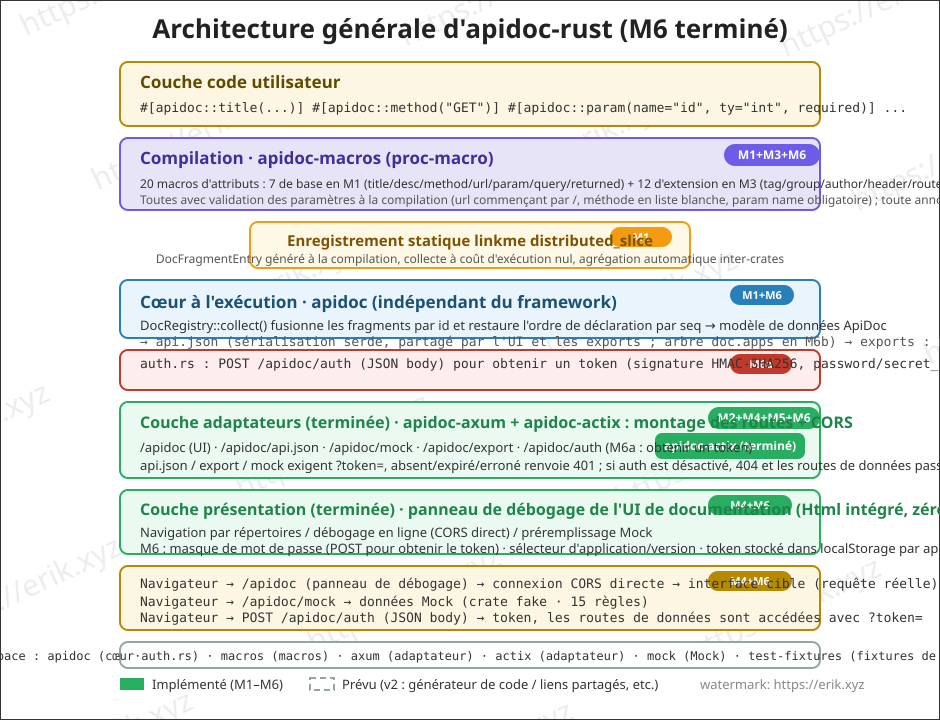
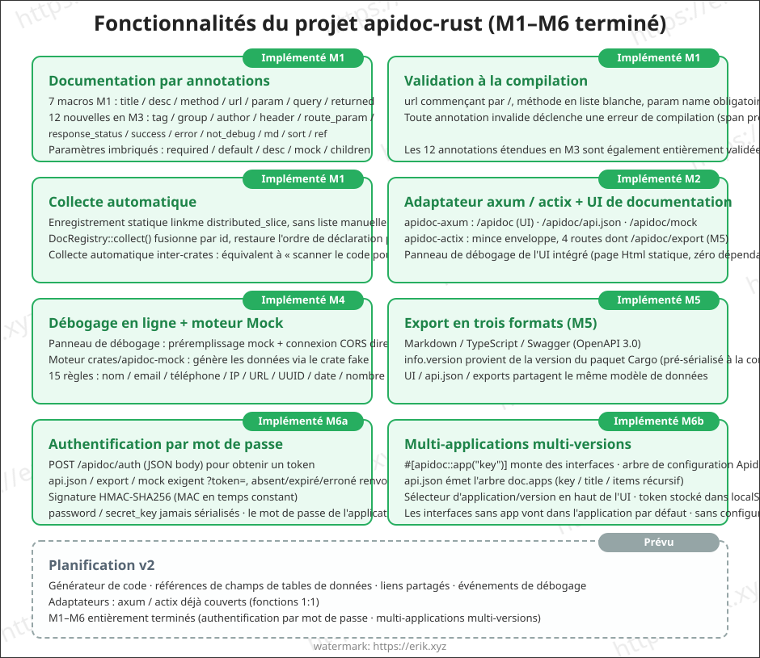
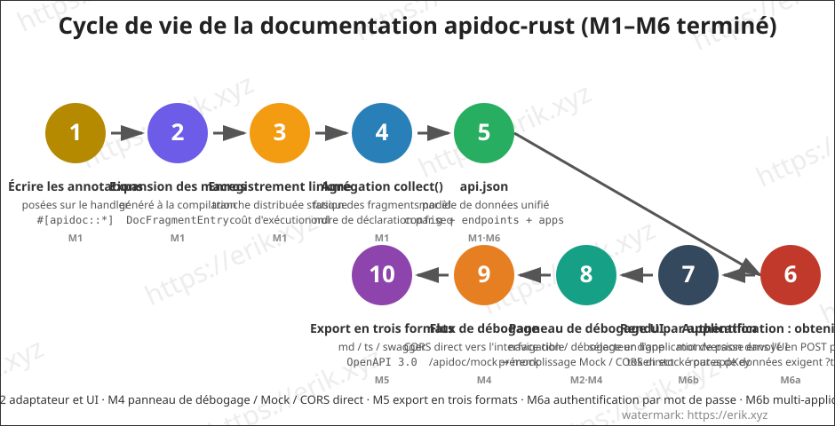

# Apidoc (apidoc-rust)

Boîte à outils de génération de documentation d'API et de développement d'interfaces basée sur les proc-macros Rust (proc-macro), compatible avec axum, actix-web et d'autres frameworks courants

[](https://github.com/erikwang2013/apidoc-rust)
[](https://github.com/erikwang2013/apidoc-rust)

[中文](../../README.md) ·
[English](README-en.md) ·
[한국어](README-ko.md) ·
[Русский](README-ru.md) ·
[Deutsch](README-de.md) ·
**[Français](README-fr.md)** ·
[Español](README-es.md) ·
[Português](README-pt.md) ·
[हिन्दी](README-hi.md) ·
[العربية](README-ar.md) ·
[বাংলা](README-bn.md) ·
[Bahasa Indonesia](README-id.md) ·
[日本語](README-ja.md)

## 📖Présentation du projet

Apidoc est une bibliothèque de plugins Rust qui génère automatiquement la documentation d'API en analysant les **proc-macros Rust (proc-macro)**, et reste compatible avec axum, actix-web et les autres frameworks courants. Outre la génération automatique de la documentation, elle intègre le débogage d'interfaces en ligne, les données Mock de débogage, la génération de code Json/TypeScript, un générateur d'interfaces et un générateur de code — couvrant tout le cycle de développement, de débogage et de livraison des interfaces, avec pour objectif d'améliorer l'efficacité du développement d'API. Depuis 2.2.0, elle expose aussi le **contrat de backend UIC-1**, consommé directement par le build Vue d'apidoc-ui ; l'UI native intégrée est conservée et l'on peut basculer entre les deux par configuration.

L'approche d'implémentation d'apidoc-rust :

- **Génération à la compilation** : la documentation est générée par les proc-macros à la compilation ; elle ne se désynchronise jamais du code ;
- **Collecte à coût nul** : enregistrement statique via linkme, une seule agrégation à l'exécution suffit pour obtenir toute la documentation des interfaces ;
- **Plugin générique** : le cœur est indépendant du framework HTTP et se connecte à n'importe quel framework via de minces adaptateurs (axum / actix-web).

### ✨Description du projet

- **Prêt à l'emploi** : aucune configuration complexe — après l'installation, il suffit d'écrire les annotations selon la documentation pour générer automatiquement la documentation de l'API.
- **Écriture simplifiée** : les références de champs `ref` / `table` et neuf formats de définition externes (OpenAPI, AsyncAPI, GraphQL, Proto, WSDL, EDMX, JSON Schema, JSON-RPC, XML-RPC) sont pris en charge via `#[apidoc::definition]` ; quelques annotations suffisent pour définir des champs complets.
- **Débogage en ligne** : déboguer les interfaces directement depuis la page de documentation, avec paramètres globaux, données Mock et événements de débogage.
- **Débogage multi-protocoles** : 45 annotations de protocole (RPC, messagerie, industriel, média, IoT, etc.) avec connexion directe depuis le navigateur et relais côté serveur ; les annotations génèrent à la fois la documentation du protocole et un panneau de débogage.
- **Contrat UIC-1** : `/apidoc/ui/v1/*` expose capabilities / config / menus / detail / docs / debug / share / cache / generator / export, de sorte qu'un seul build Vue apidoc-ui sert PHP, Go et Rust. L'UI statique Vue s'active via `ui` / `ui_path` (les paquets de release utilisent Vue par défaut, la bibliothèque conserve l'UI native intégrée).
- **Multi-applications/multi-versions** : projets mono-application, multi-applications et multi-versions configurables ; les interfaces sont regroupées et permutables par application/version.
- **Groupes/Tags** : les interfaces prennent en charge les groupes multi-niveaux et les marqueurs Tag.
- **Documentation Markdown** : l'annotation `md` monte un contenu Markdown comme page de documentation.
- **Génération Json/TypeScript** : chaque interface génère automatiquement des exemples de requête/réponse Json et des définitions de types TypeScript, directement utilisables côté frontend.
- **Générateur de code** : configuration + modèles suffisent pour générer le code métier et les fichiers Api du frontend.
- **Partage d'interfaces** : générer des liens de partage pour une application/interface donnée et exporter `swagger.json`.
- **Accès sécurisé** : mot de passe global et mots de passe indépendants par application/version ; le débogage côté serveur est désactivé par défaut et applique le garde SSRF ainsi que des plafonds taille/frames/timeout ; les fichiers de définition et les protocoles industriels ont des limites strictes ; la documentation est matérialisée à la compilation, avec des réponses locales sous 10 ms p99.

## Fonctionnalités

### Implémenté (M1-M3)

- **Documentation par annotations** : sept macros d'attributs principales — `title` / `desc` / `method` / `url` / `param` / `query` / `returned` — plus `tag` / `group` / `header` / `table` et 45 annotations de protocole ; les paramètres acceptent l'imbrication `required` / `default` / `desc` / `mock` / `children` / `field`
- **Validation à la compilation** : l'url doit commencer par `/`, méthode soumise à une liste blanche, `name` de paramètre obligatoire, etc. ; toute annotation invalide déclenche une erreur de compilation (span précis)
- **Collecte automatique** : enregistrement statique via linkme `distributed_slice`, sans liste manuelle d'interfaces ; `DocRegistry::collect()` fusionne par id et restaure l'ordre de déclaration par seq, avec collecte automatique inter-crates
- **Sortie api.json** : sérialisation serde du modèle de données unifié de la documentation (config + endpoints), les noms de champs sont partagés entre le modèle et les exportateurs
- **Adaptateur axum + UI de documentation intégrée** : monter la route suffit pour obtenir la page de documentation, navigation par répertoires groupés (M2)
- **Complément d'annotations** : 12 nouvelles annotations `tag` / `group` / `author` / `header` / `route_param` / `response_status` / `success` / `error` / `not_debug` / `md` / `sort` / `ref` (M3)

### Implémenté (M4)

- **Débogage en ligne** : la page de documentation intègre un panneau « Débogage en ligne » — Base URL préremplie avec `location.origin` pour une connexion directe inter-domaines au service cible, préremplissage du formulaire de paramètres avec les valeurs Mock, remplacement des placeholders de route `{name}` / `:name`, paramètres GET/HEAD fusionnés dans la query string, corps JSON assemblé pour les autres méthodes, édition des en-têtes de requête + en-têtes personnalisés, affichage de la réponse (statut / temps / pretty JSON), avertissement jaune en cas d'échec CORS
- **Moteur Mock** (`crates/apidoc/src/mock.rs`, dépend du crate fake, 15 règles : name / company / email / phone / url / ip / city / country / text / number / int / float / bool / uuid / date). Priorité des règles : `mock="fake:xxx"` suit la table des règles fake (nom inconnu → valeur par défaut) → les autres valeurs mock non vides sont renvoyées telles quelles (p. ex. `mock="1"`, `mock="erik"`) → sans mock, génération automatique selon `ty` (int→`"1"`, float→`"0.5"`, bool→`"true"`, object→`"{}"`, string→`"string"`) ; les children sont imbriqués récursivement, les array ont fixé 2 éléments
- **Interface mock** : l'adaptateur axum ajoute `GET /apidoc/mock?url=&method=`, correspondance exacte url + method, 404 si aucune correspondance ; le panneau de débogage masque par défaut les endpoints `not_debug`, qui n'apparaissent qu'en cochant « Afficher les interfaces not_debug »
- **Connexion CORS directe** : le débogage en ligne connecte le navigateur directement à l'endpoint cible, autorisé par le `cors_layer` de l'adaptateur ; le relais côté serveur est assuré par les exécuteurs P2–P5

### Implémenté (M5)

- **Export en quatre formats** (`crates/apidoc/src/export/`) : markdown / typescript / swagger (OpenAPI 3.0.0) / AsyncAPI 2.6 (P6) ; le crate cœur fournit `export::markdown::render` / `export::typescript::render` / `export::swagger::render` / `export::asyncapi::render`
- **Routes d'export** : les adaptateurs ajoutent `GET /apidoc/export?format=md|ts|swagger|asyncapi`, format inconnu → 400 ; Content-Type : `text/markdown` / `application/typescript` / `application/json`
- **markdown** : sommaire par groupe + table de paramètres + bloc de réponse ; **typescript** : génère les types `{Name}Params` / `{Name}Result` par namespace de groupe, les interfaces non groupées tombent dans `defaultGroup` (`default` est un mot réservé TS) ; **swagger** : `info.version` privilégie `ApidocConfig.version` et retombe sur la version du paquet Cargo (actuellement 2.2.0)
- **Adaptateur actix-web** (`crates/apidoc/src/actix.rs`) : fonctionnalités 1:1 avec l'adaptateur axum — `apidoc_routes(ApidocConfig) -> Scope` monte /apidoc, /apidoc/api.json, /apidoc/mock, /apidoc/export, `cors_layer(CorsConfig)` autorise le CORS
- **UI partagée** : l'UI de documentation (`src/ui.html`) remonte dans le crate cœur, exportée en `pub const UI_HTML`, les deux adaptateurs référencent la même copie (sûr pour l'empaquetage de publication)

### Implémenté (M6)

- **Authentification par mot de passe (M6a)** : avec `AuthConfig { enable, password, secret_key, expire }` activé, le client appelle `POST /apidoc/auth` (corps JSON `{"password": "...", "appKey": "..."}`) pour obtenir un token ; les routes de données `/apidoc/api.json`, `/apidoc/export`, `/apidoc/mock` exigent `?token=xxx` ; token manquant/expiré/incorrect → 401 et l'UI de documentation affiche un masque de mot de passe. Le mot de passe circule dans le corps de la requête (jamais dans l'URL, les logs ou l'historique du navigateur), est comparé à temps constant côté serveur et n'est jamais haché côté client. Le token est un token signé sans état `base64url(payload).base64url(HMAC-SHA256(payload))` avec un payload `{"exp": …}` ; sa clé de signature est dérivée de `secret_key` et de l'identifiant, donc changer le mot de passe invalide tous les tokens émis. Les tokens n'utilisent que des caractères compatibles URL, ils s'insèrent donc directement dans les liens de partage
- **Ligne rouge de sécurité de l'authentification** : `password` / `secret_key` ne sont jamais sérialisés ; la sortie api.json est identique octet par octet à celle avec authentification désactivée ; quand auth est désactivé, `/apidoc/auth` renvoie 404 et les routes de données laissent passer directement ; si une application configure son propre mot de passe, celui-ci prévaut sur le global, et un mot de passe vide (global ou par application) échoue toujours de façon sûre, côté émission comme côté vérification ; `secret_key` retombe sur une **clé aléatoire par processus** (les tokens meurent au redémarrage — il n'existe aucune clé par défaut publique), `expire` vaut 86400 secondes par défaut ; les connexions échouées répétées sont traitées avec un backoff exponentiel (aucune pénalité pour les 3 premières, puis 1s → 2s → … plafonné à 60s, réinitialisé en cas de succès) ; chaque réponse contenant des identifiants/un token porte `Cache-Control: no-store`
- **Multi-applications multi-versions (M6b)** : `ApidocConfig.apps: Vec<AppConfig>` (`key` / `title` / `items` sous-versions récursives / `password`) configure l'arbre d'applications ; `#[apidoc::app("key")]` attache l'interface à l'application de cette key et les interfaces sans key tombent dans l'application par défaut ; la sortie api.json ajoute l'arbre `doc.apps` ; un sélecteur d'application/version apparaît en haut de l'UI et les tokens sont stockés séparément dans localStorage par appKey (différentes applications peuvent avoir des mots de passe indépendants)

### Implémenté (v2)

- **Références de champs de tables de données (`table`)** : `#[apidoc::table("user")]` **aplatit** les champs de la table configurée par key dans `ApidocConfig.tables` et les fusionne dans `returned` (même sémantique que `ref`, à la différence près que la source de données est une table de configuration et non un autre endpoint) ; les champs prennent en charge `required` / `default` / `desc` / `mock` ; une key non configurée ne produit qu'un avertissement stderr ; sans cette annotation, la sortie est identique octet par octet à la v1
- **Matérialisation à la compilation** : api.json, exports, templates de codegen et réponses `/apidoc/mock` sont générés une fois au montage des routes ; les requêtes ne font plus qu'une lecture de table. `ApidocConfig.cache` est conservé pour compatibilité, mais les réponses mock n'ont plus besoin de mémorisation à la requête
- **Liens de partage** : `GET /apidoc/share?app=&url=&method=&base=` → `{"url":"…"}` en lien profond (`?app=<key>&ep=<url de l'interface>&method=<méthode>[&token=…]`) ; chaque interface de la page de documentation dispose d'un bouton « Partager » (copie dans le presse-papiers, avec repli sur un champ copiable en cas d'échec), et l'ouverture du lien profond positionne directement sur cette application/interface ; lorsque l'authentification est active, le lien embarque un token émis par le serveur (le mot de passe de l'application prévalant sur le global) et s'ouvre sans mot de passe
- **Générateur de code** : `GET /apidoc/generate?template=<name>` → le texte rendu (template inconnu — 404) ; trois templates intégrés : `api.ts` (fichier Api frontend), `handler.rs` (squelette d'interface Rust) et `schema.sql` (instructions CREATE TABLE générées depuis `tables`) ; un template du même nom dans `ApidocConfig.codegen` remplace celui intégré. La syntaxe de template ne comporte que deux constructions : `{{variable}}` (conservée telle quelle si non définie) et `{{#each list}}…{{/each}}` (imbriquables, p. ex. `tables` × `fields`)
- **Événements de débogage** : le panneau de débogage en ligne gagne des zones « Script avant / Script après » repliables (persistées dans localStorage) — le script avant s'exécute via `new Function('ctx', code)` avant la requête et peut modifier `ctx.url/method/headers/body` ou renvoyer un objet fusionné en surface ; le script après s'exécute après la réponse, peut lire `status/ms/text/url/method/ep` et, en renvoyant une chaîne, remplacer le texte de réponse affiché ; une erreur de script n'est signalée que dans la zone de résultat et n'interrompt pas la requête

### Implémenté (v2.2 · UIC-1)

- **Contrat de backend UIC-1 (Contract 1.0)** : `/apidoc/ui/v1/*` fournit capabilities / config / menus / detail / docMenus / docDetail / verifyAuth / sessions de débogage / enregistrements de partage / cache / modèles de code / export global. `capabilities` ne signale que ce que ce build a réellement compilé, afin que l'UI puisse masquer les entrées indisponibles. Rust déclare `share.actions=false`, `cache.mode=build`, générateur `forms=false` / `templates=true`, et uniquement le relais unaire (`relay-unary`).
- **Neuf formats de définition externes** : `#[apidoc::definition(file = "...", operation = "...")]` analyse OpenAPI, AsyncAPI, GraphQL, Proto, WSDL, EDMX, JSON Schema, JSON-RPC et XML-RPC en une charge uniforme `{format, source, operation, meta, messages, validation}` ; `/apidoc/ui/v1/detail` renvoie `definitions` avec des diagnostics par élément (`path` / `line` / `column` / `severity` / `message`). Les définitions n'entrent jamais dans api.json, l'UI native et l'ancienne sortie restent inchangées.
- **UI statique Vue** : `ui: UiMode::Vue` + `ui_path` sert le build `dist/uic1-ui/` d'apidoc-ui ; `ApidocConfig::release(title, ui_path)` est le point d'entrée des paquets de release (la bibliothèque conserve par défaut l'UI native intégrée). Comprend le fallback SPA, `config.js` / `assets/*`, la protection contre les évasions de chemin et liens symboliques, et un démarrage fail-closed si `ui_path` ou `index.html` manque.
- **Rapport complet des capacités de relais** : `capabilities.debug.relay` ne liste que les exécuteurs compilés dans ce build ; `debug-all` agrège les 30 ids de protocole, de sorte que l'UI ne propose jamais un exécuteur qui échoue avec « not compiled ».
- **Correctifs industriels et limites de ressources** : DNP3 analyse les en-têtes d'objet après IIN et plafonne chaque réponse à 10 000 points ; IEC 60870-5-104 plafonne chaque réponse à 10 000 lignes ; BACnet/IP émet une requête ReadProperty valide ; un débordement u16 du nombre de points DNP3 est corrigé.

## Documentation et débogage multi-protocoles (P1–P6)


- **45 annotations de protocole** plus la forme générique `#[apidoc::protocol("kind", ...)]` ; `event` déclare les messages de flux et `param(..., field = "1")` les numéros de champ du protocole.
- **Débogage direct dans le navigateur** (sans dépendance Rust) : SOAP, GraphQL (y compris les subscriptions), JSON-RPC, XML-RPC, OData, MCP, A2A, Webhooks, WebSocket (texte/binaire), SSE, Socket.IO, STOMP (y compris binaire), WebRTC/DataChannel, HLS.
- **Exécuteurs côté serveur** (feature-gated) : HTTP/2, HTTP/3, gRPC, Thrift, Dubbo/Hessian2, ISO 8583, TCP/UDP/Raw/Unix, MQTT, AMQP, Kafka, XMPP, STOMP/TCP, CoAP, LwM2M, Modbus, DNP3, IEC 104, BACnet/IP, OPC UA, RTP/RTCP/RTSP/SIP/RTMP. `debug-all` les active tous.
- **P6** : capture de webhooks, export AsyncAPI 2.6, import `.proto`/`.thrift` via la CLI `apidoc-idl`, registre Dubbo Nacos, exemples de mock issus des événements.
- **Capacités de relais UIC-1** : `GET /apidoc/ui/v1/capabilities` ne signale sous `features.debug.relay` que les exécuteurs compilés dans ce build. Rust est unaire (`modes` contient `relay-unary`, pas `relay-stream`) ; un build `debug-all` signale les 30 ids de protocole :

| feature | ids de protocole relais |
|---|---|
| `debug-http` | `http` `http2` |
| `debug-session` | `websocket` |
| `debug-grpc` | `grpc` |
| `debug-thrift` | `thrift` |
| `debug-dubbo` | `dubbo` `hessian` |
| `debug-iso8583` | `iso8583` |
| `debug-mqtt` | `mqtt` |
| `debug-amqp` | `amqp` |
| `debug-kafka` | `kafka` |
| `debug-xmpp` | `xmpp` |
| `debug-sockets` | `stomp` `tcp` `udp` `raw` `unix` |
| `debug-coap` | `coap` `lwm2m` |
| `debug-industrial` | `modbus` `dnp3` `iec104` `bacnet` `opcua` |
| `debug-media` | `rtp` `rtcp` `rtsp` `sip` `rtmp` |
| `debug-http3` | `http3` |

Hormis `websocket`, les exécuteurs de streaming ne sont pas encore branchés aux sessions de relais ; Kafka / AMQP / XMPP et similaires collectent une réponse unaire. `debug-all` n'agrège que les features ci-dessus.
- **Sécurité** : le débogage côté serveur est désactivé par défaut et exige une authentification globale ; le garde SSRF résout et valide chaque IP puis épingle la connexion ; redirections/proxys et métadonnées cloud sont refusés ; taille/frames/timeout sont plafonnés ; les réponses DNP3 sont plafonnées à 10 000 points et IEC 104 à 10 000 lignes (erreur stricte au-delà), afin que de petites trames ne puissent pas amplifier la sortie analysée ; les protocoles sans TLS épinglé échouent en fail-closed.
- **Performance** : documentation, exports, codegen et corps mock sont matérialisés à la compilation ; les routes locales apidoc restent sous 10 ms p99 (`tests/latency.rs`).

## Architecture



## Fonctionnalités



## Cycle de vie



## Structure du projet

```
apidoc-rust/
├── Cargo.toml                 # configuration du workspace (resolver 2)
├── VERSION                    # version du projet (v2.2.0)
├── crates/
│   ├── apidoc/                # cœur d'exécution (agnostique du framework)
│   │   ├── src/lib.rs         # modèle de données + agrégation DocRegistry + api.json + UI_HTML + UiMode
│   │   ├── src/auth.rs        # authentification par mot de passe M6a (émission/vérification de jeton HMAC + garde + backoff)
│   │   ├── src/uiapi.rs       # contrat UIC-1 : capabilities / menus / detail / docs / routes de gestion
│   │   ├── src/protocol_defs/ # neuf formats de définition externes (OpenAPI/AsyncAPI/GraphQL/proto/…)
│   │   ├── src/export/        # exports : markdown / typescript / swagger / asyncapi + codegen
│   │   ├── src/debug/         # exécuteurs côté serveur feature-gated (http / grpc / sockets / mqtt / industrial / media / …)
│   │   ├── src/axum.rs        # adaptateur axum (docs/debug/stream/webhook/UIC-1/UI statique + CORS)
│   │   ├── src/actix.rs       # adaptateur actix-web (feature `actix`, 1:1 avec axum)
│   │   ├── src/ui.html        # UI native intégrée ; le build statique Vue est servi via ui/ui_path
│   │   ├── tests/             # tests d'intégration (macros/agrégation/sérialisation/UIC-1/définitions/latence)
│   │   └── examples/demo.rs   # exemple : annotations + sortie api.json
│   ├── apidoc-macros/         # proc-macro : 24 annotations de base + 45 alias de protocole
│   │   └── src/lib.rs         # définitions des macros + analyse des arguments + validation à la compilation
│   ├── apidoc-idl/            # CLI autonome `.proto` / `.thrift` → annotation apidoc
│   └── apidoc-test-fixtures/  # fixtures de test d'enregistrement entre crates
├── contract/                  # UIC-1 Contract 1.0 : schéma + fixtures inter-backends
├── .github/
│   └── workflows/release.yml  # workflow de release (lit VERSION, crée tag+release de façon incrémentale)
└── docs/
    ├── images/                # ressources architecture/fonctionnalités/cycle de vie/multi-protocole/aperçu social
    └── i18n/                  # documentation multilingue (12 langues)
```

## Mode d'emploi

### 1. Ajouter les dépendances

```toml
[dependencies]
apidoc-rust = "2.2"        # ou path = "crates/apidoc"

serde_json = "1"      # pour la sortie api.json
linkme = "0.3"        # requis : le code d'enregistrement généré par la macro s'y réfère
```

> Adaptateur à choisir selon le framework Web : `features = ["axum"]` pour axum, `features = ["actix"]` pour actix-web (les deux ont des fonctionnalités 1:1). `mock` (moteur Mock) est une dépendance interne du framework, importée automatiquement par l'adaptateur ; le consommateur n'a généralement pas besoin de l'utiliser directement.

### 2. Écrire les annotations

En posant des annotations sur les fonctions handler, la documentation est générée à la compilation :

```rust
use apidoc::*;

#[apidoc::title("获取用户信息")]
#[apidoc::desc("根据用户 ID 查询用户详情")]
#[apidoc::url("/api/user/info")]
#[apidoc::method("GET")]
#[apidoc::param(name = "user_id", ty = "int", required, desc = "用户ID", mock = "1")]
#[apidoc::query(name = "lang", ty = "string", desc = "语言", default = "zh-CN")]
#[apidoc::returned(
    name = "data",
    ty = "object",
    desc = "用户数据",
    children = [
        { name = "id", ty = "int", required, desc = "用户ID" },
        { name = "name", ty = "string", required, desc = "用户名", mock = "erik" },
    ]
)]
fn get_user_info() -> String {
    unimplemented!()
}
```

### 3. Collecter et exporter

```rust
fn main() {
    let doc = DocRegistry::collect_doc(ApidocConfig {
        title: "Mon API".to_string(),
        description: None,
        auth: None,    // authentification M6a, voir « 8. Authentification par mot de passe »
        apps: vec![],  // M6b multi-applications multi-versions, voir « 9. Multi-applications multi-versions »
    });
    println!("{}", serde_json::to_string_pretty(&doc).unwrap());
}
```

### 4. Exécuter l'exemple

```bash
cargo run --example demo -p apidoc
```

Sortie (extrait) :

```json
{
  "config": { "title": "demo api" },
  "endpoints": [
    {
      "title": "获取用户信息",
      "desc": "根据用户 ID 查询用户详情",
      "url": "/api/user/info",
      "method": "GET",
      "params": [
        { "name": "user_id", "type": "int", "required": true, "desc": "用户ID", "mock": "1" }
      ],
      "querys": [
        { "name": "lang", "type": "string", "required": false, "default": "zh-CN", "desc": "语言" }
      ],
      "returned": [
        {
          "name": "data",
          "type": "object",
          "required": false,
          "desc": "用户数据",
          "children": [
            { "name": "id", "type": "int", "required": true, "desc": "用户ID" },
            { "name": "name", "type": "string", "required": true, "desc": "用户名", "mock": "erik" }
          ]
        }
      ]
    }
  ]
}
```

### 5. Débogage en ligne et Mock (M4)

Ouvrez la page de documentation → sélectionnez une interface → le panneau « Débogage en ligne » à droite préremplit les paramètres selon les règles Mock → pointez la Base URL vers l'adresse du service cible (par défaut `location.origin`, connexion directe inter-domaines) → cliquez sur Envoyer pour obtenir la réponse réelle (code de statut / temps / pretty JSON). Le panneau de débogage masque par défaut les endpoints `not_debug`, qui n'apparaissent qu'après avoir coché « Afficher les interfaces not_debug ».

**Exigence CORS** : le débogage en ligne connecte le navigateur directement à l'interface cible ; le service cible doit monter le `cors_layer` fourni par l'adaptateur pour autoriser les requêtes inter-domaines ; en cas d'échec CORS, le panneau affiche un avertissement jaune.

Syntaxe des règles Mock (trois niveaux de priorité) :

```rust
#[apidoc::param(name = "email", ty = "string", desc = "邮箱", mock = "fake:email")]  // généré par la règle fake
#[apidoc::param(name = "status", ty = "string", desc = "状态", mock = "1")]          // mock non vide renvoyé tel quel
#[apidoc::param(name = "name", ty = "string", desc = "用户名")]                       // sans mock : génération automatique selon ty
#[apidoc::returned(
    name = "data",
    ty = "object",
    children = [
        { name = "id", ty = "int", required },       // sans mock → "1"
        { name = "email", ty = "string", mock = "fake:email" },  // imbrication récursive des children
    ]
)]
fn create_user() -> String {
    unimplemented!()
}
```

15 règles fake intégrées : `name` / `company` / `email` / `phone` / `url` / `ip` / `city` / `country` / `text` / `number` / `int` / `float` / `bool` / `uuid` / `date` ; un nom de règle inconnu revient à la valeur par défaut. Génération automatique sans mock : int→`"1"`, float→`"0.5"`, bool→`"true"`, object→`"{}"`, string→`"string"` ; les array ont fixé 2 éléments.

### 6. Export en ligne (M5)

Les adaptateurs intègrent des routes d'export en quatre formats, utilisables dès le branchement (format inconnu → 400) :

```bash
GET /apidoc/export?format=md        # sommaire par groupe + table de paramètres + blocs de réponse (text/markdown)
GET /apidoc/export?format=ts        # génère les types {Name}Params / {Name}Result par namespace de groupe (application/typescript)
GET /apidoc/export?format=swagger   # fichier descriptif OpenAPI 3.0.0 (application/json)
GET /apidoc/export?format=asyncapi  # AsyncAPI 2.6 event/streaming spec (application/json)
```

- **markdown** : idéal à coller dans le Wiki du projet / les notes de version, sommaire par groupe, chaque interface avec table de paramètres et bloc de réponse ;
- **typescript** : le front peut coller directement les définitions de types ; les interfaces non groupées tombent dans le namespace `defaultGroup` (`default` est un mot réservé TS, il ne peut pas servir d'identifiant) ;
- **swagger** : `info.version` provient de `ApidocConfig.version` (la version d'API documentée), avec repli sur la version du paquet apidoc-rust (actuellement 2.2.0) ; les paramètres de chemin proviennent du template d'URL, la spécification est donc directement importable dans Swagger UI ou un générateur de code.
- **asyncapi** : canaux/opérations/messages pour WebSocket, SSE, MQTT, Kafka, STOMP et autres endpoints événementiels (AsyncAPI 2.6).

### 7. Adaptateur actix-web

Si le framework Web est actix-web, branchez `features = ["actix"]` (fonctionnalités 1:1 avec l'adaptateur axum) :

```toml
[dependencies]
apidoc-rust = { version = "2.2", features = ["actix"] }
```

```rust
use actix_web::{App, HttpServer};
use apidoc::actix::{apidoc_routes, cors_layer, CorsConfig};
use apidoc::ApidocConfig;

#[actix_web::main]
async fn main() -> std::io::Result<()> {
    HttpServer::new(|| {
        App::new()
            .service(apidoc_routes(ApidocConfig {
                title: "Mon API".to_string(),
                description: None,
                auth: None,    // authentification M6a, voir « 8. Authentification par mot de passe »
                apps: vec![],  // M6b multi-applications multi-versions, voir « 9. Multi-applications multi-versions »
            }))
            .wrap(cors_layer(CorsConfig::default()))   // autorisation CORS du débogage en ligne (M4)
    })
    .bind("127.0.0.1:8080")?
    .run()
    .await
}
```

Une fois montés, `/apidoc` (UI de documentation), `/apidoc/api.json` (données), `/apidoc/mock` (Mock) et `/apidoc/export` (export) sont accessibles. La configuration CORS vide — ou `["*"]` — autorise littéralement `*` (sans cookies) ; une liste blanche `allow_origins` correspond exactement en reflétant l'Origin ; aucun des deux modes n'envoie de cookies.

### 8. Authentification par mot de passe (M6a)

Une fois `auth` activé, l'accès à la documentation exige un mot de passe (tokens signés HMAC-SHA256, comparaison à temps constant côté serveur, backoff des connexions) :

> **Changement incompatible en 2.0** : l'endpoint de connexion passe de `GET /apidoc/auth?password=…` à `POST /apidoc/auth` (corps JSON), et les tokens passent de l'enveloppe précédente à des tokens signés HMAC-SHA256 — **les anciens tokens et les anciennes façons d'appeler ne fonctionnent plus**, les clients doivent envoyer un POST. Les déploiements sans `secret_key` explicite perdent aussi les tokens émis au redémarrage (une clé aléatoire par processus est utilisée ; aucun défaut public n'existe).

```rust
use apidoc::auth::AuthConfig;

let doc = DocRegistry::collect_doc(ApidocConfig {
    title: "Mon API".to_string(),
    description: None,
    auth: Some(AuthConfig {
        enable: true,
        password: "your-password".to_string(),
        secret_key: "your-secret-key".to_string(), // par défaut, une clé aléatoire par processus : un redémarrage invalide les tokens ; à définir explicitement pour les déploiements multi-instances
        expire: 86400,                             // secondes ; par défaut 86400
    }),
    apps: vec![],
});
```

**Déroulement** :

1. Le client appelle `POST /apidoc/auth` (corps JSON `{"password": "...", "appKey": "<key>"}` ; `appKey` sélectionne une application ayant son propre mot de passe) pour obtenir un token (succès → `{"token":"..."}`, mot de passe incorrect → 401, corps mal formé → 400) ; le mot de passe circule dans le corps — jamais dans l'URL ni dans les logs — et n'est jamais haché côté client. Si auth est désactivé, cette route renvoie 404 et les routes de données laissent passer directement
2. Les routes de données `GET /apidoc/api.json`, `/apidoc/export`, `/apidoc/mock` exigent `?token=xxx` (ainsi que `&appKey=` lorsqu'une application précise est sélectionnée) ; token manquant/expiré/incorrect → 401 et l'UI de documentation ouvre automatiquement le masque de mot de passe ; après saisie, le front l'envoie directement en POST pour l'échanger contre un token
3. Le token est `base64url(payload).base64url(HMAC-SHA256(payload))` avec un payload `{"exp": <secondes unix>}` ; la clé de signature est HMAC-SHA256(`secret_key`, identifiant), donc changer le mot de passe invalide immédiatement les anciens tokens. La vérification compare le MAC à temps constant puis contrôle l'expiration ; les tokens n'utilisent que des caractères compatibles URL
4. `password` / `secret_key` ne sont jamais sérialisés ; la sortie api.json est identique octet par octet à celle avec authentification désactivée ; si une application configure son propre `password`, le mot de passe de l'application prévaut sur le global, et un mot de passe vide (global ou par application) échoue toujours de façon sûre
5. Les connexions échouées répétées sont traitées avec un backoff exponentiel (aucune pénalité pour les 3 premières, puis 1s → 2s → … plafonné à 60s, réinitialisé en cas de succès) ; les réponses contenant des identifiants/un token portent `Cache-Control: no-store`

### 9. Multi-applications multi-versions (M6b)

Un projet peut être découpé en plusieurs applications/versions, chacune avec son propre affichage et contrôle d'accès :

```rust
#[apidoc::title("获取用户信息")]
#[apidoc::app("demo")]   // attache à l'application de key="demo" ; les interfaces sans app tombent dans l'application par défaut
fn get_user_info() -> String {
    unimplemented!()
}
```

```rust
let doc = DocRegistry::collect_doc(ApidocConfig {
    title: "Mon API".to_string(),
    description: None,
    auth: None,
    apps: vec![
        AppConfig {
            key: "demo".to_string(),
            title: "演示应用".to_string(),
            items: vec![AppConfig {
                key: "v1".to_string(),
                title: "v1".to_string(),
                items: vec![],
                password: None,
            }],
            password: None, // mot de passe d'accès indépendant de l'application, prévaut sur le global, jamais sérialisé
        },
    ],
});
```

- `AppConfig { key, title, items, password }` : `key` est l'identifiant unique référencé par l'annotation `#[apidoc::app("key")]` ; `items` imbrique récursivement les sous-versions/sous-applications ; `password` est le mot de passe d'accès indépendant de l'application (avec mot de passe indépendant, seul le token de l'application est validé)
- La sortie api.json ajoute l'arbre `doc.apps` (key / title / items / endpoints) ; un sélecteur d'application/version apparaît en haut de l'UI ; au changement, les interfaces sont rendues selon ce nœud et les données sont rechargées ; les tokens sont stockés séparément dans localStorage par appKey
- Si l'annotation `app` référence une key non configurée dans `apps`, avertissement stderr et chute dans l'application par défaut ; sans annotation `app` ni `apps` configuré, la sortie est identique octet par octet à M5

### 10. Références de champs de tables de données · cache de documentation (v2)

```rust
ApidocConfig {
    // structure des tables fournie par la configuration (le côté Rust ne se connecte pas à la base), l'annotation référence par key
    tables: vec![TableDef {
        key: "user".into(),
        title: "用户表".into(),
        fields: vec![
            TableField { name: "id".into(), ty: "int".into(), required: true, desc: Some("用户ID".into()), ..Default::default() },
            TableField { name: "name".into(), ty: "string".into(), mock: Some("erik".into()), ..Default::default() },
        ],
    }],
    // cache de documentation : la sortie de /apidoc/mock est mémorisée par (url, method) et reconstruite après ttl secondes (0 = définitif)
    cache: Some(CacheConfig { enable: true, ttl: 60 }),
    ..Default::default()   // title / description / auth / apps / codegen se configurent comme d'habitude
}
```

Sur le handler, même écriture que pour `ref` : `#[apidoc::table("user")]`. Les champs sont aplatis dans le `returned` de cette interface ; une key absente de `tables` ne donne qu'un avertissement, pas d'erreur.

### 11. Liens de partage · génération de code (v2)

- `GET /apidoc/share?app=api&url=/api/user/info&method=GET&base=https://example.com` → `{"url":"https://example.com/apidoc?app=api&ep=%2Fapi%2Fuser%2Finfo&method=GET"}` (avec l'authentification activée, `&token=…` est ajouté en fin de lien, l'ouverture se fait sans mot de passe)
- `GET /apidoc/generate?template=api.ts` (ou `handler.rs` / `schema.sql`) → `text/plain; charset=utf-8` ; template inconnu — 404, paramètre manquant — 400
- Templates personnalisés (un nom identique remplace celui intégré) :

```rust
ApidocConfig {
    codegen: vec![CodegenTemplate {
        name: "api.ts".into(),
        template: "// {{title}}\n{{#each endpoints}}// {{method}} {{url}}\n{{/each}}".into(),
    }],
    ..Default::default()
}
```

Variables disponibles dans les templates : au niveau supérieur `title` / `description` ; dans `{{#each endpoints}}` : `title` / `url` / `method` / `group` / `desc` / `author` ; dans `{{#each tables}}` : `key` / `title`, et dans son `{{#each fields}}` : `name` / `ty` / `required` / `default` / `desc` / `mock` ; s'y ajoutent les variables dérivées `not_null` / `default_clause` / `comma` / `key_q` / `name_q` (pratiques pour générer directement du SQL valide ; les `*_q` sont des identifiants entre guillemets), ainsi que `url_js` / `method_js` dans `{{#each endpoints}}` (littéraux de chaîne JSON, prêts à insérer dans du code JS) et `fn_name` (un `{method}_{group}` assaini en identifiant pour le squelette Rust).

### 12. Scripts avant/après du débogage (v2)

Sur la page de documentation, le panneau « Débogage en ligne » permet de déplier « Script avant » et « Script après » (contenu stocké dans localStorage) :

```js
// script avant : exécuté juste avant l'envoi de la requête, peut modifier ctx.url / method / headers / body ou renvoyer un objet fusionné en surface
ctx.headers['X-Token'] = localStorage.getItem('token') || '';
```

```js
// script après : exécuté après la réponse, ctx = { status, ms, text, url, method, ep } (lecture seule)
// renvoyer une chaîne remplace le texte affiché dans la zone de résultat
return 'HTTP ' + ctx.status + ' · ' + ctx.ms + 'ms\n' + ctx.text;
```

Une erreur de script n'est signalée que dans la zone de résultat du débogage et n'interrompt pas la requête (en cas d'échec du script avant, la requête part normalement ; en cas d'échec du script après, la réponse d'origine s'affiche normalement).

### 13. UI : native / build statique Vue (UIC-1 Phase 5)

Par défaut, `/apidoc` sert l'UI native intégrée (`UiMode::Native`), donc les déploiements existants n'ont rien à changer. Le build Vue consomme le contrat UIC-1 de la section 14 et est partagé avec PHP et Go (apidoc-ui `npm run package:ui`) :

```rust
use apidoc::{ApidocConfig, UiMode};

let cfg = ApidocConfig {
    title: "Mon API".into(),
    ui: UiMode::Vue,
    ui_path: Some("/srv/apidoc".into()), // contenu de dist/uic1-ui/ : index.html + config.js + assets/
    ..Default::default()
};
```

- Les paquets de release utilisent Vue par défaut : `ApidocConfig::release("Mon API", "/srv/apidoc")` équivaut à la configuration explicite ci-dessus ; **la bibliothèque reste par défaut en `native`**.
- En mode Vue, `GET /apidoc` renvoie une redirection 307 vers `/apidoc/` (le build utilise des URLs relatives `./assets/...`), `/apidoc/`, `config.js` et `assets/*` sont lus depuis `ui_path`, et les chemins inconnus sans extension retombent sur `index.html` (fallback SPA).
- Les routes API gardent la priorité : `/apidoc/api.json`, `/apidoc/export`, `/apidoc/ui/v1/*`, auth, debug et webhook correspondent toujours avant les fichiers statiques ; les sous-chemins API inconnus renvoient 404 au lieu de la coque SPA.
- Sécurité : les chemins sont confinés à `ui_path` ; `..`, les contournements d'encodage et les évasions par lien symbolique renvoient 404, les répertoires ne sont jamais listés, et un `ui_path` / `index.html` manquant échoue au démarrage (fail closed). `ui` / `ui_path` sont réservés au serveur et ne sont jamais sérialisés dans api.json.
- Retour arrière : repasser à `ui: UiMode::Native` et redémarrer ; l'UI native et toutes les anciennes routes restent inchangées.

### 14. Contrat UIC-1 · définitions de protocoles externes

`/apidoc/ui/v1/*` est le contrat stable consommé par apidoc-ui (Contract 1.0) ; les réponses réussies sont `{code:0,message:"ok",data}` :

| Route | Objet |
|---|---|
| `GET /apidoc/ui/v1/capabilities` | Capacités du backend : contract / backend / version / features (dont la liste des protocoles relais compilés) |
| `GET /apidoc/ui/v1/config` | Configuration d'amorçage de l'UI (titre, arbre d'applications, commutateurs d'auth, …) |
| `POST /apidoc/ui/v1/menus` · `detail` | Catalogue et détail des endpoints, dont `definitions` et `validation` |
| `GET/POST /apidoc/ui/v1/docMenus` · `POST docDetail` | Catalogue et corps de la documentation Markdown |
| `POST /apidoc/ui/v1/verifyAuth` | Vérifier les jetons global / application / partage |
| `POST /apidoc/ui/v1/debugSend` · `debugStart` · `debugPoll` · `debugStop` | Débogage direct depuis le navigateur et par relais serveur |
| `POST /apidoc/ui/v1/addApiShare` · `getApiShareList` · `getApiShareDetail` · `deleteApiShare` · `handleApiShareAction` | CRUD des enregistrements de partage (Rust `share.actions=false` ; aucune action déclarative) |
| `POST /apidoc/ui/v1/cache/clear` · `cache/warm` | Gestion du cache (Rust `cache.mode=build`) |
| `POST /apidoc/ui/v1/renderCodeTemplate` · `exportAllData` | Rendu de modèles de code et export global (l'UI génère md / pdf / openapi / postman / asyncapi / typescript) |

Attachez une définition externe à un handler avec `#[apidoc::definition]` :

```rust
#[apidoc::title("Obtenir l'utilisateur")]
#[apidoc::url("/api/user/info")]
#[apidoc::method("GET")]
#[apidoc::definition(file = "api/openapi.yaml", operation = "getUser")]
fn get_user_info() -> String { unimplemented!() }
```

- **Neuf formats** : OpenAPI, AsyncAPI, GraphQL, Proto, WSDL, EDMX, JSON Schema, JSON-RPC et XML-RPC. Si `format` est omis, il est détecté d'après l'extension/contenu, ou peut être fixé explicitement.
- **Arguments optionnels** : `operation` (choisir une opération), `message` / `direction` (choisir un message), `sample` / `sample_file` / `sample_encoding` (échantillon de validation) et `strict` (par défaut `true` : les constructions non prises en charge sont des erreurs).
- **Sortie** : une charge uniforme `{format, source, operation, meta, messages, validation}` ; les diagnostics portent `path / line / column / severity / message`. Les définitions n'apparaissent que dans le détail UIC-1 et jamais dans api.json.
- **Limites** : les chemins sont relatifs au `CARGO_MANIFEST_DIR` du crate déclarant, et le realpath d'un lien symbolique doit rester dans la racine du crate ; chaque fichier est plafonné à 2 MiB / 50 000 lignes, avec au plus 64 imports et une profondeur d'import de 32.

## Feuille de route

| Phase | Contenu | Statut |
|------|------|------|
| M1 | squelette du workspace + modèle de données + MVP des macros + enregistrement linkme | ✅ Terminé |
| M2 | adaptateur axum + UI de documentation intégrée + répertoires groupés | ✅ Terminé |
| M3 | complément d'annotations (tag/group/author/header/route_param/response_status/success/error/not_debug/md/sort/ref) | ✅ Terminé |
| M4 | débogage en ligne + moteur Mock | ✅ Terminé |
| M5 | export markdown / typescript / swagger.json (OpenAPI3) | ✅ Terminé |
| —  | adaptateur actix-web (fonctionnalités 1:1 avec axum) | ✅ Terminé |
| M6a | Authentification par mot de passe (token signé HMAC-SHA256 + masque de mot de passe, mot de passe de l'application prévaut) | ✅ Terminé |
| M6b | Multi-applications multi-versions (arbre de config apps + annotation app + sélecteur d'UI) | ✅ Terminé |
| v2 | références de champs de tables de données + cache de documentation + liens de partage + générateur de code + événements de débogage | ✅ Terminé |
| UIC-1 Phase 0–2 | Contract 1.0 : capabilities / menus / detail / docs / debug / share / cache / generator / export, alignés sémantiquement entre backends | ✅ Terminé |
| UIC-1 Phase 3–4 | rapport complet des capacités de relais + neuf analyseurs de définitions externes branchés sur le détail UIC | ✅ Terminé |
| UIC-1 Phase 5 | UI statique Vue (`ui` / `ui_path` ; paquets de release en Vue par défaut, UI native conservée) | ✅ Terminé |

## Documentation multilingue

- [English](README-en.md)
- [한국어](README-ko.md)
- [Русский](README-ru.md)
- [Deutsch](README-de.md)
- [Français](README-fr.md)
- [Español](README-es.md)
- [Português](README-pt.md)
- [हिन्दी](README-hi.md)
- [العربية](README-ar.md)
- [বাংলা](README-bn.md)
- [Bahasa Indonesia](README-id.md)
- [日本語](README-ja.md)

## Soutien et dons

Si ce projet vous est utile, n'hésitez pas à nous soutenir avec une ⭐ Star, et les dons sont également les bienvenus pour l'open source !

### WeChat Pay (微信支付) / Alipay (支付宝)

| 微信支付 (WeChat Pay) | 支付宝 (Alipay) |
|---|---|
|  |  |

### Dons par virement international

**【Informations du bénéficiaire】**

- Nom du bénéficiaire : WANG KEXUN
- Numéro de compte : 881015918251

**【Banque du bénéficiaire】**

- Code SWIFT de ZA Bank : AABLHKHHXXX
- Nom de la banque : ZA Bank Limited
- Code banque : 387
- Adresse de la banque : Core F, Cyberport 3, 100 Cyberport Road, Hong Kong

**【Banque correspondante pour virements transfrontaliers (si nécessaire)】**

> Veuillez noter qu'il s'agit de la banque correspondante (banque intermédiaire) pour les virements transfrontaliers, et non de la banque du bénéficiaire. Renseignez-vous auprès de votre banque émettrice pour savoir si ces informations sont requises.

- **La banque correspondante pour les virements en HKD, CNY et USD est Citibank :**
  - Nom de la banque : Citibank N.A. Hong Kong
  - Code SWIFT : CITIHKHXXXX
  - Code banque : 006
  - Nom de l'agence : Hong Kong Branch
  - Code d'agence : 391
  - Adresse de la banque : Citibank Tower, Citibank Plaza, 3 Garden Road, Central, Hong Kong
- **La banque correspondante pour les autres devises est BNY Mellon :**
  - Nom de la banque : THE BANK OF NEW YORK MELLON
  - Code SWIFT : IRVTUS3NXXX
  - Adresse de la banque : THE BANK OF NEW YORK MELLON, 240 GREENWICH STREET, NEW YORK, États-Unis

## License

[MIT](../../LICENSE)
