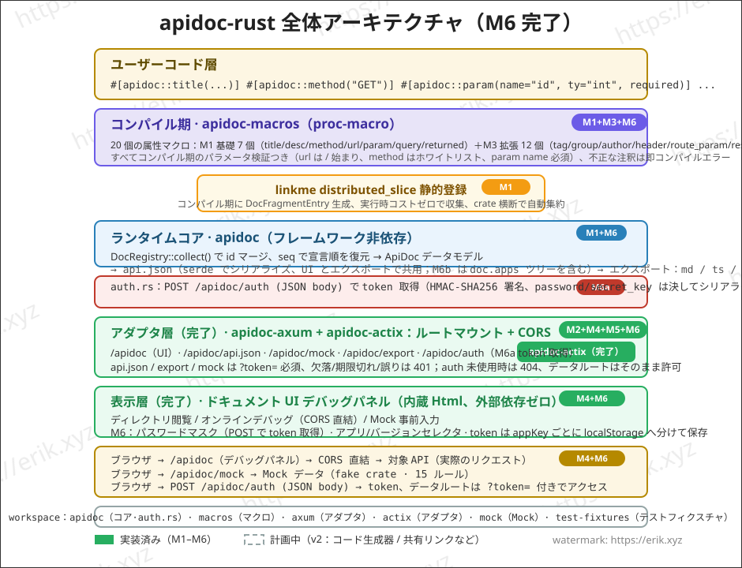
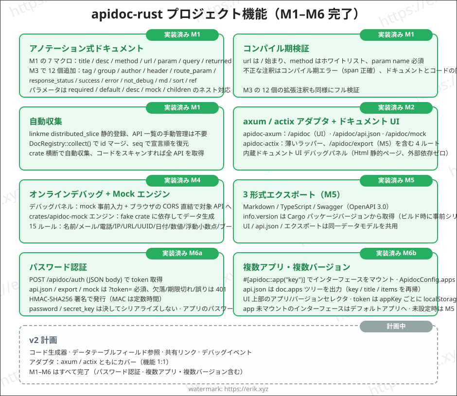
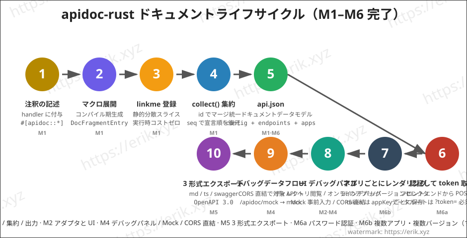

# Apidoc (apidoc-rust)

Rust の手続きマクロ（proc-macro）による API ドキュメント生成・インターフェース開発ツール。axum、actix-web など主要フレームワークに対応

[](https://github.com/erikwang2013/apidoc-rust)
[](https://github.com/erikwang2013/apidoc-rust)

[中文](../../README.md) ·
[English](README-en.md) ·
[한국어](README-ko.md) ·
[Русский](README-ru.md) ·
[Deutsch](README-de.md) ·
[Français](README-fr.md) ·
[Español](README-es.md) ·
[Português](README-pt.md) ·
[हिन्दी](README-hi.md) ·
[العربية](README-ar.md) ·
[বাংলা](README-bn.md) ·
[Bahasa Indonesia](README-id.md) ·
**[日本語](README-ja.md)**

## 📖プロジェクト紹介

Apidoc は **Rust の手続きマクロ（proc-macro）** を解析して API インターフェースドキュメントを自動生成する Rust プラグインライブラリで、axum、actix-web などの主要フレームワークに対応しています。ドキュメントの自動生成に加えて、オンラインインターフェースデバッグ、Mock デバッグデータ、Json/TypeScript コード生成、インターフェースジェネレータ、コードジェネレータなどの機能を統合し、インターフェースの開発・デバッグ・納品までの全工程をカバーして、API 開発効率の向上を目指しています。 2.2.0 からは **UIC-1 バックエンド契約**も提供し、apidoc-ui の Vue ビルドが直接利用します。組み込み native UI は維持され、設定でどちらかを選択できます。

apidoc-rust の実装方針：

- **コンパイル期生成**：ドキュメントは手続きマクロによりコンパイル期に生成され、ドキュメントとコードの同期が常に保たれます；
- **ゼロコスト収集**：linkme による静的登録で、実行時に一度集約するだけで全インターフェースドキュメントを取得できます；
- **汎用プラグイン**：コアは HTTP フレームワークに依存せず、薄いアダプタ（axum / actix-web）経由で任意のフレームワークに接続できます。

### ✨プロジェクト説明

- **すぐに使える**：面倒な設定は不要で、インストール後にドキュメントどおりに注釈を書くだけで API ドキュメントが自動生成されます。
- **簡単な記述**: `ref` / `table` フィールド参照と 9 種類の外部定義フォーマット（OpenAPI、AsyncAPI、GraphQL、Proto、WSDL、EDMX、JSON Schema、JSON-RPC、XML-RPC）を `#[apidoc::definition]` でサポート。数個のアノテーションでフィールド定義を完結できます。
- **オンラインデバッグ**：ドキュメントページ上でインターフェースを直接デバッグでき、グローバルパラメータの引き継ぎ、Mock データ、デバッグイベントに対応します。
- **マルチプロトコルデバッグ**: 45 のプロトコルアノテーション（RPC、メッセージング、産業、メディア、IoT など）をブラウザ直結とサーバーリレーの両チャネルで提供。アノテーションはプロトコルドキュメントとデバッグパネルの両方を生成します。
- **UIC-1 契約**: `/apidoc/ui/v1/*` が capabilities / config / menus / detail / docs / debug / share / cache / generator / export を提供し、apidoc-ui の 1 つの Vue ビルドで PHP・Go・Rust を支えます。静的 Vue UI は `ui` / `ui_path` で有効化します（リリースパッケージは既定で Vue、ライブラリ既定では組み込み native UI を維持）。
- **複数アプリ・複数バージョン**：単一アプリ、複数アプリ、複数バージョンのプロジェクトをいずれも設定でき、インターフェースはアプリ/バージョンごとにグループ化して表示・切り替えできます。
- **グループ・Tag**：インターフェースは多段階グループと Tag マーキングに対応します。
- **Markdown ドキュメント**：`md` 注釈で Markdown をドキュメントページとしてマウントできます。
- **Json・TypeScript 生成**：各インターフェースの Json リクエスト/レスポンス例と TypeScript 型定義を自動生成し、フロントエンドでそのまま利用できます。
- **コードジェネレータ**：設定 + テンプレートで業務コードとフロントエンドの Api ファイルを生成できます。
- **インターフェース共有**：指定したアプリ/インターフェースの共有リンクを生成し、`swagger.json` をエクスポートできます。
- **安全なアクセス**: グローバルパスワードとアプリ/バージョン別の独立パスワード。サーバー側デバッグは既定で無効で、SSRF ガードとサイズ/フレーム/タイムアウト上限を適用。定義ファイルと産業プロトコルには厳格な上限があり、ドキュメントはビルド時に生成、ローカル応答は 10ms p99 未満です。

## 特徴

### 実装済み（M1–M3）

- **アノテーションによるドキュメント**: 7 つの基本属性マクロ `title` / `desc` / `method` / `url` / `param` / `query` / `returned` に加え、`tag` / `group` / `header` / `table` と 45 のプロトコルアノテーション。パラメータは `required` / `default` / `desc` / `mock` / `children` / `field` のネストに対応
- **コンパイル期検証**：url は `/` で始まる必要があり、method はホワイトリスト、param の name は必須など、不正な注釈はコンパイル期にエラーになります（span 単位で正確）
- **自動収集**：linkme の `distributed_slice` による静的登録で、手動のインターフェース一覧は不要。`DocRegistry::collect()` が id でマージし、seq で宣言順を復元、crate をまたいで自動収集します
- **api.json 出力**：serde で統一ドキュメントデータモデル（config + endpoints）をシリアライズし、フィールド名はモデルとエクスポータで同一の定義を共用します
- **axum アダプタ + 組み込みドキュメント UI**：ルートをマウントするだけでドキュメントページが使え、グループ別ディレクトリで閲覧できます（M2）
- **注釈の拡充**：`tag` / `group` / `author` / `header` / `route_param` / `response_status` / `success` / `error` / `not_debug` / `md` / `sort` / `ref` の 12 個の新注釈（M3）

### 実装済み（M4）

- **オンラインデバッグ**：ドキュメントページに組み込みの「オンラインデバッグ」パネル——Base URL は `location.origin` で事前入力されクロスオリジンで対象サービスに直結、パラメータフォームは mock で事前入力、`{name}` / `:name` のルートプレースホルダー置換、GET/HEAD パラメータは query に統合、その他の method は JSON body に組み立て、リクエストヘッダー編集 + カスタム header、レスポンス表示（ステータス / 所要時間 / pretty JSON）、CORS 失敗時は黄色の警告
- **Mock エンジン**（`crates/apidoc/src/mock.rs`、fake crate 依存、15 ルール：name / company / email / phone / url / ip / city / country / text / number / int / float / bool / uuid / date）。ルール優先度：`mock="fake:xxx"` は fake ルール表を通る（不明な名前はデフォルト値にフォールバック）→ その他の非空 mock はそのまま出力（例：`mock="1"`、`mock="erik"`）→ mock なしは `ty` に応じて自動生成（int→`"1"`、float→`"0.5"`、bool→`"true"`、object→`"{}"`、string→`"string"`）；children は再帰的にネスト、array は固定 2 項目
- **mock インターフェース**：axum アダプタに `GET /apidoc/mock?url=&method=` を追加、url + method を完全一致で照合し、不一致は 404；デバッグパネルはデフォルトで `not_debug` エンドポイントを非表示にし、「not_debug インターフェースを表示」にチェックすると表示
- **CORS 直接接続**: オンラインデバッグはブラウザから対象 API へ直接接続し、アダプタの `cors_layer` が許可します。サーバー側リレーは P2–P5 の実行者が提供します

### 実装済み（M5）

- **4 形式のエクスポート** (`crates/apidoc/src/export/`): markdown / typescript / swagger (OpenAPI 3.0.0) / AsyncAPI 2.6 (P6)。コア crate は `export::markdown::render` / `export::typescript::render` / `export::swagger::render` / `export::asyncapi::render` を提供
- **エクスポートルート**: アダプタに `GET /apidoc/export?format=md|ts|swagger|asyncapi` を追加、不明な形式は 400。Content-Type はそれぞれ `text/markdown` / `application/typescript` / `application/json`
- **markdown**: グループ別インデックス + パラメータ表 + レスポンスブロック。**typescript**: group namespace ごとに `{Name}Params` / `{Name}Result` 型を生成し、未グループのインターフェースは `defaultGroup` に入ります（`default` は TS の予約語）。**swagger**: `info.version` は `ApidocConfig.version` を優先し、なければ Cargo パッケージ版（現在 2.2.0）にフォールバック
- **actix-web アダプタ**（`crates/apidoc/src/actix.rs`）：axum アダプタと機能 1:1——`apidoc_routes(ApidocConfig) -> Scope` で /apidoc、/apidoc/api.json、/apidoc/mock、/apidoc/export をマウント、`cors_layer(CorsConfig)` がクロスオリジンを許可
- **UI 共有**：ドキュメント UI（`src/ui.html`）をコア crate に移動し、`pub const UI_HTML` としてエクスポート、両アダプタは同一のものを参照（リリースパッケージングでも安全）

### 実装済み（M6）

- **パスワード認証（M6a）**：`AuthConfig { enable, password, secret_key, expire }` を有効にすると、クライアントは `POST /apidoc/auth`（JSON body `{"password": "...", "appKey": "..."}`）で token を取得；データルート `/apidoc/api.json`、`/apidoc/export`、`/apidoc/mock` には `?token=xxx` の添付が必要で、token の欠落/期限切れ/誤りは 401 を返し、ドキュメント UI はパスワード入力マスクを表示します。パスワードはリクエスト body で送信され（URL・アクセスログ・ブラウザ履歴には残りません）、サーバー側で定数時間比較され、クライアント側でのハッシュ化は行いません。token はステートレスな署名付き token `base64url(payload).base64url(HMAC-SHA256(payload))` で、ペイロードは `{"exp": …}`；署名鍵は `secret_key` とクレデンシャルから導出されるため、パスワードを変更すると発行済みの token はすべて無効になります。token は URL セーフな文字のみを使うので、そのまま共有リンクに使えます
- **認証の安全ライン**：`password` / `secret_key` は決してシリアライズされず、api.json の出力は認証を無効にした場合とバイトレベルで一致；auth が無効のとき `/apidoc/auth` は 404 を返し、データルートは直接通過；アプリ設定の独立 password がある場合はアプリのパスワードがグローバルのパスワードより優先され、空のパスワード（グローバル/アプリ単位のいずれでも）は発行側・検証側の双方で常にフェイルクローズします；`secret_key` は**プロセスごとのランダムキー**にフォールバックし（再起動で token は失効、公開されたデフォルトキーは存在しません）、`expire` のデフォルトは 86400 秒；ログイン失敗が繰り返されると指数バックオフで応答します（最初の 3 回はペナルティなし、その後 1 秒 → 2 秒 → … 最大 60 秒、成功でリセット）；クレデンシャル/token の応答には `Cache-Control: no-store` が付きます
- **複数アプリ・複数バージョン（M6b）**：`ApidocConfig.apps: Vec<AppConfig>`（`key` / `title` / `items` 再帰サブバージョン / `password`）でアプリツリーを設定、`#[apidoc::app("key")]` でインターフェースを指定のアプリ key に接続、key 未指定のインターフェースはデフォルトアプリに落ちる；api.json の出力に `doc.apps` ツリーが追加され、UI 上部にアプリ/バージョン選択セレクタが出現、token は appKey ごとに localStorage を分けて保存（アプリごとに独立したパスワードを持てる）

### 実装済み（v2）

- **データテーブルフィールド参照（`table`）**：`#[apidoc::table("user")]` は `ApidocConfig.tables` にその key で設定したテーブルのフィールドを `returned` に**平坦化**してマージします（`ref` と同じ意味で、データソースが他のエンドポイントではなく設定テーブルである点だけが異なります）；フィールドは `required` / `default` / `desc` / `mock` に対応；未設定の key は stderr 警告のみ；この注釈を使わない場合の出力は v1 とバイトレベルで一致
- **ビルド時マテリアライズ**：api.json、エクスポート、codegen テンプレート、`/apidoc/mock` のボディはルートのマウント時に一度だけ生成され、リクエスト時はテーブル参照のみ。`ApidocConfig.cache` は互換性のため残していますが、mock レスポンスにリクエスト時のメモ化は不要です
- **共有リンク**：`GET /apidoc/share?app=&url=&method=&base=` → `{"url":"…"}` のディープリンク（`?app=<key>&ep=<インターフェース url>&method=<メソッド>[&token=…]`）；ドキュメントページの各インターフェースの横に「共有」ボタンがあり（クリップボードに書き込み、失敗時はコピー可能な入力欄にフォールバック）、ディープリンクを開くとそのアプリ/インターフェースへ直接ジャンプします；認証が有効なときはリンクにサーバー発行の token が付き（アプリ独立パスワードがグローバルより優先）、開くとパスワード不要です
- **コードジェネレータ**：`GET /apidoc/generate?template=<name>` → レンダリング済みテキスト（未知のテンプレートは 404）；内蔵 `api.ts`（フロントエンド Api ファイル）、`handler.rs`（Rust インターフェースの雛形）、`schema.sql`（`tables` から CREATE TABLE 文を生成）；`ApidocConfig.codegen` の同名テンプレートが内蔵を上書きします。テンプレート構文は 2 種類のみ：`{{変数}}`（未定義ならそのまま保持）と `{{#each リスト}}…{{/each}}`（ネスト可、例：`tables` × `fields`）
- **デバッグイベント**：オンラインデバッグパネルに折りたたみ式の「前処理スクリプト / 後処理スクリプト」（localStorage に永続化）を追加 — 前処理スクリプトは `new Function('ctx', code)` によりリクエスト前に実行され、`ctx.url/method/headers/body` を変更したり、オブジェクトを返して浅くマージできます；後処理スクリプトはレスポンス後に実行され `status/ms/text/url/method/ep` を読み取れ、文字列を返すと表示中のレスポンステキストを置き換えます；スクリプトのエラーは結果エリアに提示されるだけで、リクエストは中断されません

### 実装済み (v2.2 · UIC-1)

- **UIC-1 バックエンド契約 (Contract 1.0)**: `/apidoc/ui/v1/*` が capabilities / config / menus / detail / docMenus / docDetail / verifyAuth / デバッグセッション / 共有レコード / キャッシュ / コードテンプレート / 全量エクスポートを提供。`capabilities` はこのビルドで実際にコンパイルされたものだけを報告し、UI が利用不可の項目を隠せます。Rust は `share.actions=false`、`cache.mode=build`、ジェネレータ `forms=false` / `templates=true`、単項リレーのみ (`relay-unary`) を宣言します。
- **9 種類の外部定義フォーマット**: `#[apidoc::definition(file = "...", operation = "...")]` が OpenAPI、AsyncAPI、GraphQL、Proto、WSDL、EDMX、JSON Schema、JSON-RPC、XML-RPC を統一 payload `{format, source, operation, meta, messages, validation}` に解析します。`/apidoc/ui/v1/detail` は項目ごとの診断 (`path` / `line` / `column` / `severity` / `message`) 付きで `definitions` を返します。定義は api.json に入らないため、native UI と従来の出力は変わりません。
- **静的 Vue UI**: `ui: UiMode::Vue` + `ui_path` で apidoc-ui の `dist/uic1-ui/` ビルドを配信します。`ApidocConfig::release(title, ui_path)` がリリースパッケージの入口です（ライブラリ既定は組み込み native UI のまま）。SPA fallback、`config.js` / `assets/*`、パス脱出とシンボリックリンク対策、`ui_path` や `index.html` がない場合の fail-closed 起動を含みます。
- **リレー機能の完全報告**: `capabilities.debug.relay` はこのビルドでコンパイルされた実行者だけを列挙します。`debug-all` では 30 個のプロトコル ID を集約するため、UI が「not compiled」で失敗する実行者を提示することはありません。
- **産業プロトコルの修正とリソース上限**: DNP3 は IIN の後にオブジェクトヘッダを解析し、各応答を 10,000 ポイントに制限。IEC 60870-5-104 は各応答を 10,000 行に制限。BACnet/IP は有効な ReadProperty 要求を送信。DNP3 ポイント数の u16 オーバーフローを修正しました。

## マルチプロトコルのドキュメントとデバッグ（P1–P6）


- **45 個のプロトコル注釈**と汎用 `#[apidoc::protocol("kind", ...)]`。`event` はストリームメッセージ、`param(..., field = "1")` はプロトコルのフィールド番号を宣言します。
- **ブラウザ直結デバッグ**（Rust 依存なし）: SOAP、GraphQL（subscription 含む）、JSON-RPC、XML-RPC、OData、MCP、A2A、Webhooks、WebSocket（テキスト/バイナリ）、SSE、Socket.IO、STOMP（バイナリ含む）、WebRTC/DataChannel、HLS。
- **サーバー側エグゼキュータ**（feature-gated）: HTTP/2、HTTP/3、gRPC、Thrift、Dubbo/Hessian2、ISO 8583、TCP/UDP/Raw/Unix、MQTT、AMQP、Kafka、XMPP、STOMP/TCP、CoAP、LwM2M、Modbus、DNP3、IEC 104、BACnet/IP、OPC UA、RTP/RTCP/RTSP/SIP/RTMP。`debug-all` で一括有効化。
- **P6**: Webhook キャプチャ、AsyncAPI 2.6 エクスポート、`apidoc-idl` CLI による `.proto`/`.thrift` インポート、Dubbo Nacos レジストリ、イベントからの mock 例。
- **UIC-1 リレー機能**: `GET /apidoc/ui/v1/capabilities` の `features.debug.relay` はこのビルドでコンパイルされた実行者だけを報告します。Rust は単項のみ (`modes` に `relay-unary` を含み、`relay-stream` を含まない)。`debug-all` ビルドは 30 個すべてのプロトコル ID を報告します:

| feature | リレーのプロトコル ID |
|---|---|
| `debug-http` | `http` `http2` |
| `debug-session` | `websocket` |
| `debug-grpc` | `grpc` |
| `debug-thrift` | `thrift` |
| `debug-dubbo` | `dubbo` `hessian` |
| `debug-iso8583` | `iso8583` |
| `debug-mqtt` | `mqtt` |
| `debug-amqp` | `amqp` |
| `debug-kafka` | `kafka` |
| `debug-xmpp` | `xmpp` |
| `debug-sockets` | `stomp` `tcp` `udp` `raw` `unix` |
| `debug-coap` | `coap` `lwm2m` |
| `debug-industrial` | `modbus` `dnp3` `iec104` `bacnet` `opcua` |
| `debug-media` | `rtp` `rtcp` `rtsp` `sip` `rtmp` |
| `debug-http3` | `http3` |

`websocket` を除き、ストリーミング実行者はまだリレーセッションに接続されていません。Kafka / AMQP / XMPP などは単項応答を収集します。`debug-all` は上記の機能を集約するだけです。
- **セキュリティ**: サーバー側デバッグは既定で無効かつグローバル認証が必要。SSRF ガードが各 IP を解決・検証して接続をピン留めし、リダイレクト/プロキシとクラウドメタデータを拒否。応答サイズ/フレーム/タイムアウトを制限。DNP3 応答は 10,000 ポイント、IEC 104 は 10,000 行に制限（超過は厳格なエラー）し、小さなフレームで解析出力が膨らまないようにします。TLS ピン留めのないプロトコルは fail-closed です。
- **性能**: ドキュメント、エクスポート、codegen、mock ボディはビルド時に生成。apidoc のローカルルートは p99 10ms 未満（`tests/latency.rs`）。

## アーキテクチャ



## 機能



## ライフサイクル



## プロジェクト構成

```
apidoc-rust/
├── Cargo.toml                 # workspace 設定 (resolver 2)
├── VERSION                    # プロジェクト版 (v2.2.0)
├── crates/
│   ├── apidoc/                # ランタイムコア (フレームワーク非依存)
│   │   ├── src/lib.rs         # データモデル + DocRegistry 集約 + api.json + UI_HTML + UiMode
│   │   ├── src/auth.rs        # M6a パスワード認証 (HMAC トークン発行/検証 + ガード + backoff)
│   │   ├── src/uiapi.rs       # UIC-1 契約: capabilities / menus / detail / docs / 管理ルート
│   │   ├── src/protocol_defs/ # 9 種類の外部定義フォーマット (OpenAPI/AsyncAPI/GraphQL/proto/…)
│   │   ├── src/export/        # エクスポート: markdown / typescript / swagger / asyncapi + codegen
│   │   ├── src/debug/         # feature-gated サーバー実行者 (http / grpc / sockets / mqtt / industrial / media / …)
│   │   ├── src/axum.rs        # axum アダプタ (docs/debug/stream/webhook/UIC-1/静的 UI + CORS)
│   │   ├── src/actix.rs       # actix-web アダプタ (feature `actix`、axum と 1:1)
│   │   ├── src/ui.html        # 組み込み native UI。静的 Vue ビルドは ui/ui_path から配信
│   │   ├── tests/             # 統合テスト (マクロ/集約/シリアライズ/UIC-1/定義/レイテンシ)
│   │   └── examples/demo.rs   # 例: アノテーション + api.json 出力
│   ├── apidoc-macros/         # proc-macro: 24 基本アノテーション + 45 プロトコル別名
│   │   └── src/lib.rs         # マクロ定義 + 引数解析 + コンパイル時検証
│   ├── apidoc-idl/            # 独立 CLI `.proto` / `.thrift` → apidoc アノテーション
│   └── apidoc-test-fixtures/  # crate 間登録テスト用フィクスチャ
├── contract/                  # UIC-1 Contract 1.0: スキーマ + バックエンド間フィクスチャ
├── .github/
│   └── workflows/release.yml  # リリースワークフロー (VERSION を読み、段階的に tag+release を作成)
└── docs/
    ├── images/                # アーキテクチャ/機能/ライフサイクル/マルチプロトコル/ソーシャルプレビュー素材
    └── i18n/                  # 多言語ドキュメント (12 言語)
```

## 使い方

### 1. 依存関係の追加

```toml
[dependencies]
apidoc-rust = "2.2"        # または path = "crates/apidoc"

serde_json = "1"      # api.json 出力用
linkme = "0.3"        # 必須：マクロが生成する登録コードがこれを参照します
```

> アダプタは Web フレームワークに応じてどちらか一方を選びます：axum は `features = ["axum"]`、actix-web は `features = ["actix"]`（両者の機能は 1:1）。`mock`（Mock エンジン）はフレームワーク内部の依存で、アダプタ経由で自動的に導入されるため、通常は利用側が直接使う必要はありません。

### 2. 注釈の記述

handler 関数に注釈を 1 つずつ付けると、ドキュメントはコンパイル期に生成されます：

```rust
use apidoc::*;

#[apidoc::title("获取用户信息")]
#[apidoc::desc("根据用户 ID 查询用户详情")]
#[apidoc::url("/api/user/info")]
#[apidoc::method("GET")]
#[apidoc::param(name = "user_id", ty = "int", required, desc = "用户ID", mock = "1")]
#[apidoc::query(name = "lang", ty = "string", desc = "语言", default = "zh-CN")]
#[apidoc::returned(
    name = "data",
    ty = "object",
    desc = "用户数据",
    children = [
        { name = "id", ty = "int", required, desc = "用户ID" },
        { name = "name", ty = "string", required, desc = "用户名", mock = "erik" },
    ]
)]
fn get_user_info() -> String {
    unimplemented!()
}
```

### 3. 収集と出力

```rust
fn main() {
    let doc = DocRegistry::collect_doc(ApidocConfig {
        title: "マイ API".to_string(),
        description: None,
        auth: None,    // M6a パスワード認証、詳細は「8. パスワード認証」
        apps: vec![],  // M6b 複数アプリ・複数バージョン、詳細は「9. 複数アプリ・複数バージョン」
    });
    println!("{}", serde_json::to_string_pretty(&doc).unwrap());
}
```

### 4. サンプルの実行

```bash
cargo run --example demo -p apidoc
```

出力（抜粋）：

```json
{
  "config": { "title": "demo api" },
  "endpoints": [
    {
      "title": "获取用户信息",
      "desc": "根据用户 ID 查询用户详情",
      "url": "/api/user/info",
      "method": "GET",
      "params": [
        { "name": "user_id", "type": "int", "required": true, "desc": "用户ID", "mock": "1" }
      ],
      "querys": [
        { "name": "lang", "type": "string", "required": false, "default": "zh-CN", "desc": "语言" }
      ],
      "returned": [
        {
          "name": "data",
          "type": "object",
          "required": false,
          "desc": "用户数据",
          "children": [
            { "name": "id", "type": "int", "required": true, "desc": "用户ID" },
            { "name": "name", "type": "string", "required": true, "desc": "用户名", "mock": "erik" }
          ]
        }
      ]
    }
  ]
}
```

### 5. オンラインデバッグと Mock（M4）

ドキュメントページを開く → インターフェースを選択 → 右側の「オンラインデバッグ」パネルが mock ルールに従ってパラメータを事前入力 → Base URL を対象サービスのアドレスに指定（デフォルトは `location.origin`、クロスオリジン直結）→ 送信をクリックすると実際のレスポンス（ステータスコード / 所要時間 / pretty JSON）が得られます。デバッグパネルはデフォルトで `not_debug` エンドポイントを非表示にし、「not_debug インターフェースを表示」にチェックすると表示されます。

**CORS 要件**：オンラインデバッグはブラウザから対象インターフェースに直接接続するため、対象サービスはアダプタが提供する `cors_layer` をマウントしてクロスオリジンリクエストを許可する必要があります。CORS 失敗時はパネルに黄色の警告が表示されます。

Mock ルールの構文（3 つの優先度）：

```rust
#[apidoc::param(name = "email", ty = "string", desc = "邮箱", mock = "fake:email")]  // fake 规则生成
#[apidoc::param(name = "status", ty = "string", desc = "状态", mock = "1")]          // 非空 mock 原样直出
#[apidoc::param(name = "name", ty = "string", desc = "用户名")]                       // 无 mock：按 ty 自动生成
#[apidoc::returned(
    name = "data",
    ty = "object",
    children = [
        { name = "id", ty = "int", required },       // 无 mock → "1"
        { name = "email", ty = "string", mock = "fake:email" },  // children 递归嵌套
    ]
)]
fn create_user() -> String {
    unimplemented!()
}
```

組み込みの 15 個の fake ルール：`name` / `company` / `email` / `phone` / `url` / `ip` / `city` / `country` / `text` / `number` / `int` / `float` / `bool` / `uuid` / `date`；不明な名前はデフォルト値にフォールバックします。mock なしの自動生成ルール：int→`"1"`、float→`"0.5"`、bool→`"true"`、object→`"{}"`、string→`"string"`；array は固定 2 項目です。

### 6. オンラインエクスポート（M5）

アダプタに 4 形式のエクスポートインターフェースが組み込まれており、マウントするだけで使えます（未知の `format` は 400 を返します）：

```bash
GET /apidoc/export?format=md        # グループ別ディレクトリ + パラメータ表 + レスポンスブロック（text/markdown）
GET /apidoc/export?format=ts        # group ごとに名前空間で {Name}Params / {Name}Result 型を生成（application/typescript）
GET /apidoc/export?format=swagger   # OpenAPI 3.0.0 記述ファイル（application/json）
GET /apidoc/export?format=asyncapi  # AsyncAPI 2.6 event/streaming spec (application/json)
```

- **markdown**：プロジェクト Wiki / リリースノートに貼り付けるのに適しており、グループごとにディレクトリを出力し、各インターフェースにパラメータ表とレスポンスブロック付き；
- **typescript**：フロントエンドがそのまま型定義として貼り付け可能；未グループのインターフェースは `defaultGroup` 名前空間に入る（`default` は TS の予約語のため識別子にできない）；
- **swagger**：`info.version` は `ApidocConfig.version`（ドキュメント化された API バージョン）から取得し、未設定時は apidoc-rust のパッケージバージョン（現在 2.2.0）にフォールバック；path パラメータは URL テンプレートに基づくため、そのまま Swagger UI やコードジェネレータにインポート可能。
- **asyncapi**：WebSocket、SSE、MQTT、Kafka、STOMP などのイベントエンドポイント向けの channel/operation/message を出力（AsyncAPI 2.6）。

### 7. actix-web アダプタ

Web フレームワークに actix-web を使う場合は `features = ["actix"]` を接続します（axum アダプタと機能 1:1）：

```toml
[dependencies]
apidoc-rust = { version = "2.2", features = ["actix"] }
```

```rust
use actix_web::{App, HttpServer};
use apidoc::actix::{apidoc_routes, cors_layer, CorsConfig};
use apidoc::ApidocConfig;

#[actix_web::main]
async fn main() -> std::io::Result<()> {
    HttpServer::new(|| {
        App::new()
            .service(apidoc_routes(ApidocConfig {
                title: "マイ API".to_string(),
                description: None,
                auth: None,    // M6a パスワード認証、詳細は「8. パスワード認証」
                apps: vec![],  // M6b 複数アプリ・複数バージョン、詳細は「9. 複数アプリ・複数バージョン」
            }))
            .wrap(cors_layer(CorsConfig::default()))   // M4 在线调试跨域放行
    })
    .bind("127.0.0.1:8080")?
    .run()
    .await
}
```

マウント後は `/apidoc`（ドキュメント UI）、`/apidoc/api.json`（データ）、`/apidoc/mock`（Mock）、`/apidoc/export`（エクスポート）にアクセスできます。CORS 空設定 — または `["*"]` — はリテラル `*` を許可し（クレデンシャルなし）、`allow_origins` ホワイトリストを設定するとリフレクトされた Origin を正確に一致させます。どちらのモードもクレデンシャルは有効にしません。

### 8. パスワード認証（M6a）

`auth` を有効にすると、ドキュメントへのアクセスにパスワードが必要になります（HMAC-SHA256 署名付き token、サーバー側での定数時間比較、ログインバックオフ）：

> **2.0 の破壊的変更**：ログインエンドポイントは `GET /apidoc/auth?password=…` から `POST /apidoc/auth`（JSON body）に移行し、token は旧形式のエンベロープから HMAC-SHA256 署名付き token に変わりました——**旧 token と旧呼び出し方式はもう動作しません**。クライアントは POST する必要があります。`secret_key` を明示的に設定していないデプロイでは、再起動時に発行済み token も失われます（プロセスごとのランダムキーが使用され、公開されたデフォルトは存在しません）。

```rust
use apidoc::auth::AuthConfig;

let doc = DocRegistry::collect_doc(ApidocConfig {
    title: "マイ API".to_string(),
    description: None,
    auth: Some(AuthConfig {
        enable: true,
        password: "your-password".to_string(),
        secret_key: "your-secret-key".to_string(), // 未設定時はプロセスごとのランダムキー：再起動で token は失効（マルチインスタンス構成では必ず明示設定）
        expire: 86400,                             // 秒；デフォルト 86400
    }),
    apps: vec![],
});
```

**フロー**：

1. クライアントが `POST /apidoc/auth`（JSON body `{"password": "...", "appKey": "<key>"}`；`appKey` は独立パスワードを持つアプリを選択）で token を取得（成功すると `{"token":"..."}` を返し、パスワード誤りは 401、body が不正な場合は 400）；パスワードは body で送信され（URL やログには残りません）、クライアント側でのハッシュ化は行いません。auth が無効のときこのルートは 404 を返し、データルートは直接通過
2. データルート `GET /apidoc/api.json`、`/apidoc/export`、`/apidoc/mock` には `?token=xxx` の添付が必要（特定のアプリを選択した場合は同時に `&appKey=` を付ける）；token の欠落/期限切れ/誤りは 401 を返し、ドキュメント UI が自動的にパスワード入力マスクを表示、パスワード入力後にフロントエンドがそのまま POST して token を取得
3. token は `base64url(payload).base64url(HMAC-SHA256(payload))` で、ペイロードは `{"exp": <Unix 秒>}`；署名鍵は HMAC-SHA256(`secret_key`, クレデンシャル) であるため、パスワードを変更すると古い token は直ちに無効になります。検証では MAC を定数時間で比較してから有効期限を確認；token は URL セーフな文字のみを使用
4. `password` / `secret_key` は決してシリアライズされず、api.json の出力は認証を無効にした場合とバイトレベルで一致；アプリに独立した `password` を設定した場合はアプリのパスワードがグローバルのパスワードより優先され、空のパスワード（グローバル/アプリ単位）は常にフェイルクローズします
5. ログイン失敗が繰り返されると指数バックオフで応答します（最初の 3 回はペナルティなし、その後 1 秒 → 2 秒 → … 最大 60 秒、成功でクリア）；クレデンシャル/token の応答には `Cache-Control: no-store` が付きます

### 9. 複数アプリ・複数バージョン（M6b）

1 つのプロジェクトを複数のアプリ/バージョンに分割でき、それぞれ独立して表示・アクセス制御できます：

```rust
#[apidoc::title("获取用户信息")]
#[apidoc::app("demo")]   // key="demo" のアプリに接続；app 未指定のインターフェースはデフォルトアプリに落ちる
fn get_user_info() -> String {
    unimplemented!()
}
```

```rust
let doc = DocRegistry::collect_doc(ApidocConfig {
    title: "マイ API".to_string(),
    description: None,
    auth: None,
    apps: vec![
        AppConfig {
            key: "demo".to_string(),
            title: "演示应用".to_string(),
            items: vec![AppConfig {
                key: "v1".to_string(),
                title: "v1".to_string(),
                items: vec![],
                password: None,
            }],
            password: None, // アプリ独立のアクセスパスワード、グローバルのパスワードより優先、決してシリアライズされない
        },
    ],
});
```

- `AppConfig { key, title, items, password }`：`key` は `#[apidoc::app("key")]` アノテーションが参照する一意の識別子、`items` は子バージョン/子アプリを再帰的にネスト、`password` はアプリ独立のアクセスパスワード（独立パスワードがあるときはアプリ token のみ検証）
- api.json の出力に `doc.apps` ツリー（key / title / items / endpoints）が追加；UI 上部にアプリ/バージョン選択セレクタが出現し、切り替えるとそのノードでインターフェースを描画してデータを再取得、token は appKey ごとに localStorage を分けて保存
- `app` アノテーションが `apps` に設定されていない key を参照した場合は stderr に警告しデフォルトアプリに落ちる；`app` アノテーションなし、または `apps` 未設定の場合は M5 とバイトレベルで一致する出力

### 10. データテーブルフィールド参照 · ドキュメントキャッシュ（v2）

```rust
ApidocConfig {
    // テーブル構造は設定で提供（Rust 側はデータベースに接続しない）、注釈は key で参照
    tables: vec![TableDef {
        key: "user".into(),
        title: "用户表".into(),
        fields: vec![
            TableField { name: "id".into(), ty: "int".into(), required: true, desc: Some("用户ID".into()), ..Default::default() },
            TableField { name: "name".into(), ty: "string".into(), mock: Some("erik".into()), ..Default::default() },
        ],
    }],
    // ドキュメントキャッシュ: /apidoc/mock の出力を (url, method) 単位でメモ化し、ttl 秒後に再構築（0 = 永久）
    cache: Some(CacheConfig { enable: true, ttl: 60 }),
    ..Default::default()   // title / description / auth / apps / codegen は通常どおり設定
}
```

handler では `ref` と同じ書き方です：`#[apidoc::table("user")]`。フィールドはそのインターフェースの `returned` に平坦化してマージされます；`tables` に存在しない key は警告のみでエラーにはなりません。

### 11. 共有リンク · コード生成（v2）

- `GET /apidoc/share?app=api&url=/api/user/info&method=GET&base=https://example.com` → `{"url":"https://example.com/apidoc?app=api&ep=%2Fapi%2Fuser%2Finfo&method=GET"}`（認証が有効なときはリンク末尾に `&token=…` が付き、開くとパスワード不要）
- `GET /apidoc/generate?template=api.ts`（または `handler.rs` / `schema.sql`）→ `text/plain; charset=utf-8`；未知のテンプレートは 404、パラメータ欠落は 400
- カスタムテンプレート（同名テンプレートが内蔵を上書き）：

```rust
ApidocConfig {
    codegen: vec![CodegenTemplate {
        name: "api.ts".into(),
        template: "// {{title}}\n{{#each endpoints}}// {{method}} {{url}}\n{{/each}}".into(),
    }],
    ..Default::default()
}
```

使用できるテンプレート変数：トップレベルは `title` / `description`；`{{#each endpoints}}` 内は `title` / `url` / `method` / `group` / `desc` / `author`；`{{#each tables}}` 内は `key` / `title`、その中の `{{#each fields}}` 内は `name` / `ty` / `required` / `default` / `desc` / `mock`、ほかに派生変数 `not_null` / `default_clause` / `comma` / `key_q` / `name_q`（有効な SQL をそのまま生成するのに便利で、`*_q` は引用符付き識別子）、`url_js` / `method_js`（JSON 文字列リテラルで、JS コードの位置にそのまま貼り付け可能）、`fn_name`（Rust の雛形用に識別子としてサニタイズされた `{method}_{group}`）。

### 12. デバッグ前処理/後処理スクリプト（v2）

ドキュメントページの「オンラインデバッグ」パネルで「前処理スクリプト」「後処理スクリプト」を展開します（内容は localStorage に保存）：

```js
// 前処理：リクエスト送信前に実行、ctx.url / method / headers / body を変更可能、またはオブジェクトを返して浅くマージ
ctx.headers['X-Token'] = localStorage.getItem('token') || '';
```

```js
// 後処理：レスポンス受信後に実行、ctx = { status, ms, text, url, method, ep }（読み取り専用）
// 文字列を返すと結果エリアに表示されるテキストを置き換え
return 'HTTP ' + ctx.status + ' · ' + ctx.ms + 'ms\n' + ctx.text;
```

スクリプトのエラーはデバッグ結果エリアに提示されるだけで、リクエストは中断されません（前処理が失敗してもリクエストは通常どおり送信され、後処理が失敗しても元のレスポンスがそのまま表示されます）。

### 13. UI: native / 静的 Vue ビルド (UIC-1 Phase 5)

既定では `/apidoc` は組み込み native UI (`UiMode::Native`) を配信するため、既存のデプロイに変更は不要です。Vue ビルドは第 14 節の UIC-1 契約を利用し、PHP と Go で共有されます (apidoc-ui `npm run package:ui`):

```rust
use apidoc::{ApidocConfig, UiMode};

let cfg = ApidocConfig {
    title: "My API".into(),
    ui: UiMode::Vue,
    ui_path: Some("/srv/apidoc".into()), // dist/uic1-ui/ の内容: index.html + config.js + assets/
    ..Default::default()
};
```

- リリースパッケージは既定で Vue: `ApidocConfig::release("My API", "/srv/apidoc")` は上記の明示設定と等価です。**ライブラリ既定は `native` のまま**です。
- Vue モードでは `GET /apidoc` が 307 で `/apidoc/` へリダイレクトし（ビルドは相対 URL `./assets/...` を使用）、`/apidoc/`、`config.js`、`assets/*` は `ui_path` から読み込まれ、拡張子のない不明なパスは `index.html` にフォールバックします (SPA fallback)。
- API ルートは優先されます: `/apidoc/api.json`、`/apidoc/export`、`/apidoc/ui/v1/*`、auth、debug、webhook は静的ファイルより先にマッチします。不明な API サブパスは SPA シェルではなく 404 を返します。
- セキュリティ: パスは `ui_path` 内に限定され、`..`、エンコーディング回避、シンボリックリンク脱出は 404 を返します。ディレクトリ一覧は決して行わず、`ui_path` / `index.html` がない場合は起動時に失敗します (fail closed)。`ui` / `ui_path` はサーバー専用で、api.json にシリアライズされることはありません。
- ロールバック: `ui: UiMode::Native` に戻して再起動します。native UI とすべての旧ルートはそのままです。

### 14. UIC-1 契約 · 外部プロトコル定義

`/apidoc/ui/v1/*` は apidoc-ui が利用する安定契約 (Contract 1.0) です。成功応答は `{code:0,message:"ok",data}` です:

| ルート | 用途 |
|---|---|
| `GET /apidoc/ui/v1/capabilities` | バックエンド機能: contract / backend / version / features（コンパイル済みリレープロトコル一覧を含む） |
| `GET /apidoc/ui/v1/config` | UI 起動設定（タイトル、アプリツリー、auth スイッチなど） |
| `POST /apidoc/ui/v1/menus` · `detail` | エンドポイント一覧と詳細（`definitions` と `validation` を含む） |
| `GET/POST /apidoc/ui/v1/docMenus` · `POST docDetail` | Markdown ドキュメント一覧と本文 |
| `POST /apidoc/ui/v1/verifyAuth` | グローバル / アプリ / 共有トークンの検証 |
| `POST /apidoc/ui/v1/debugSend` · `debugStart` · `debugPoll` · `debugStop` | ブラウザ直結およびサーバーリレー経由のデバッグ |
| `POST /apidoc/ui/v1/addApiShare` · `getApiShareList` · `getApiShareDetail` · `deleteApiShare` · `handleApiShareAction` | 共有レコードの CRUD（Rust `share.actions=false`、宣言的アクションなし） |
| `POST /apidoc/ui/v1/cache/clear` · `cache/warm` | キャッシュ管理（Rust `cache.mode=build`） |
| `POST /apidoc/ui/v1/renderCodeTemplate` · `exportAllData` | コードテンプレートのレンダリングと全量エクスポート（UI が md / pdf / openapi / postman / asyncapi / typescript を生成） |

`#[apidoc::definition]` で外部定義をハンドラに紐付けます:

```rust
#[apidoc::title("ユーザー取得")]
#[apidoc::url("/api/user/info")]
#[apidoc::method("GET")]
#[apidoc::definition(file = "api/openapi.yaml", operation = "getUser")]
fn get_user_info() -> String { unimplemented!() }
```

- **9 種類の形式**: OpenAPI、AsyncAPI、GraphQL、Proto、WSDL、EDMX、JSON Schema、JSON-RPC、XML-RPC。`format` を省略すると拡張子/内容から検出され、明示指定も可能です。
- **任意引数**: `operation`（操作の選択）、`message` / `direction`（メッセージの選択）、`sample` / `sample_file` / `sample_encoding`（検証サンプル）、`strict`（既定 `true`: 未対応構文はエラー）。
- **出力**: 統一 payload `{format, source, operation, meta, messages, validation}`。診断は `path / line / column / severity / message` を持ちます。定義は UIC-1 の detail にのみ現れ、api.json には決して入りません。
- **制限**: パスは宣言元 crate の `CARGO_MANIFEST_DIR` からの相対で、シンボリックリンクの realpath は crate ルート内に留まる必要があります。各ファイルは 2 MiB / 50,000 行、最大 64 インポート、インポート深さ 32 に制限されます。

## 開発ロードマップ

| フェーズ | 内容 | ステータス |
|------|------|------|
| M1 | workspace の骨組み + データモデル + マクロ MVP + linkme 登録 | ✅ 完了 |
| M2 | axum アダプタ + 組み込みドキュメント UI + グループ別ディレクトリ | ✅ 完了 |
| M3 | 注釈の拡充（tag/group/author/header/route_param/response_status/success/error/not_debug/md/sort/ref） | ✅ 完了 |
| M4 | オンラインデバッグ + Mock エンジン | ✅ 完了 |
| M5 | markdown / typescript / swagger.json（OpenAPI3）のエクスポート | ✅ 完了 |
| —  | actix-web アダプタ（axum と機能 1:1） | ✅ 完了 |
| M6a | パスワード認証（HMAC-SHA256 署名付き token + パスワードマスク、アプリのパスワード優先） | ✅ 完了 |
| M6b | 複数アプリ・複数バージョン（apps 設定ツリー + app アノテーション + UI セレクタ） | ✅ 完了 |
| v2 | データテーブルフィールド参照 + ドキュメントキャッシュ + 共有リンク + コードジェネレータ + デバッグイベント | ✅ 完了 |
| UIC-1 Phase 0–2 | Contract 1.0: capabilities / menus / detail / docs / debug / share / cache / generator / export、全バックエンドで意味的に整合 | ✅ 完了 |
| UIC-1 Phase 3–4 | リレー機能の完全報告 + UIC detail に接続された 9 種類の外部定義パーサ | ✅ 完了 |
| UIC-1 Phase 5 | 静的 Vue UI (`ui` / `ui_path`、リリースパッケージは既定 Vue、native UI 維持) | ✅ 完了 |

## 多言語ドキュメント

- [English](README-en.md)
- [한국어](README-ko.md)
- [Русский](README-ru.md)
- [Deutsch](README-de.md)
- [Français](README-fr.md)
- [Español](README-es.md)
- [Português](README-pt.md)
- [हिन्दी](README-hi.md)
- [العربية](README-ar.md)
- [বাংলা](README-bn.md)
- [Bahasa Indonesia](README-id.md)
- [日本語](README-ja.md)

## サポートと寄付

本プロジェクトがお役に立ちましたら、ぜひ ⭐ Star でのサポートをお願いします。オープンソースへの寄付も大歓迎です！

### 微信 / 支付宝

| 微信支付（WeChat Pay） | 支付宝（Alipay） |
|---|---|
|  |  |

### 海外送金での寄付

**【受取人情報】**

- 受取人名：WANG KEXUN
- 受取口座番号：881015918251

**【受取銀行】**

- ZA Bank SWIFT Code：AABLHKHHXXX
- 銀行名：ZA Bank Limited
- 銀行番号：387
- 銀行住所：Core F, Cyberport 3, 100 Cyberport Road, Hong Kong

**【クロスボーダー送金代理銀行（必要な場合）】**

> ご注意：これはクロスボーダー送金の代理銀行（中継銀行）情報であり、受取銀行の情報ではありません。送金銀行に代理銀行情報の提供が必要かどうかをご確認ください。

- **香港ドル・人民元・米ドルでの送金時の代理銀行は Citibank です：**
  - 銀行名：Citibank N.A. Hong Kong
  - SWIFT Code：CITIHKHXXXX
  - 銀行番号：006
  - 支店名：Hong Kong Branch
  - 支店番号：391
  - 銀行住所：Citibank Tower, Citibank Plaza, 3 Garden Road, Central, Hong Kong
- **その他の通貨での送金時の代理銀行は BNY Mellon です：**
  - 銀行名：THE BANK OF NEW YORK MELLON
  - SWIFT Code：IRVTUS3NXXX
  - 銀行住所：THE BANK OF NEW YORK MELLON, 240 GREENWICH STREET, NEW YORK, United States

## License

[MIT](../../LICENSE)
