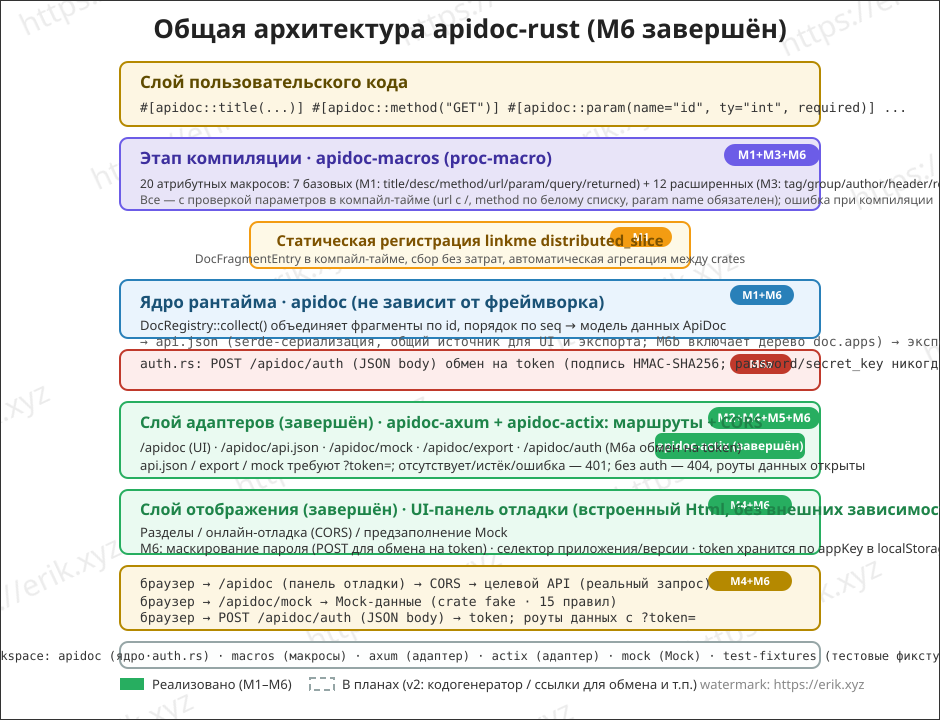
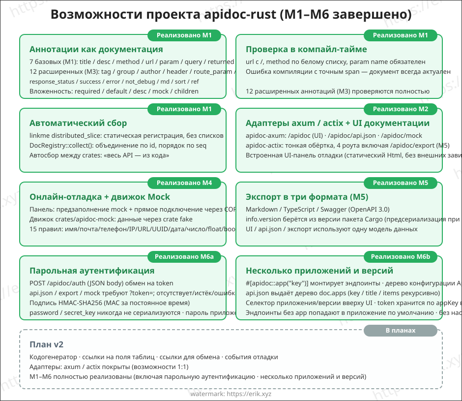
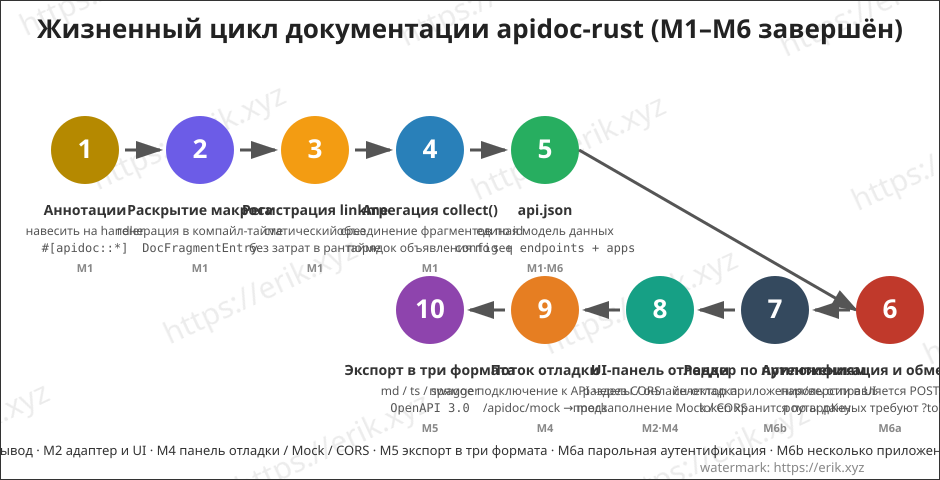

# Apidoc (apidoc-rust)

Инструментарий для генерации документации API и разработки интерфейсов на основе процедурных макросов Rust (proc-macro), совместимый с axum, actix-web и другими популярными фреймворками

[](https://github.com/erikwang2013/apidoc-rust)
[](https://github.com/erikwang2013/apidoc-rust)

[中文](../../README.md) ·
[English](README-en.md) ·
[한국어](README-ko.md) ·
**[Русский](README-ru.md)** ·
[Deutsch](README-de.md) ·
[Français](README-fr.md) ·
[Español](README-es.md) ·
[Português](README-pt.md) ·
[हिन्दी](README-hi.md) ·
[العربية](README-ar.md) ·
[বাংলা](README-bn.md) ·
[Bahasa Indonesia](README-id.md) ·
[日本語](README-ja.md)

## 📖О проекте

Apidoc — это Rust-библиотека-плагин, которая автоматически генерирует документацию API, разбирая **процедурные макросы Rust (proc-macro)**, и совместима с axum, actix-web и другими популярными фреймворками. Помимо автоматической генерации документации, она объединяет онлайн-отладку интерфейсов, Mock-данные для отладки, генерацию кода Json/TypeScript, генератор интерфейсов и генератор кода — охватывая полный цикл разработки, отладки и поставки интерфейсов и стремясь повысить эффективность разработки API. Начиная с 2.2.0 она также предоставляет **бэкенд-контракт UIC-1**, напрямую потребляемый Vue-сборкой apidoc-ui; встроенная native-UI сохранена, и между ними можно переключаться конфигурацией.

Принципы реализации apidoc-rust:

- **Генерация на этапе компиляции**: документация создаётся процедурными макросами во время компиляции — документация никогда не расходится с кодом;
- **Сбор с нулевой стоимостью**: статическая регистрация через linkme — один проход агрегации в рантайме даёт всю документацию API;
- **Универсальные плагины**: ядро не зависит от HTTP-фреймворка; любой фреймворк подключается через тонкие адаптеры (axum / actix-web).

### ✨Описание проекта

- **Готово к использованию**: Без сложной конфигурации — после установки достаточно написать аннотации по документации, и документация API сгенерируется автоматически.
- **Простота написания**: ссылки на поля `ref` / `table` и девять форматов внешних определений (OpenAPI, AsyncAPI, GraphQL, Proto, WSDL, EDMX, JSON Schema, JSON-RPC, XML-RPC) поддерживаются через `#[apidoc::definition]`; несколько аннотаций — и полное описание полей готово.
- **Онлайн-отладка**: Отладка интерфейсов прямо на странице документации, с подстановкой глобальных параметров, Mock-данными и событиями отладки.
- **Отладка мультипротоколов**: 45 аннотаций протоколов (RPC, обмен сообщениями, промышленные, медиа, IoT и др.) с прямым подключением из браузера и серверным релеем; аннотации создают и документацию протокола, и панель отладки.
- **Контракт UIC-1**: `/apidoc/ui/v1/*` предоставляет capabilities / config / menus / detail / docs / debug / share / cache / generator / export, поэтому одна Vue-сборка apidoc-ui обслуживает PHP, Go и Rust. Статическая Vue-UI включается через `ui` / `ui_path` (в релизных пакетах по умолчанию Vue, в библиотеке по умолчанию остаётся встроенная native-UI).
- **Несколько приложений/версий**: Проекты с одним приложением, несколькими приложениями и несколькими версиями — всё конфигурируемо; интерфейсы группируются по приложению/версии и переключаются.
- **Группы/Tag**: Интерфейсы поддерживают многоуровневые группы и метки Tag.
- **Markdown-документация**: Аннотация `md` монтирует Markdown как страницу документации.
- **Генерация Json/TypeScript**: Для каждого интерфейса автоматически создаются примеры Json-запроса/ответа и определения типов TypeScript — сразу для фронтенда.
- **Генератор кода**: Конфигурация + шаблоны — и готовы бизнес-код и файлы Api для фронтенда.
- **Обмен интерфейсами**: Можно генерировать ссылки для обмена выбранными приложениями/интерфейсами и экспортировать `swagger.json`.
- **Безопасный доступ**: глобальный пароль и независимые пароли приложений/версий; серверная отладка выключена по умолчанию и применяет SSRF-guard, а также лимиты размера/кадров/таймаута; файлы определений и промышленные протоколы имеют жёсткие лимиты; документация материализуется при сборке, локальные ответы укладываются в 10 мс p99.

## Возможности

### Реализовано (M1-M3)

- **Аннотации как документация**: семь основных атрибутных макросов — `title` / `desc` / `method` / `url` / `param` / `query` / `returned` — плюс `tag` / `group` / `header` / `table` и 45 аннотаций протоколов; параметры поддерживают вложенность `required` / `default` / `desc` / `mock` / `children` / `field`
- **Проверка на этапе компиляции**: url обязан начинаться с `/`, method — по белому списку, param name обязателен и т.д.; недопустимые аннотации вызывают ошибку компиляции (с точным span)
- **Автоматический сбор**: статическая регистрация linkme `distributed_slice` — ручной список интерфейсов не нужен; `DocRegistry::collect()` объединяет фрагменты по id и восстанавливает порядок объявления по seq, с автоматическим сбором между crates
- **Вывод api.json**: serde сериализует единую модель данных документации (config + endpoints), имена полей общие для модели и экспортёров
- **Адаптер axum + встроенный UI документации**: монтируете маршруты — получаете страницу документации с группировкой по разделам (M2)
- **Дополнение аннотаций**: 12 новых аннотаций `tag` / `group` / `author` / `header` / `route_param` / `response_status` / `success` / `error` / `not_debug` / `md` / `sort` / `ref` (M3)

### Реализовано (M4)

- **Онлайн-отладка**: на странице документации встроена панель «Онлайн-отладка» — Base URL предзаполняется из `location.origin` для кросс-доменного прямого подключения к целевому сервису, форма параметров предзаполняется по mock, подстановка плейсхолдеров `{name}` / `:name` в маршруте, параметры GET/HEAD уходят в query, остальные method собираются в JSON body, редактирование заголовков запроса + свои заголовки, показ ответа (статус / время / pretty JSON), жёлтая подсказка при сбое CORS
- **Движок Mock** (`crates/apidoc/src/mock.rs`, зависит от crate fake, 15 правил: name / company / email / phone / url / ip / city / country / text / number / int / float / bool / uuid / date). Приоритет правил: `mock="fake:xxx"` — через таблицу правил fake (неизвестные имена откатываются к значениям по умолчанию) → остальные непустые mock выводятся как есть (например, `mock="1"`, `mock="erik"`) → без mock автоматически по `ty` (int→`"1"`, float→`"0.5"`, bool→`"true"`, object→`"{}"`, string→`"string"`); children рекурсивно вкладываются, array всегда из 2 элементов
- **Mock-интерфейс**: в адаптере axum добавлен `GET /apidoc/mock?url=&method=` — точное совпадение url + method, иначе 404; панель отладки по умолчанию скрывает эндпоинты `not_debug`, они появляются после установки флажка «Показать интерфейсы not_debug»
- **Прямое подключение через CORS**: онлайн-отладка выполняется браузером напрямую к целевому API, что разрешает `cors_layer` адаптера; серверный релей обеспечивают исполнители P2–P5

### Реализовано (M5)

- **Экспорт в четыре формата** (`crates/apidoc/src/export/`): markdown / typescript / swagger (OpenAPI 3.0.0) / AsyncAPI 2.6 (P6); core crate предоставляет `export::markdown::render` / `export::typescript::render` / `export::swagger::render` / `export::asyncapi::render`
- **Маршруты экспорта**: в адаптеры добавлен `GET /apidoc/export?format=md|ts|swagger|asyncapi` — неизвестный format возвращает 400; Content-Type: `text/markdown` / `application/typescript` / `application/json`
- **markdown**: группировка по разделам + таблицы параметров + блоки ответов; **typescript**: типы `{Name}Params` / `{Name}Result` в пространстве имён по group, неструппированные интерфейсы попадают в `defaultGroup` (`default` — зарезервированное слово TS); **swagger**: `info.version` предпочитает `ApidocConfig.version` и откатывается к версии пакета Cargo (сейчас 2.2.0)
- **Адаптер actix-web** (`crates/apidoc/src/actix.rs`): функционально 1:1 с адаптером axum — `apidoc_routes(ApidocConfig) -> Scope` монтирует /apidoc, /apidoc/api.json, /apidoc/mock, /apidoc/export, `cors_layer(CorsConfig)` разрешает кросс-домен
- **Общий UI**: UI документации (`src/ui.html`) перенесён в core crate и экспортируется как `pub const UI_HTML`; оба адаптера ссылаются на одну копию (безопасно при публикации)

### Реализовано (M6)

- **Парольная аутентификация (M6a)**: при включённом `AuthConfig { enable, password, secret_key, expire }` клиент вызывает `POST /apidoc/auth` (JSON-тело `{"password": "...", "appKey": "..."}`), чтобы получить token; маршруты данных `/apidoc/api.json`, `/apidoc/export`, `/apidoc/mock` требуют `?token=xxx` — отсутствие/просрочка/ошибка token возвращает 401, а UI документации показывает парольную маску. Пароль передаётся в теле запроса (никогда — в URL, логах или истории браузера), сравнивается на сервере за константное время и никогда не хешируется на клиенте. Token — это stateless-подписанный token `base64url(payload).base64url(HMAC-SHA256(payload))` с полезной нагрузкой `{"exp": …}`; ключ подписи выводится из `secret_key` и учётных данных, поэтому смена пароля аннулирует все выданные token. Token использует только URL-безопасные символы, поэтому сразу подходит для ссылок обмена
- **Красные линии безопасности**: `password` / `secret_key` никогда не сериализуются — вывод api.json побайтово совпадает с вариантом без аутентификации; при выключенном auth `/apidoc/auth` возвращает 404, а маршруты данных пропускают напрямую; при собственном password у приложения приоритет у пароля приложения, а не глобального, и пустой пароль (глобальный или приложения) всегда отказывает по принципу fail-closed как при выдаче, так и при проверке; `secret_key` при отсутствии значения — **случайный ключ на процесс** (при перезапуске token перестают действовать — публичного ключа по умолчанию нет), `expire` по умолчанию 86400 секунд; повторные неудачные входы получают экспоненциальную задержку (без штрафа за первые 3 попытки, далее 1s → 2s → … с потолком 60s, сбрасывается при успехе); каждый ответ с учётными данными/token несёт `Cache-Control: no-store`
- **Несколько приложений и версий (M6b)**: `ApidocConfig.apps: Vec<AppConfig>` (`key` / `title` / `items` с рекурсивными подверсиями / `password`) задаёт дерево приложений; `#[apidoc::app("key")]` привязывает интерфейс к key приложения; интерфейсы без key попадают в приложение по умолчанию; в вывод api.json добавлено дерево `doc.apps`, вверху UI появляется селектор приложения/версии, token хранится в localStorage раздельно по appKey (у разных приложений могут быть свои пароли)

### Реализовано (v2)

- **Ссылки на поля таблиц данных (`table`)**: `#[apidoc::table("user")]` **разворачивает** поля в `returned` по key таблицы из `ApidocConfig.tables` (семантика та же, что у `ref`, отличие — источник данных: настроенная таблица, а не другой эндпоинт); поля поддерживают `required` / `default` / `desc` / `mock`; для ненастроенного key — только предупреждение в stderr; без этой аннотации вывод побайтово совпадает с v1
- **Материализация при сборке**: api.json, экспорты, шаблоны codegen и тела `/apidoc/mock` создаются один раз при монтировании маршрутов; запросы лишь обращаются к таблице. `ApidocConfig.cache` сохранён для совместимости, но mock-ответам больше не нужна мемоизация во время запроса
- **Ссылки для обмена**: `GET /apidoc/share?app=&url=&method=&base=` → `{"url":"…"}` — глубокая ссылка (`?app=<key>&ep=<url интерфейса>&method=<метод>[&token=…]`); рядом с каждым интерфейсом на странице документации есть кнопка «Поделиться» (пишет в буфер обмена, при сбое — вместо неё копируемое поле), открытие глубокой ссылки сразу позиционирует на это приложение/интерфейс; при включённой аутентификации ссылка несёт подписанный сервером token (пароль приложения приоритетнее глобального) и открывается без пароля
- **Генератор кода**: `GET /apidoc/generate?template=<name>` → отрендеренный текст (неизвестный шаблон — 404); встроены `api.ts` (файл Api для фронтенда), `handler.rs` (скелет Rust-интерфейса), `schema.sql` (SQL-скрипт создания таблиц по `tables`); одноимённый шаблон в `ApidocConfig.codegen` перекрывает встроенный. В синтаксисе шаблонов всего две конструкции: `{{变量}}` (если не определена — остаётся как есть) и `{{#each 列表}}…{{/each}}` (можно вкладывать, например `tables` × `fields`)
- **События отладки**: на панели онлайн-отладки появились сворачиваемые «Предзапросный скрипт / Постскрипт» (хранятся в localStorage) — предзапросный выполняется через `new Function('ctx', code)` до запроса и может менять `ctx.url/method/headers/body` или вернуть объект для неглубокого слияния; постскрипт выполняется после ответа, может читать `status/ms/text/url/method/ep`, а вернув строку — заменить отображаемый текст ответа; ошибка скрипта показывается только в области результата и не прерывает запрос

### Реализовано (v2.2 · UIC-1)

- **Бэкенд-контракт UIC-1 (Contract 1.0)**: `/apidoc/ui/v1/*` предоставляет capabilities / config / menus / detail / docMenus / docDetail / verifyAuth / сессии отладки / записи обмена / кэш / шаблоны кода / полный экспорт. `capabilities` сообщает только то, что реально скомпилировано в этой сборке, чтобы UI мог скрыть недоступные пункты. Rust объявляет `share.actions=false`, `cache.mode=build`, генератор `forms=false` / `templates=true` и только унарный релей (`relay-unary`).
- **Девять форматов внешних определений**: `#[apidoc::definition(file = "...", operation = "...")]` разбирает OpenAPI, AsyncAPI, GraphQL, Proto, WSDL, EDMX, JSON Schema, JSON-RPC и XML-RPC в единый payload `{format, source, operation, meta, messages, validation}`; `/apidoc/ui/v1/detail` возвращает `definitions` с диагностикой по каждому элементу (`path` / `line` / `column` / `severity` / `message`). Определения никогда не попадают в api.json, поэтому native-UI и прежний вывод не меняются.
- **Статическая Vue-UI**: `ui: UiMode::Vue` + `ui_path` отдаёт сборку apidoc-ui `dist/uic1-ui/`; `ApidocConfig::release(title, ui_path)` — точка входа релизных пакетов (по умолчанию библиотека сохраняет встроенную native-UI). Включает SPA-fallback, `config.js` / `assets/*`, защиту от выхода за пределы пути и симлинков, а также fail-closed запуск при отсутствии `ui_path` или `index.html`.
- **Полный отчёт о возможностях релея**: `capabilities.debug.relay` перечисляет только скомпилированные в этой сборке исполнители; `debug-all` агрегирует все 30 id протоколов, поэтому UI никогда не предлагает исполнитель, падающий с «not compiled».
- **Исправления промышленных протоколов и лимиты ресурсов**: DNP3 разбирает заголовки объектов после IIN и ограничивает каждый ответ 10 000 точками; IEC 60870-5-104 ограничивает каждый ответ 10 000 строками; BACnet/IP отправляет корректный запрос ReadProperty; исправлено переполнение u16 счётчика точек DNP3.

## Документация и отладка мультипротоколов (P1–P6)


- **45 аннотаций протоколов** плюс универсальная форма `#[apidoc::protocol("kind", ...)]`; `event` объявляет сообщения потока, а `param(..., field = "1")` — номера полей протокола.
- **Отладка прямо из браузера** (без зависимостей Rust): SOAP, GraphQL (вкл. subscriptions), JSON-RPC, XML-RPC, OData, MCP, A2A, Webhooks, WebSocket (текст/бинарные кадры), SSE, Socket.IO, STOMP (вкл. бинарный), WebRTC/DataChannel, HLS.
- **Серверные исполнители** (feature-gated): HTTP/2, HTTP/3, gRPC, Thrift, Dubbo/Hessian2, ISO 8583, TCP/UDP/Raw/Unix, MQTT, AMQP, Kafka, XMPP, STOMP/TCP, CoAP, LwM2M, Modbus, DNP3, IEC 104, BACnet/IP, OPC UA, RTP/RTCP/RTSP/SIP/RTMP. `debug-all` включает их все.
- **P6**: захват webhooks, экспорт AsyncAPI 2.6, импорт `.proto`/`.thrift` через CLI `apidoc-idl`, реестр Dubbo Nacos, mock-примеры из событий.
- **Возможности релея UIC-1**: `GET /apidoc/ui/v1/capabilities` в `features.debug.relay` перечисляет только скомпилированные в этой сборке исполнители. Rust поддерживает только унарный режим (`modes` содержит `relay-unary`, но не `relay-stream`); сборка `debug-all` сообщает все 30 id протоколов:

| feature | id протоколов релея |
|---|---|
| `debug-http` | `http` `http2` |
| `debug-session` | `websocket` |
| `debug-grpc` | `grpc` |
| `debug-thrift` | `thrift` |
| `debug-dubbo` | `dubbo` `hessian` |
| `debug-iso8583` | `iso8583` |
| `debug-mqtt` | `mqtt` |
| `debug-amqp` | `amqp` |
| `debug-kafka` | `kafka` |
| `debug-xmpp` | `xmpp` |
| `debug-sockets` | `stomp` `tcp` `udp` `raw` `unix` |
| `debug-coap` | `coap` `lwm2m` |
| `debug-industrial` | `modbus` `dnp3` `iec104` `bacnet` `opcua` |
| `debug-media` | `rtp` `rtcp` `rtsp` `sip` `rtmp` |
| `debug-http3` | `http3` |

Кроме `websocket`, потоковые исполнители ещё не подключены к сессиям релея; Kafka / AMQP / XMPP и подобные протоколы собирают унарный ответ. `debug-all` только агрегирует перечисленные features.
- **Безопасность**: серверная отладка выключена по умолчанию и требует глобальной аутентификации; SSRF-guard разрешает и проверяет каждый IP и закрепляет соединение; редиректы/прокси и облачные метаданные запрещены; размер/кадры/таймаут ограничены; ответы DNP3 ограничены 10 000 точками, а IEC 104 — 10 000 строками (свыше — жёсткая ошибка), чтобы малые кадры не раздували разобранный вывод; протоколы без закреплённого TLS работают fail-closed.
- **Производительность**: документация, экспорты, codegen и mock-тела материализуются при сборке; локальные маршруты apidoc держатся ниже 10 мс p99 (`tests/latency.rs`).

## Архитектура



## Возможности



## Жизненный цикл



## Структура проекта

```
apidoc-rust/
├── Cargo.toml                 # конфигурация workspace (resolver 2)
├── VERSION                    # версия проекта (v2.2.0)
├── crates/
│   ├── apidoc/                # runtime-ядро (не зависит от фреймворка)
│   │   ├── src/lib.rs         # модель данных + агрегация DocRegistry + api.json + UI_HTML + UiMode
│   │   ├── src/auth.rs        # парольная аутентификация M6a (выдача/проверка HMAC-токена + guard + backoff)
│   │   ├── src/uiapi.rs       # контракт UIC-1: capabilities / menus / detail / docs / маршруты управления
│   │   ├── src/protocol_defs/ # девять форматов внешних определений (OpenAPI/AsyncAPI/GraphQL/proto/…)
│   │   ├── src/export/        # экспорт: markdown / typescript / swagger / asyncapi + codegen
│   │   ├── src/debug/         # серверные исполнители под feature-флагами (http / grpc / sockets / mqtt / industrial / media / …)
│   │   ├── src/axum.rs        # адаптер axum (docs/debug/stream/webhook/UIC-1/статика UI + CORS)
│   │   ├── src/actix.rs       # адаптер actix-web (feature `actix`, 1:1 с axum)
│   │   ├── src/ui.html        # встроенная native-UI; статическая Vue-сборка отдаётся через ui/ui_path
│   │   ├── tests/             # интеграционные тесты (макросы/агрегация/сериализация/UIC-1/определения/задержки)
│   │   └── examples/demo.rs   # пример: аннотации + вывод api.json
│   ├── apidoc-macros/         # proc-macro: 24 базовые аннотации + 45 псевдонимов протоколов
│   │   └── src/lib.rs         # определения макросов + разбор аргументов + проверка на этапе компиляции
│   ├── apidoc-idl/            # отдельный CLI `.proto` / `.thrift` → аннотация apidoc
│   └── apidoc-test-fixtures/  # тестовые фикстуры регистрации между crates
├── contract/                  # UIC-1 Contract 1.0: схема + фикстуры между бэкендами
├── .github/
│   └── workflows/release.yml  # release-workflow (читает VERSION, инкрементально создаёт tag+release)
└── docs/
    ├── images/                # ресурсы архитектуры/возможностей/жизненного цикла/мультипротоколов/соцпревью
    └── i18n/                  # документация на разных языках (12 языков)
```

## Использование

### 1. Добавление зависимостей

```toml
[dependencies]
apidoc-rust = "2.2"        # или path = "crates/apidoc"

serde_json = "1"      # для вывода api.json
linkme = "0.3"        # обязательно: генерируемый макросом код регистрации ссылается на него
```

> Адаптер выбирается по веб-фреймворку: для axum — `features = ["axum"]`, для actix-web — `features = ["actix"]` (оба функционально 1:1). `mock` (движок Mock) — внутренняя зависимость фреймворка, подключается адаптером автоматически; обычно потребителю не нужно использовать её напрямую.

### 2. Написание аннотаций

Аннотации навешиваются на функции-handler по одной — документация генерируется на этапе компиляции:

```rust
use apidoc::*;

#[apidoc::title("获取用户信息")]
#[apidoc::desc("根据用户 ID 查询用户详情")]
#[apidoc::url("/api/user/info")]
#[apidoc::method("GET")]
#[apidoc::param(name = "user_id", ty = "int", required, desc = "用户ID", mock = "1")]
#[apidoc::query(name = "lang", ty = "string", desc = "语言", default = "zh-CN")]
#[apidoc::returned(
    name = "data",
    ty = "object",
    desc = "用户数据",
    children = [
        { name = "id", ty = "int", required, desc = "用户ID" },
        { name = "name", ty = "string", required, desc = "用户名", mock = "erik" },
    ]
)]
fn get_user_info() -> String {
    unimplemented!()
}
```

### 3. Сбор и вывод

```rust
fn main() {
    let doc = DocRegistry::collect_doc(ApidocConfig {
        title: "Мой API".to_string(),
        description: None,
        auth: None,    // M6a парольная аутентификация, см. «8. Парольная аутентификация»
        apps: vec![],  // M6b несколько приложений и версий, см. «9. Несколько приложений и версий»
    });
    println!("{}", serde_json::to_string_pretty(&doc).unwrap());
}
```

### 4. Запуск примера

```bash
cargo run --example demo -p apidoc
```

Вывод (фрагмент):

```json
{
  "config": { "title": "demo api" },
  "endpoints": [
    {
      "title": "获取用户信息",
      "desc": "根据用户 ID 查询用户详情",
      "url": "/api/user/info",
      "method": "GET",
      "params": [
        { "name": "user_id", "type": "int", "required": true, "desc": "用户ID", "mock": "1" }
      ],
      "querys": [
        { "name": "lang", "type": "string", "required": false, "default": "zh-CN", "desc": "语言" }
      ],
      "returned": [
        {
          "name": "data",
          "type": "object",
          "required": false,
          "desc": "用户数据",
          "children": [
            { "name": "id", "type": "int", "required": true, "desc": "用户ID" },
            { "name": "name", "type": "string", "required": true, "desc": "用户名", "mock": "erik" }
          ]
        }
      ]
    }
  ]
}
```

### 5. Онлайн-отладка и Mock (M4)

Откройте страницу документации → выберите интерфейс → панель «Онлайн-отладка» справа предзаполнит параметры по правилам mock → укажите Base URL целевого сервиса (по умолчанию `location.origin`, прямое кросс-доменное подключение) → нажмите «Отправить» и получите реальный ответ (код статуса / время / pretty JSON). Панель отладки по умолчанию скрывает эндпоинты `not_debug` — они появляются только после установки флажка «Показать интерфейсы not_debug».

**Требование CORS**: онлайн-отладка выполняется браузером напрямую к целевому API, поэтому целевой сервис должен подключить `cors_layer` из адаптера, чтобы разрешить кросс-доменные запросы; при сбое CORS панель показывает жёлтую подсказку.

Синтаксис правил mock (три уровня приоритета):

```rust
#[apidoc::param(name = "email", ty = "string", desc = "邮箱", mock = "fake:email")]  // генерация по правилу fake
#[apidoc::param(name = "status", ty = "string", desc = "状态", mock = "1")]          // непустой mock выводится как есть
#[apidoc::param(name = "name", ty = "string", desc = "用户名")]                       // без mock: автогенерация по ty
#[apidoc::returned(
    name = "data",
    ty = "object",
    children = [
        { name = "id", ty = "int", required },       // без mock → "1"
        { name = "email", ty = "string", mock = "fake:email" },  // children рекурсивно вложены
    ]
)]
fn create_user() -> String {
    unimplemented!()
}
```

15 встроенных правил fake: `name` / `company` / `email` / `phone` / `url` / `ip` / `city` / `country` / `text` / `number` / `int` / `float` / `bool` / `uuid` / `date`; неизвестные имена правил откатываются к значениям по умолчанию. Автогенерация без mock: int→`"1"`, float→`"0.5"`, bool→`"true"`, object→`"{}"`, string→`"string"`; массив всегда из 2 элементов.

### 6. Онлайн-экспорт (M5)

В адаптер встроены четыре формата экспорта — после подключения работает сразу (неизвестный `format` возвращает 400):

```bash
GET /apidoc/export?format=md        # группировка по разделам + таблицы параметров + блоки ответов (text/markdown)
GET /apidoc/export?format=ts        # типы {Name}Params / {Name}Result в пространстве имён по group (application/typescript)
GET /apidoc/export?format=swagger   # файл описания OpenAPI 3.0.0 (application/json)
GET /apidoc/export?format=asyncapi  # AsyncAPI 2.6 event/streaming spec (application/json)
```

- **markdown**: удобно вставлять в Wiki проекта / заметки к релизу; по группам выводится оглавление, у каждого интерфейса таблица параметров и блок ответа;
- **typescript**: фронтенд может вставить это как определения типов; неструппированные интерфейсы попадают в пространство имён `defaultGroup` (`default` — зарезервированное слово TS, не может быть идентификатором);
- **swagger**: `info.version` берётся из `ApidocConfig.version` (версия документируемого API); если она не задана — из версии пакета apidoc-rust (сейчас 2.2.0); параметры пути берутся из шаблона URL, поэтому спецификацию можно сразу импортировать в Swagger UI или генераторы кода.
- **asyncapi**: каналы/операции/сообщения для WebSocket, SSE, MQTT, Kafka, STOMP и других событийных endpoint'ов (AsyncAPI 2.6).

### 7. Адаптер actix-web

При использовании actix-web подключайте `features = ["actix"]` (функционально 1:1 с адаптером axum):

```toml
[dependencies]
apidoc-rust = { version = "2.2", features = ["actix"] }
```

```rust
use actix_web::{App, HttpServer};
use apidoc::actix::{apidoc_routes, cors_layer, CorsConfig};
use apidoc::ApidocConfig;

#[actix_web::main]
async fn main() -> std::io::Result<()> {
    HttpServer::new(|| {
        App::new()
            .service(apidoc_routes(ApidocConfig {
                title: "Мой API".to_string(),
                description: None,
                auth: None,    // M6a парольная аутентификация, см. «8. Парольная аутентификация»
                apps: vec![],  // M6b несколько приложений и версий, см. «9. Несколько приложений и версий»
            }))
            .wrap(cors_layer(CorsConfig::default()))   // разрешение кросс-домена для онлайн-отладки (M4)
    })
    .bind("127.0.0.1:8080")?
    .run()
    .await
}
```

После подключения доступны `/apidoc` (UI документации), `/apidoc/api.json` (данные), `/apidoc/mock` (Mock), `/apidoc/export` (экспорт). Пустая конфигурация CORS — или `["*"]` — пропускает литеральный `*` (без учётных данных); при настройке белого списка `allow_origins` Origin отражается с точным совпадением — в обоих режимах учётные данные не включаются.

### 8. Парольная аутентификация (M6a)

При включённом `auth` документация доступна только по паролю (token с подписью HMAC-SHA256, сравнение на сервере за константное время, задержка при неудачных входах):

> **Критическое изменение в 2.0**: маршрут входа переехал с `GET /apidoc/auth?password=…` на `POST /apidoc/auth` (JSON-тело), а token вместо прежнего конверта стали token с подписью HMAC-SHA256 — **старые token и старые способы вызова больше не работают**, клиенты должны использовать POST. Развёртывания без явного `secret_key` также теряют выданные token при перезапуске (используется случайный ключ на процесс; публичного значения по умолчанию нет).

```rust
use apidoc::auth::AuthConfig;

let doc = DocRegistry::collect_doc(ApidocConfig {
    title: "Мой API".to_string(),
    description: None,
    auth: Some(AuthConfig {
        enable: true,
        password: "your-password".to_string(),
        secret_key: "your-secret-key".to_string(), // если не задан — случайный ключ на процесс: перезапуск аннулирует token; задайте явно для мультиинстансных развёртываний
        expire: 86400,                             // секунды; по умолчанию 86400
    }),
    apps: vec![],
});
```

**Порядок действий**:

1. Клиент вызывает `POST /apidoc/auth` (JSON-тело `{"password": "...", "appKey": "<key>"}`; `appKey` выбирает приложение с собственным паролем), чтобы получить token (при успехе возвращается `{"token":"..."}`, при неверном пароле — 401, при некорректном теле — 400); пароль передаётся в теле — никогда в URL или логах — и никогда не хешируется на клиенте. При выключенном auth этот маршрут возвращает 404, а маршруты данных пропускают напрямую
2. Маршруты данных `GET /apidoc/api.json`, `/apidoc/export`, `/apidoc/mock` требуют `?token=xxx` (а при выборе конкретного приложения — ещё и `&appKey=`); отсутствие/просрочка/ошибка token возвращает 401, UI документации автоматически показывает парольную маску, а после ввода пароля фронтенд отправляет его напрямую через POST в обмен на token
3. Token — это `base64url(payload).base64url(HMAC-SHA256(payload))` с полезной нагрузкой `{"exp": <unix-секунды>}`; ключ подписи — HMAC-SHA256(`secret_key`, учётные данные), поэтому смена пароля немедленно аннулирует старые token. Проверка сравнивает MAC за константное время и затем проверяет срок действия; token использует только URL-безопасные символы
4. `password` / `secret_key` никогда не сериализуются — вывод api.json побайтово совпадает с вариантом без аутентификации; при собственном `password` у приложения приоритет у пароля приложения, а не глобального, и пустой пароль (глобальный или приложения) всегда отказывает по принципу fail-closed
5. Повторные неудачные входы получают экспоненциальную задержку (без штрафа за первые 3 попытки, далее 1s → 2s → … с потолком 60s, сбрасывается при успехе); ответы с учётными данными/token несут `Cache-Control: no-store`

### 9. Несколько приложений и версий (M6b)

Один проект можно разбить на несколько приложений/версий, у каждого — свой показ и контроль доступа:

```rust
#[apidoc::title("获取用户信息")]
#[apidoc::app("demo")]   // привязка к приложению key="demo"; интерфейсы без app попадают в приложение по умолчанию
fn get_user_info() -> String {
    unimplemented!()
}
```

```rust
let doc = DocRegistry::collect_doc(ApidocConfig {
    title: "Мой API".to_string(),
    description: None,
    auth: None,
    apps: vec![
        AppConfig {
            key: "demo".to_string(),
            title: "演示应用".to_string(),
            items: vec![AppConfig {
                key: "v1".to_string(),
                title: "v1".to_string(),
                items: vec![],
                password: None,
            }],
            password: None, // свой пароль доступа приложения, приоритет над глобальным, никогда не сериализуется
        },
    ],
});
```

- `AppConfig { key, title, items, password }`: `key` — уникальный идентификатор, на который ссылается аннотация `#[apidoc::app("key")]`; `items` рекурсивно вкладывает подверсии/подприложения; `password` — свой пароль доступа приложения (при своём пароле проверяется только token приложения)
- В вывод api.json добавлено дерево `doc.apps` (key / title / items / endpoints); вверху UI появляется селектор приложения/версии — при переключении интерфейсы рендерятся по выбранному узлу и данные перезагружаются; token хранится в localStorage раздельно по appKey
- Если аннотация `app` ссылается на key, отсутствующий в `apps`, — предупреждение в stderr и попадание в приложение по умолчанию; без аннотации `app` или без настройки `apps` вывод побайтово совпадает с M5

### 10. Ссылки на поля таблиц данных · кэширование документации (v2)

```rust
ApidocConfig {
    // структура таблиц задаётся конфигурацией (Rust-сторона не подключается к БД), аннотация ссылается по key
    tables: vec![TableDef {
        key: "user".into(),
        title: "用户表".into(),
        fields: vec![
            TableField { name: "id".into(), ty: "int".into(), required: true, desc: Some("用户ID".into()), ..Default::default() },
            TableField { name: "name".into(), ty: "string".into(), mock: Some("erik".into()), ..Default::default() },
        ],
    }],
    // кэш документации: вывод /apidoc/mock мемоизируется по (url, method) и пересобирается через ttl секунд (0 = навсегда)
    cache: Some(CacheConfig { enable: true, ttl: 60 }),
    ..Default::default()   // title / description / auth / apps / codegen настраиваются как обычно
}
```

На handler аннотация пишется так же, как у `ref`: `#[apidoc::table("user")]`. Поля разворачиваются в `returned` этого интерфейса; key, отсутствующий в `tables`, даёт только предупреждение, а не ошибку.

### 11. Ссылки для обмена · генерация кода (v2)

- `GET /apidoc/share?app=api&url=/api/user/info&method=GET&base=https://example.com` → `{"url":"https://example.com/apidoc?app=api&ep=%2Fapi%2Fuser%2Finfo&method=GET"}` (при включённой аутентификации в конец ссылки добавляется `&token=…`, открытие — без пароля)
- `GET /apidoc/generate?template=api.ts` (или `handler.rs` / `schema.sql`) → `text/plain; charset=utf-8`; неизвестный шаблон — 404, отсутствующий параметр — 400
- Свои шаблоны (одноимённые перекрывают встроенные):

```rust
ApidocConfig {
    codegen: vec![CodegenTemplate {
        name: "api.ts".into(),
        template: "// {{title}}\n{{#each endpoints}}// {{method}} {{url}}\n{{/each}}".into(),
    }],
    ..Default::default()
}
```

Доступные в шаблонах переменные: верхний уровень — `title` / `description`; внутри `{{#each endpoints}}` — `title` / `url` / `method` / `group` / `desc` / `author`; внутри `{{#each tables}}` — `key` / `title`, а внутри его `{{#each fields}}` — `name` / `ty` / `required` / `default` / `desc` / `mock`; есть также производные переменные `not_null` / `default_clause` / `comma` / `key_q` / `name_q` (для непосредственной генерации корректного SQL), а также `url_js` / `method_js` внутри `{{#each endpoints}}` (литералы строк JSON) и `fn_name` (приведённый к допустимому идентификатору `{method}_{group}` для Rust-скелета).

### 12. Предзапросный и постскрипт отладки (v2)

На странице документации в панели «Онлайн-отладка» разворачиваются «Предзапросный скрипт» и «Постскрипт» (содержимое хранится в localStorage):

```js
// предзапросный: выполняется до отправки запроса, может менять ctx.url / method / headers / body или вернуть объект для неглубокого слияния
ctx.headers['X-Token'] = localStorage.getItem('token') || '';
```

```js
// постскрипт: выполняется после ответа, ctx = { status, ms, text, url, method, ep } (только чтение)
// при возврате строки заменяет текст, отображаемый в области результата
return 'HTTP ' + ctx.status + ' · ' + ctx.ms + 'ms\n' + ctx.text;
```

Ошибка скрипта показывается только в области результата отладки и не прерывает запрос (при сбое предзапросного скрипта запрос отправляется как обычно, при сбое постскрипта исходный ответ отображается как обычно).

### 13. UI: native / статическая сборка Vue (UIC-1 Phase 5)

По умолчанию `/apidoc` отдаёт встроенную native-UI (`UiMode::Native`), поэтому существующим развёртываниям менять ничего не нужно. Vue-сборка потребляет контракт UIC-1 из раздела 14 и используется совместно с PHP и Go (apidoc-ui `npm run package:ui`):

```rust
use apidoc::{ApidocConfig, UiMode};

let cfg = ApidocConfig {
    title: "Мой API".into(),
    ui: UiMode::Vue,
    ui_path: Some("/srv/apidoc".into()), // содержимое dist/uic1-ui/: index.html + config.js + assets/
    ..Default::default()
};
```

- Релизные пакеты по умолчанию используют Vue: `ApidocConfig::release("Мой API", "/srv/apidoc")` эквивалентно явной конфигурации выше; **по умолчанию в библиотеке остаётся `native`**.
- В режиме Vue `GET /apidoc` возвращает 307 на `/apidoc/` (сборка использует относительные URL `./assets/...`), `/apidoc/`, `config.js` и `assets/*` читаются из `ui_path`, а неизвестные пути без расширения отдают `index.html` (SPA-fallback).
- Маршруты API сохраняют приоритет: `/apidoc/api.json`, `/apidoc/export`, `/apidoc/ui/v1/*`, auth, debug и webhook по-прежнему срабатывают раньше статических файлов; неизвестные подпути API возвращают 404, а не SPA-оболочку.
- Безопасность: пути ограничены `ui_path`; `..`, обходы кодирования и выходы через симлинки возвращают 404, каталоги никогда не листаются, а отсутствие `ui_path` / `index.html` приводит к ошибке при запуске (fail closed). `ui` / `ui_path` только серверные и никогда не сериализуются в api.json.
- Откат: верните `ui: UiMode::Native` и перезапустите; native-UI и все старые маршруты не меняются.

### 14. Контракт UIC-1 · внешние определения протоколов

`/apidoc/ui/v1/*` — стабильный контракт, потребляемый apidoc-ui (Contract 1.0); успешные ответы имеют вид `{code:0,message:"ok",data}`:

| Маршрут | Назначение |
|---|---|
| `GET /apidoc/ui/v1/capabilities` | Возможности бэкенда: contract / backend / version / features (включая список скомпилированных протоколов релея) |
| `GET /apidoc/ui/v1/config` | Конфигурация запуска UI (заголовок, дерево приложений, переключатели auth, …) |
| `POST /apidoc/ui/v1/menus` · `detail` | Каталог и детали интерфейсов, включая `definitions` и `validation` |
| `GET/POST /apidoc/ui/v1/docMenus` · `POST docDetail` | Каталог и текст Markdown-документации |
| `POST /apidoc/ui/v1/verifyAuth` | Проверка глобального / прикладного / share-токена |
| `POST /apidoc/ui/v1/debugSend` · `debugStart` · `debugPoll` · `debugStop` | Отладка напрямую из браузера и через серверный релей |
| `POST /apidoc/ui/v1/addApiShare` · `getApiShareList` · `getApiShareDetail` · `deleteApiShare` · `handleApiShareAction` | CRUD записей обмена (Rust `share.actions=false`; декларативных действий нет) |
| `POST /apidoc/ui/v1/cache/clear` · `cache/warm` | Управление кэшем (Rust `cache.mode=build`) |
| `POST /apidoc/ui/v1/renderCodeTemplate` · `exportAllData` | Рендеринг шаблонов кода и полный экспорт данных (UI формирует md / pdf / openapi / postman / asyncapi / typescript) |

Внешнее определение прикрепляется к обработчику через `#[apidoc::definition]`:

```rust
#[apidoc::title("Получить пользователя")]
#[apidoc::url("/api/user/info")]
#[apidoc::method("GET")]
#[apidoc::definition(file = "api/openapi.yaml", operation = "getUser")]
fn get_user_info() -> String { unimplemented!() }
```

- **Девять форматов**: OpenAPI, AsyncAPI, GraphQL, Proto, WSDL, EDMX, JSON Schema, JSON-RPC и XML-RPC. Если `format` не указан, он определяется по расширению/содержимому или задаётся явно.
- **Необязательные аргументы**: `operation` (выбор операции), `message` / `direction` (выбор сообщения), `sample` / `sample_file` / `sample_encoding` (пример для валидации) и `strict` (по умолчанию `true`: неподдерживаемые конструкции считаются ошибкой).
- **Вывод**: единый payload `{format, source, operation, meta, messages, validation}`; диагностика содержит `path / line / column / severity / message`. Определения попадают только в detail UIC-1 и никогда в api.json.
- **Ограничения**: пути относительны `CARGO_MANIFEST_DIR` объявляющего crate, а realpath симлинка должен оставаться внутри корня crate; файл ограничен 2 MiB / 50 000 строк, максимум 64 импорта и глубина импорта 32.

## План разработки

| Этап | Содержание | Статус |
|------|------------|--------|
| M1 | Скелет workspace + модель данных + MVP макросов + регистрация linkme | ✅ Завершено |
| M2 | Адаптер axum + встроенный UI документации + группировка по разделам | ✅ Завершено |
| M3 | Дополнение аннотаций (tag/group/author/header/route_param/response_status/success/error/not_debug/md/sort/ref) | ✅ Завершено |
| M4 | Онлайн-отладка + движок Mock | ✅ Завершено |
| M5 | Экспорт в markdown / typescript / swagger.json (OpenAPI3) | ✅ Завершено |
| —  | Адаптер actix-web (функционально 1:1 с axum) | ✅ Завершено |
| M6a | Парольная аутентификация (token с подписью HMAC-SHA256 + парольная маска, приоритет пароля приложения) | ✅ Завершено |
| M6b | Несколько приложений и версий (дерево настройки apps + аннотация app + селектор в UI) | ✅ Завершено |
| v2 | Ссылки на поля таблиц данных + кэширование документации + ссылки для обмена + генератор кода + события отладки | ✅ Завершено |
| UIC-1 Phase 0–2 | Contract 1.0: capabilities / menus / detail / docs / debug / share / cache / generator / export, семантически согласованы между бэкендами | ✅ Завершено |
| UIC-1 Phase 3–4 | полный отчёт о возможностях релея + девять парсеров внешних определений, подключённых к detail UIC | ✅ Завершено |
| UIC-1 Phase 5 | статическая Vue-UI (`ui` / `ui_path`; релизные пакеты по умолчанию на Vue, native-UI сохранена) | ✅ Завершено |

## Многоязычная документация

- [English](README-en.md)
- [한국어](README-ko.md)
- [Русский](README-ru.md)
- [Deutsch](README-de.md)
- [Français](README-fr.md)
- [Español](README-es.md)
- [Português](README-pt.md)
- [हिन्दी](README-hi.md)
- [العربية](README-ar.md)
- [বাংলা](README-bn.md)
- [Bahasa Indonesia](README-id.md)
- [日本語](README-ja.md)

## Поддержка и пожертвования

Если этот проект оказался вам полезен, поставьте нам ⭐ Star — и вы также можете поддержать открытый исходный код пожертвованием!

### 微信 / 支付宝 (WeChat Pay / Alipay)

| 微信支付 | 支付宝 |
|---|---|
|  |  |

### Пожертвования международным переводом

**【Информация о получателе】**

- Имя получателя: WANG KEXUN
- Номер счёта получателя: 881015918251

**【Банк получателя】**

- ZA Bank SWIFT Code: AABLHKHHXXX
- Название банка: ZA Bank Limited
- Банковский код: 387
- Адрес банка: Core F, Cyberport 3, 100 Cyberport Road, Hong Kong

**【Банк-посредник для международных переводов (при необходимости)】**

> Обратите внимание: это информация о банке-посреднике (транзитном банке) для международных переводов, а не о банке получателя. Уточните в банке, из которого делаете перевод, требуется ли предоставлять данные банка-посредника.

- **Банк-посредник для переводов в гонконгских долларах, юанях и долларах США — Citibank:**
  - Название банка: Citibank N.A. Hong Kong
  - SWIFT Code: CITIHKHXXXX
  - Банковский код: 006
  - Отделение: Hong Kong Branch
  - Код отделения: 391
  - Адрес банка: Citibank Tower, Citibank Plaza, 3 Garden Road, Central, Hong Kong
- **Банк-посредник для переводов в других валютах — BNY Mellon:**
  - Название банка: THE BANK OF NEW YORK MELLON
  - SWIFT Code: IRVTUS3NXXX
  - Адрес банка: THE BANK OF NEW YORK MELLON, 240 GREENWICH STREET, NEW YORK, United States

## License

[MIT](../../LICENSE)
